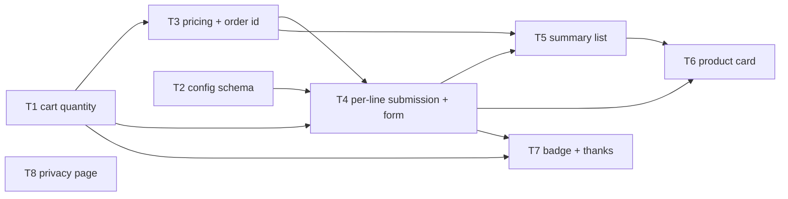
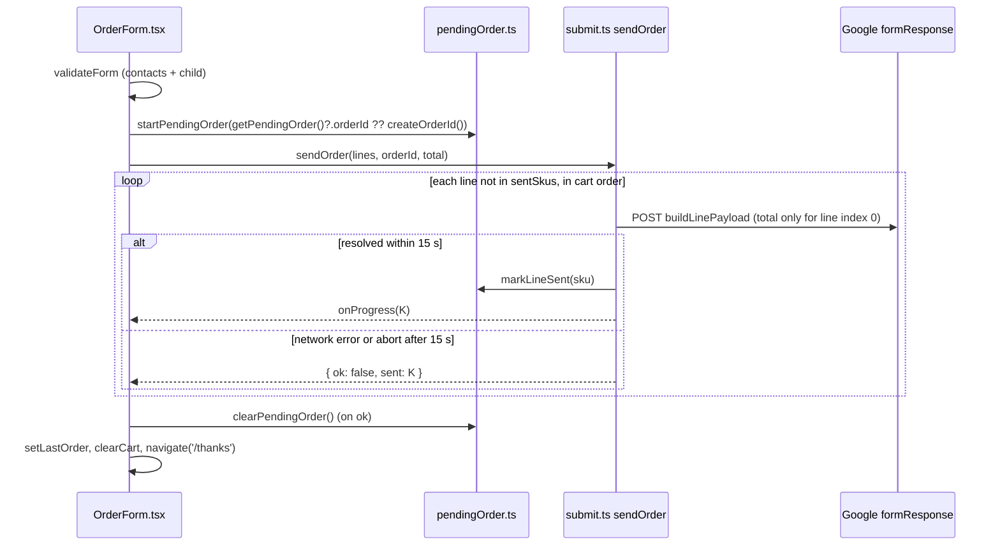

# Implementation Plan — Item quantity, approximate total and one form row per order line
Date: 2026-10-19 · Branch: feature/cash-payment-coordinator · Status: draft · Execution mode: single-agent
Sources: `specs/SPEC-2026-10-19-item-quantity.md` (Spec ID SPEC-2026-10-19-item-quantity, status approved) and the user's answers to the Requirements Review (Q-mode, Q-1, Q-2, Q-3). Both are read-only. This plan does not change them.

## 1. Goal & scope
Customers can order 1–20 units per size from the product card and the summary page. They see per-line prices and an approximate total. Every order line is sent as its own Google Form submission, carrying a shared order id, the contacts and the child's name. Only the first line carries the approximate total ("Сума"). A failed send resumes from the first unsent line, and that state survives a page reload. The thanks page, the header badge and the copy text show units, the order id and the total. The `SITE_CONFIG` schema requires the new form fields. The privacy page lists the child's name.

Out of scope:
- `docs/SPEC.md`, `docs/DESIGN-BRIEF.md` and everything under `specs/`. The main session updates the docs before implementation (user answer Q-3).
- Playwright or any other browser e2e tool (user answer Q-1).
- Locking the cart while an order is in the Sending state (user answer Q-2, REC-3 rejected).
- The Google Form changes and updating the `SITE_CONFIG` GitHub Variable or the local `.env`. These are coordinator/user steps from the spec's checklist.
- All of the spec's Non-goals.

## 2. Requirements
- R1 — Cart lines have an integer `quantity` 1–20. "+" / "−" change it by exactly 1 within the bounds. Each size has its own quantity. Quantity survives a reload. Stored lines without a quantity load as 1. Invalid stored values normalise to 1 (missing, NaN, < 1, non-integer) or 20 (> 20). · Source: SPEC AC-3, AC-4, AC-5, AC-6, AC-8, AC-27, AC-28, AC-29
- R2 — Product card:
  - adding a size gives quantity 1;
  - while the size is in the cart, the card shows the counter "− N +" and "Прибрати" instead of "Додати до замовлення";
  - "Прибрати" removes the line whatever its quantity;
  - the price shown is the selected size's price, or no price line when that size is unpriced; with no size selected it is the first priced variant's price;
  - the chip reads "✓ {size}" or "✓ {size} ×N";
  - quantities up to 20 are allowed for "немає" / "під замовлення" sizes.
  · Source: SPEC AC-1, AC-2, AC-7, AC-9, AC-10, AC-11, AC-12
- R3 — Accessibility:
  - counter buttons are named "Зменшити кількість: {name}, {size}" / "Збільшити кількість: {name}, {size}";
  - a quantity change announces "Кількість: N" in the live region;
  - the chip's accessible name includes "у замовленні: N";
  - the counter works by keyboard and exposes its disabled state.
  · Source: SPEC AC-13, AC-14, AC-15, NFR-5
- R4 — Summary page:
  - each line has the same counter as the card;
  - a priced line shows "{price} × N = {line total}", an unpriced line shows "Ціна невідома";
  - "Разом орієнтовно: X ₴" appears when at least one line is priced;
  - "N позицій без ціни, остаточну суму повідомить координатор" appears when lines are mixed (correct plural);
  - "Ціни невідомі, суму повідомить координатор" appears when no line is priced;
  - prices come from the currently loaded catalog, and a SKU missing from it counts as unpriced;
  - the heading reads "Позицій: N · штук: M";
  - "Прибрати" removes the line;
  - totals update in the same render as the quantity change.
  · Source: SPEC AC-16…AC-21, AC-23, AC-24, AC-26, NFR-2
- R5 — While the approximate total is shown, the payment block on the summary page also shows "Разом орієнтовно: X ₴". The block's heading is "Оплата" since commit d81c110; the spec still calls it "Куди та як платити". · Source: SPEC AC-22 · ⚠ assumed default — confirm (D-AC22)
- R6 — The header badge shows the sum of quantities. Its accessible name states the number of units ("Кошик, 3 штуки"). · Source: SPEC AC-25 · wording: ⚠ assumed default — confirm (A3)
- R7 — Submission:
  - one POST per cart line, sequential, in cart order, at most one in flight;
  - every request carries the contact fields and consent as today, plus `orderId`, `sku`, `itemName` (catalog name, else the stored name), `size`, `quantity` (plain integer string) and the trimmed child first and last name;
  - the legacy `order` field is never sent;
  - `total` is sent only on the request for the first cart line, only when that field is configured and at least one line is priced, formatted as digits with a decimal comma and no thousands separator;
  - one order id in the format `YYYYMMDD-XXXX` is created on the first "Відправити" and reused on every line and every retry;
  - while sending, the submit button reads "Відправляємо… K з N", and extra clicks start no extra send;
  - when all lines succeed, the cart is cleared and the thanks page opens.
  · Source: SPEC AC-30…AC-40, AC-42, NFR-1, NFR-6
- R8 — Failure and resume:
  - a send failure is a network error or a request not finished within 15 s;
  - on a failure the attempt stops at that line and shows the alert "Відправлено K з N позицій. Номер замовлення: {id}" with "Спробувати ще" and "Скопіювати текст замовлення";
  - "Спробувати ще" sends only the unsent lines, starting with the first one;
  - while the order is partial, the summary counters, "Прибрати" buttons and contact/child fields are disabled, and the product cards disable add/counter/remove and show "Спершу завершіть відправлення замовлення";
  - after a reload the partial alert shows the same id, K and N, and the contact fields are empty, editable and validated before a retry;
  - with 0 lines sent, the cart and fields stay editable;
  - unreadable stored state, or a stored id in the wrong format, is discarded;
  - browser storage holds no contact data.
  · Source: SPEC AC-43…AC-51, AC-66, NFR-4, NFR-7
- R9 — "Скопіювати текст замовлення" copies the text in the spec's **Copy text format**. · Source: SPEC AC-52
- R10 — The thanks page shows "Замовлення {id} · N {позиція|позиції|позицій}, M шт. · координатор зателефонує на {phone}", plus "Разом орієнтовно: X ₴" when the order had at least one priced line. · Source: SPEC AC-53, AC-54
- R11 — `SITE_CONFIG.form.fields`:
  - required non-empty: `orderId`, `sku`, `itemName`, `size`, `quantity`, `childFirstName`, `childLastName`;
  - optional non-empty: `total`, `order`.
  The build fails, printing `form.fields.<key>: Required` for each missing key. A legacy config (with `order`, without `total`) validates. · Source: SPEC AC-55, AC-56
- R12 — The contact form has the required fields "Ім'я дитини" and "Прізвище дитини":
  - the hint is linked as their description;
  - commas are accepted verbatim, and values are trimmed only at the edges;
  - the fields are never prefilled from the contact name;
  - blank values show "Вкажіть ім'я дитини" / "Вкажіть прізвище дитини" with the same timing as other field errors;
  - blank values block sending and announce "Перевірте поля форми";
  - every line carries the trimmed values.
  · Source: SPEC AC-57…AC-62, AC-64, AC-65
- R13 — The Datenschutzerklärung lists the child's first and last name as collected data, with the German wording "Vor- und Nachname des Kindes, für das die Artikel bestimmt sind". · Source: SPEC AC-63 · wording: ⚠ assumed default — confirm (A4)
- R14 — Every new visible UI text lives in `src/i18n/uk.json`, and `npm run lint` (check-i18n) passes. · Source: SPEC NFR-3

## 3. Requirements review, assumptions & open questions
- Q-mode — single-agent · answered by the user.
- Q-1 — e2e-labelled ACs are verified by app-level RTL tests in jsdom. No Playwright. AC-41 stays manual · answered by the user.
- REC-3 — lock the cart also while Sending · **Rejected by the user** (Q-2). Locking follows the spec's term "Partial order" only; see A5. The send loop lives in a lib module (`src/lib/submit.ts`) so it is not tied to one component's lifecycle. The residual risk is in §12.
- REC-4 — docs left untouched · superseded by Q-3: the main session updates `docs/SPEC.md` and `docs/DESIGN-BRIEF.md` itself before implementation. No task in this plan touches `docs/` except this plan file.
- REC-1 — Mandatory skills follow the Vite + React stack: `frontend-ui-architecture`, `react-best-practices`, `typescript-expert`, plus `react-testing-library` / `zod` where triggered. `next-best-practices` is not used: the project has no Next.js (`package.json`, `docs/SPEC.md` §8 "React + Vite, без SSR"). No Backend scope · Applied as default.
- REC-2 — Pure logic goes in `src/lib`: `pricing.ts`, `orderId.ts`, `pendingOrder.ts`, `submit.ts`. Components stay thin, and CartPage is split into `OrderForm.tsx` and `CartLines.tsx` · Applied as default.
- REC-5 — AC-55 is tested by spawning `scripts/write-config.ts` with an explicit `SITE_CONFIG` · Applied as default.
- A1 — **assumed default.** The order id is created on the first "Відправити" and stored with the partial state (`plast-order-v1`) until the order is done. It is reused after a 0-sent failure, even if the customer edits the cart. With 0 lines sent, a reload shows no alert and locks nothing (AC-48 covers only partial orders). The copy text uses the stored id when one exists.
- A2 — **assumed default.** The card keeps the label "Додано ✓ · {size}" next to the counter and "Прибрати".
- A3 — **assumed default.** Plural forms for units are "штука / штуки / штук" (keys `plural.unit.one/few/many`), used in the badge's accessible name.
- A4 — **assumed default.** The German privacy wording of R13.
- A5 — **assumed default.** "Partial" follows the spec's Terms definition: at least one line of the current order id is sent and at least one cart line is unsent. Locking (AC-46, AC-47) is derived from that stored state, so it also applies during a retry or a running send once line 1 has been sent. No separate Sending-state lock is added (REC-3 rejected). The K-of-N alert is shown only after a failure (AC-44) or after a reload while partial (AC-48).
- A6 — **assumed default.** On every send failure, including K = 0, the alert shows the existing title "Не вдалося відправити." followed by "Відправлено K з N позицій. Номер замовлення: {id}". AC-44 applies to any send failure; AC-50 only adds that controls stay editable when K = 0.
- A7 — Money in tests: `Intl uk-UA` emits non-breaking spaces (`src/lib/ui.ts:25`). Tests compare after `text.replace(/\s/g, ' ')`; `formatPrice` stays unchanged.
- A8 — The spec's [NEEDS CLARIFICATION] markers (OQ-2, 4, 5, 7, 9, 10, 11, 12) are implemented with the defaults the approved spec records.
- D-AC22 — **assumed default.** The AC-22 total is rendered inside `PaymentDetails variant="cart"`, whose heading is "Оплата" (`src/i18n/uk.json:79`).
- No open questions. Blocking: none.

## 4. Affected modules
| Package | Layer / area | Files (existing or new) |
|---|---|---|
| root (single package) | domain types | `src/lib/types.ts` |
| root | cart store | `src/lib/cart.ts` |
| root | config schema | `src/lib/config.ts`, `config.example.json` |
| root | pure logic (new) | `src/lib/pricing.ts` (new), `src/lib/orderId.ts` (new) |
| root | submission / partial state | `src/lib/submit.ts`, `src/lib/pendingOrder.ts` (new), `src/lib/lastOrder.ts` |
| root | formatting | `src/lib/ui.ts` |
| root | components | `src/components/CartPage.tsx`, `src/components/OrderForm.tsx` (new), `src/components/CartLines.tsx` (new), `src/components/QuantityCounter.tsx` (new), `src/components/ProductCard.tsx`, `src/components/PaymentDetails.tsx`, `src/components/Layout.tsx`, `src/components/ThanksPage.tsx` |
| root | content | `src/content/legal.tsx` |
| root | texts / styles | `src/i18n/uk.json`, `src/styles.css` |
| root | tests | `tests/cart.test.ts`, `tests/submit.test.ts`, `tests/app.test.tsx`, `tests/harness.ts` (new), `tests/config.test.ts` (new), `tests/pricing.test.ts` (new), `tests/orderId.test.ts` (new), `tests/pendingOrder.test.ts` (new), `tests/cartPage.test.tsx` (new), `tests/productCard.test.tsx` (new), `tests/legal.test.tsx` (new) |

## 5. Constraints
- All UI texts are in `src/i18n/uk.json`. No Cyrillic literals in `src/components/*.tsx` outside comments — source: `README.md` "Тексти", `scripts/check-i18n.ts`, `docs/SPEC.md` §12 item 14.
- No backend. The site talks only to the existing `formResponse` address via `fetch` POST `mode: 'no-cors'`, `application/x-www-form-urlencoded` — source: `docs/SPEC.md` §4 and §7, `src/lib/submit.ts:61-75`.
- localStorage holds only the cart (and now the partial-order state), never personal data — source: `docs/SPEC.md` §9, SPEC NFR-4.
- `SITE_CONFIG` is validated by `configSchema` at build time (`scripts/write-config.ts`) and also in the browser (`loadConfig`). `config.example.json` must satisfy the same schema, because CI builds with it — source: `docs/SPEC.md` §10, `.github/workflows/ci.yml`.
- Do not touch `.env`, `package-lock.json`, `dist/`, `public/config.json`, `public/catalog.json`, `docs/`, `specs/` — source: `.gitignore`, user answer Q-3, spec ownership rules.
- No new dependencies. zod 3 (installed 3.25.76) reports a missing key as "Required" — source: `package.json`, `node_modules/zod/package.json`.
- TypeScript `strict`, `noUnusedLocals`, `noUnusedParameters` — source: `tsconfig.json`.
- Tests: Vitest + jsdom, `tests/**/*.test.{ts,tsx}`, in-memory `localStorage` from `tests/setup.ts` — source: `vite.config.ts:20`.
- Test naming: tests carrying spec ACs sit inside `describe('SPEC-2026-10-19-item-quantity', …)` with titles `AC-N: …` — source: plan template §7 (plan-verifier greps for them).
- Skills: components stay pure, with logic in `src/lib` (react-best-practices "Component Design"; frontend-ui-architecture "Where business logic belongs"). No render factories: the existing `textField(...)` helper in `CartPage.tsx:110` becomes a `TextField` component when moved (react-best-practices "Render Factories"). Derive totals during render, never via `useState` + `useEffect` (react-best-practices "Derive, Don't Store"). Untrusted JSON from localStorage goes through zod `safeParse` (zod `parse-never-trust-json`, `parse-use-safeparse`). Components are queried by role/label and driven with `userEvent` (react-testing-library).

## 6. Tasks

### T1 — Cart lines carry a quantity
- Requirements: R1
- Scope: Frontend
- Depends on: —
- Owned paths: `src/lib/types.ts`, `src/lib/cart.ts`, `tests/cart.test.ts`, `tests/submit.test.ts` (fixture only: add `quantity: 1` to the two `items`)
- Mandatory skills: `engineering-paved-path:frontend-ui-architecture`, `engineering-paved-path:react-best-practices`, `engineering-paved-path:typescript-expert`
- Change:
  - `types.ts`: add `quantity: number` to `CartItem`. Export `export const QTY_MIN = 1; export const QTY_MAX = 20;`.
  - `cart.ts`: keep `KEY = 'plast-cart-v1'`, because old carts must keep loading (G6).
  - In `read()`, map every stored line that has a string `sku` through `normalizeQuantity(raw: unknown): number`. The rule: if it is not a finite number, or not an integer, or < 1, return 1; if > 20, return 20; otherwise return the value. Lines without a quantity therefore get 1.
  - Export `normalizeQuantity`.
  - Change `addToCart(item: Omit<CartItem, 'quantity'>)`: if the SKU is already in the cart, return unchanged; otherwise append it with `quantity: 1`.
  - Add `setQuantity(sku: string, quantity: number): void`. It clamps to [1, 20] (integer) and does nothing when the SKU is absent or the value is unchanged.
  - Add `cartUnits(items: CartItem[]): number` (sum of quantities).
  - `removeFromCart` and `clearCart` stay unchanged.
- Why: every later task builds on the stored quantity. Keeping the key keeps old carts working.
- Risk: Medium. A stored `"2"` string, `2.5`, `0`, `99`, `null` or a missing field could crash later arithmetic, or show NaN, if not normalised. · Mitigation: normalise in `read()`; the tests cover each case listed in AC-29.
- Acceptance:
  - `tests/cart.test.ts` has `AC-8` (M ×2 and L ×1 are two lines), `AC-27` (quantity 3 survives `resetCartCache()`), `AC-28` (a legacy stored line without quantity → 1) and `AC-29` ("abc" → 1, 0 → 1, 2.5 → 1, 99 → 20).
  - It also has a bounds case: `setQuantity` with 21 → 20 and with 0 → 1.
  - The existing tests still pass.
- Done-condition: `npm run lint && npm test`

### T2 — `SITE_CONFIG` schema for per-line fields
- Requirements: R11
- Scope: Frontend
- Depends on: —
- Owned paths: `src/lib/config.ts`, `config.example.json`, `tests/config.test.ts` (new), `src/lib/submit.ts` (only line 56: guard `if (f.order) body.set(f.order, …)` so `tsc` passes until T4 rewrites the file)
- Mandatory skills: `engineering-paved-path:frontend-ui-architecture`, `engineering-paved-path:react-best-practices`, `engineering-paved-path:typescript-expert`, `engineering-paved-path:zod`
- Change:
  - In `configSchema.form.fields`:
    - keep `firstName, lastName, phone, station, uladh, unit, consent: z.string().min(1)`;
    - set `order: z.string().min(1).optional()`;
    - add `orderId, sku, itemName, size, quantity, childFirstName, childLastName: z.string().min(1)`;
    - add `total: z.string().min(1).optional()`.
  - `SiteConfig` stays `z.infer`.
  - `config.example.json`: add fictitious ids `"orderId": "entry.1001"`, `"sku": "entry.1002"`, `"itemName": "entry.1003"`, `"size": "entry.1004"`, `"quantity": "entry.1005"`, `"childFirstName": "entry.1006"`, `"childLastName": "entry.1007"`, `"total": "entry.1008"`. Keep `"order": "entry.555"`.
  - `scripts/write-config.ts` already prints `path: message` for each issue, so it needs no change.
- Why: the build must fail early when the real `SITE_CONFIG` cannot store the per-line rows. The example config must stay valid for CI and tests.
- Risk: Medium. (a) The local `.env` and the `SITE_CONFIG` GitHub Variable lack the new keys, so `npm run dev` / `npm run build` with them fail by design until the user updates them. (b) The test may accidentally write `public/config.json`. · Mitigation: (a) rollout note in §12; the Package gate builds with the example config. (b) The spawned script exits before writing on a schema failure (`scripts/write-config.ts:27-31`); the success case is tested only through `configSchema.safeParse`.
- Acceptance:
  - `tests/config.test.ts` has `AC-55`: run `node_modules/.bin/tsx scripts/write-config.ts` via `child_process.spawnSync` with `env: { ...process.env, SITE_CONFIG: <example JSON without the 7 required keys>, REQUIRE_CONFIG: '' }`. Expect a non-zero status, and stderr containing `form.fields.<key>: Required` for each of `orderId, sku, itemName, size, quantity, childFirstName, childLastName`.
  - It also has `AC-56`: `configSchema.safeParse` succeeds for the example config without `total`, and for one that still has `order`.
- Done-condition: `npm run lint && npm test`

### T3 — Pricing and order-id helpers
- Requirements: R4, R7
- Scope: Frontend
- Depends on: T1
- Owned paths: `src/lib/pricing.ts` (new), `src/lib/orderId.ts` (new), `tests/pricing.test.ts` (new), `tests/orderId.test.ts` (new)
- Mandatory skills: `engineering-paved-path:frontend-ui-architecture`, `engineering-paved-path:react-best-practices`, `engineering-paved-path:typescript-expert`
- Change:
  - `pricing.ts` (pure, no React):
    - `export interface PricedLine { item: CartItem; name: string; stock: Stock; price: number | null; lineTotal: number | null }`
    - `resolveLines(items: CartItem[], products: Product[]): PricedLine[]`. For each item: find the product by `productId`, then the variant by `sku`. `name = product?.nameUk ?? item.name`, `stock = variant?.stock ?? item.stock`, `price = variant?.price ?? null`. A missing SKU means unpriced (AC-23, AC-34). `lineTotal = price === null ? null : round2(price * quantity)`.
    - `export interface OrderTotals { lines: number; units: number; total: number | null; unpriced: number }` and `orderTotals(lines: PricedLine[]): OrderTotals`. `total` is `round2` of the sum of priced line totals, or `null` when no line is priced.
    - `round2(n) = Math.round(n * 100) / 100`.
    - `formatSumField(total: number): string`: `String(round2(total)).replace('.', ',')` (1884.5 → "1884,5", 1860 → "1860").
  - `orderId.ts`:
    - `export const ORDER_ID_ALPHABET = '23456789ABCDEFGHJKMNPQRSTUVWXYZ'` (31 characters);
    - `export const ORDER_ID_RE = /^[0-9]{8}-[2-9A-HJKMNP-Z]{4}$/`;
    - `createOrderId(now: Date = new Date(), randomBytes: (n: number) => Uint8Array = (n) => crypto.getRandomValues(new Uint8Array(n))): string`. It builds `YYYYMMDD` from the device's local `getFullYear/getMonth/getDate`, zero-padded, then 4 characters chosen by rejection sampling: accept a byte only if `< 248` (8 × 31), use `byte % 31`, and draw new bytes until 4 are accepted;
    - `isOrderId(s: unknown): s is string`.
- Why: totals, copy text, the thanks page and the "Сума" field must share one computation. The order id must be testable deterministically.
- Risk: Low. Float rounding (0.1 + 0.2) could show a stray digit. · Mitigation: `round2` on line totals and on the total; the AC-19 example is tested.
- Acceptance:
  - `tests/pricing.test.ts` has `AC-19` (930 × 2 + 24.5 × 1 → total 1884.5), `AC-23` (a price change in the products changes `lineTotal`; a removed SKU → `price` null), `AC-37` (1884.5 → "1884,5", 1860 → "1860") and `AC-34` (name falls back to the stored name).
  - `tests/orderId.test.ts` has `AC-39`: 200 generated ids match `ORDER_ID_RE`; a fixed date 2026-10-19 gives the prefix `20261019-`; an injected byte stream with values ≥ 248 is skipped.
- Done-condition: `npm run lint && npm test`

### T4 — Per-line submission, partial-order state and the contact form
- Requirements: R7, R8, R9, R12, R14
- Scope: Frontend
- Depends on: T1, T2, T3
- Owned paths: `src/lib/submit.ts`, `src/lib/pendingOrder.ts` (new), `src/lib/lastOrder.ts`, `src/components/OrderForm.tsx` (new), `src/components/CartPage.tsx`, `src/i18n/uk.json`, `src/styles.css`, `tests/submit.test.ts`, `tests/pendingOrder.test.ts` (new), `tests/harness.ts` (new), `tests/app.test.tsx`
- Mandatory skills: `engineering-paved-path:frontend-ui-architecture`, `engineering-paved-path:react-best-practices`, `engineering-paved-path:typescript-expert`, `engineering-paved-path:react-testing-library`, `engineering-paved-path:zod`
- Change:
  - **`pendingOrder.ts`** is a store shaped like `cart.ts`, built on `useSyncExternalStore`.
    - Key `'plast-order-v1'`.
    - Schema `pendingSchema = z.object({ orderId: z.string().regex(ORDER_ID_RE), sentSkus: z.array(z.string()) })`. `read()` uses `JSON.parse` in a try block plus `safeParse`; on failure it returns `null` and removes the key (AC-51).
    - Exports: `getPendingOrder(): PendingOrder | null`, `startPendingOrder(orderId)` (sets `sentSkus: []` when none exists), `markLineSent(sku)`, `clearPendingOrder()`, `resetPendingOrderCache()` (for tests), `usePendingOrder()`.
    - Pure `partialStatus(cart: CartItem[], pending: PendingOrder | null): { orderId: string; sent: number; total: number } | null`. It returns a value only when `1 ≤ sent < cart.length`, where `sent` counts cart SKUs found in `sentSkus` (A5).
    - Hook `usePartialOrder()` combines `useCart()` and `usePendingOrder()`.
    - The stored state holds no contact or child data (NFR-4).
  - **`submit.ts`**:
    - `ContactForm` gains `childFirstName: string; childLastName: string`.
    - `validateForm` adds `childFirstName` and `childLastName` errors when the trimmed value is empty.
    - Remove `buildOrderText` and `buildPayload`.
    - Add `buildLinePayload(config, form, line: PricedLine, orderId: string, total: number | null): URLSearchParams`. It sets the existing contact/consent fields exactly as today's `buildPayload` did (minus `order`), then `orderId`, `sku`, `itemName` (`line.name`), `size`, `quantity` (`String(line.item.quantity)`), and the trimmed `childFirstName` / `childLastName`. It sets `total` with `formatSumField(total)` only when `total !== null && config.form.fields.total`. It never sets `order` (AC-38).
    - `export const SEND_TIMEOUT_MS = 15_000`.
    - `postLine(config, body, timeoutMs)`: `fetch` with an `AbortController`, aborted by `setTimeout(timeoutMs)`. It rejects on a network error or on abort, and always clears the timer. When `config.form.action` is empty it keeps the current behaviour: return in DEV, otherwise throw.
    - `sendOrder(config, form, lines: PricedLine[], opts: { orderId: string; total: number | null; isSent: (sku) => boolean; onSent: (sku) => void; onProgress: (sent: number) => void; timeoutMs?: number }): Promise<{ ok: true } | { ok: false; sent: number }>`. It iterates `lines` in order and skips already-sent SKUs. For each line it awaits `postLine` before starting the next (NFR-1). It passes `total` only for `index === 0` (the first cart line, so a resumed order never resends "Сума", E-18). After each success it calls `onSent` and `onProgress`. On the first rejection it returns `{ ok: false, sent }` (AC-43, AC-66).
    - Replace `buildCopyText(lines: PricedLine[], totals: OrderTotals, form: ContactForm, orderId: string | null): string` with the spec's **Copy text format**:
      - header `Замовлення: {id}` or `Замовлення:`;
      - item line `{sku} / {size} — {name} × {q} · {price} = {lineTotal}` or `… × {q} · ціна невідома`, with money via `formatPrice`;
      - the total line, omitted when `total === null`; the parenthesis `({n} {itemsWord(n)} без ціни)` only when `unpriced > 0`;
      - `Ім'я дитини: …` / `Прізвище дитини: …`, each omitted while empty;
      - a blank line, then the unchanged contacts block.
      All text comes from `t()` keys.
  - **`lastOrder.ts`**: `LastOrder` becomes `{ count: number; units: number; orderId: string; total: number | null; name: string; phone: string }`. Additive only; `ThanksPage` keeps compiling and is changed in T7.
  - **`OrderForm.tsx`** (new) gets the `<form>` from `CartPage.tsx:164-256`.
    - Props: `config`, `lines: PricedLine[]`, `totals: OrderTotals`.
    - Move the `textField` render factory into a `TextField` component (react-best-practices "Render Factories").
    - Add a `.pair` row with `childFirstName` ("Ім'я дитини") and `childLastName` ("Прізвище дитини") after the contact name pair, plus a hint ``. Both child inputs get `aria-describedby` set to the hint id, plus the error id when an error is shown (AC-64).
    - Child fields start empty and are never derived from `firstName` / `lastName` (AC-58).
    - Error timing reuses `shown(k)` (blur or `tried`), with messages `form.error.childFirstName` / `form.error.childLastName` (AC-59, AC-60).
    - The submit handler keeps the existing `!valid || sending` guard and announcement (AC-61, AC-42). Then:
      1. `orderId = getPendingOrder()?.orderId ?? createOrderId()`, then `startPendingOrder(orderId)` (A1).
      2. Set `sending`, `progress = sent count`, `failed = false`.
      3. `await sendOrder(...)` with `isSent` / `onSent` wired to the pending store.
      4. On `ok`: `setLastOrder({ count, units, orderId, total, name, phone })`, `clearPendingOrder()`, `clearCart()`, announce `live.sent`, `navigate('/thanks')` (AC-40).
      5. On failure: set `failed = true` and announce `live.failed`.
    - The button text while sending is `t('form.sendingProgress', { sent, total: lines.length })` (AC-42).
    - The alert is shown when `failed` is true, or when `usePartialOrder()` is non-null (AC-48). It shows `form.sendError.title` plus `form.partialError` with `{ sent, total, id }` (A6), "Спробувати ще" (type submit, which validates the form, AC-49) and "Скопіювати текст замовлення" (copy text with the current/pending id).
    - While `usePartialOrder()` is non-null, every input, select and checkbox in the form gets `disabled`, except after a reload. Exception (AC-49): the fields are disabled only while the partial order was produced in this mounted session. Implementation: keep `lockedFields = partial !== null && sessionStarted`, where `sessionStarted` is component state set on the first submit. After a reload `sessionStarted` is false, so the fields are empty and editable; "Спробувати ще" remains the submit path. A 0-sent failure leaves everything editable (AC-50).
  - **`CartPage.tsx`** becomes the container. It computes `lines = resolveLines(items, catalog.products)` and `totals = orderTotals(lines)` during render, renders the existing list (unchanged in this task apart from using `lines` for the name/stock) and `<OrderForm config lines totals />`. It drops the moved form state. The `Field` type and `message` map move with the form.
  - **`uk.json`**, new keys only:
    - `form.childFirstName` "Ім'я дитини"
    - `form.childLastName` "Прізвище дитини"
    - `form.childHint` "Якщо замовляєте для себе, вкажіть своє ім'я. Для кількох дітей вкажіть імена через кому."
    - `form.error.childFirstName` "Вкажіть ім'я дитини"
    - `form.error.childLastName` "Вкажіть прізвище дитини"
    - `form.sendingProgress` "Відправляємо… {sent} з {total}"
    - `form.partialError` "Відправлено {sent} з {total} позицій. Номер замовлення: {id}"
    - `copy.header` "Замовлення: {id}"
    - `copy.line` "{sku} / {size} — {name} × {quantity} · {price} = {lineTotal}"
    - `copy.lineUnpriced` "{sku} / {size} — {name} × {quantity} · ціна невідома"
    - `copy.total` "Разом орієнтовно: {total}"
    - `copy.totalUnpriced` "Разом орієнтовно: {total} ({count} {unit} без ціни)"
    - `copy.childFirstName` "Ім'я дитини: {value}"
    - `copy.childLastName` "Прізвище дитини: {value}"
    - `cart.total` "Разом орієнтовно: {total}"
    The existing `form.orderHeader` stays the id-less header.
  - **`tests/harness.ts`**: move the `files` map, the `posts` capture and the `fetch` stub from `tests/app.test.tsx:8-37` into exported helpers: `installFetchStub()`, `posts`, and a `fillContactForm(user)` that also fills both child fields. Each POST is recorded with its start time so that order can be asserted. Update `tests/app.test.tsx` to use it and to stop asserting `entry.555`.
- Why: this is the contract core of the feature: the per-line rows, the shared order id, "Сума" once, resume without duplicates, and the child's name.
- Risk: High.
  - (a) A timer leak, or an abort that does not reject, could hang the attempt.
  - (b) After a reload, a partial order with an empty form could be resent without contacts.
  - (c) `total` could be sent twice on a retry.
  - (d) Contact data could leak into storage.
  - (e) Lines added on a card during the first line's send are cleared on success (accepted residual risk, §12).
  · Mitigation: (a) `finally { clearTimeout }` and a lib test with fake timers. (b) The retry is a submit, so `validateForm` gates it (AC-49 test). (c) `total` only for `index === 0`, and sent lines are skipped (AC-45 test asserts that no retry body carries `total`). (d) The zod schema has only `orderId` / `sentSkus`, and a test asserts the stored JSON keys.
- Acceptance:
  - `tests/submit.test.ts` covers AC-31, AC-32, AC-33, AC-34, AC-35, AC-36, AC-37 (body value), AC-38, AC-52 (exact example cart, whitespace-normalised per A7), AC-59 and AC-60 (validation lib), AC-62 and AC-65.
  - `tests/pendingOrder.test.ts`, with a stubbed `fetch` and `vi.useFakeTimers()`, covers:
    - AC-30: three sequential POSTs, each started after the previous one resolved;
    - AC-43: request 2 rejects, request 3 is not made;
    - AC-45: the retry sends lines 2 and 3 with the same id;
    - AC-66: request 2 never resolves; after `advanceTimersByTime(15_000)` the result is `{ ok: false, sent: 1 }`, request 3 is not made, and the retry starts with line 2;
    - AC-39: same id across lines and retries;
    - AC-51: corrupt JSON and a bad id → `getPendingOrder()` returns null;
    - NFR-4: the stored keys are exactly `orderId`, `sentSkus`.
  - `tests/app.test.tsx` covers:
    - AC-40: thanks page shown, cart storage empty;
    - AC-42: "Відправляємо… 1 з 2" visible while the second POST is pending, and a double click adds no POST;
    - AC-44: alert text;
    - AC-46: summary controls disabled while partial;
    - AC-48 and AC-49: `cleanup()`, `resetCartCache()`, `resetPendingOrderCache()`, re-render; the alert shows the same id and K/N; the empty fields block the retry with zero POSTs;
    - AC-50: 0-sent failure leaves the fields enabled;
    - AC-57: both child fields are visible and empty;
    - AC-61: blank child fields → zero POSTs and the live region reads "Перевірте поля форми".
- Done-condition: `npm run lint && npm test`

### T5 — Summary list: counters, prices, totals
- Requirements: R3, R4, R5, R14
- Scope: Frontend
- Depends on: T3, T4
- Owned paths: `src/components/QuantityCounter.tsx` (new), `src/components/CartLines.tsx` (new), `src/components/CartPage.tsx`, `src/components/PaymentDetails.tsx`, `src/i18n/uk.json`, `src/styles.css`, `tests/cartPage.test.tsx` (new), `tests/app.test.tsx`
- Mandatory skills: `engineering-paved-path:frontend-ui-architecture`, `engineering-paved-path:react-best-practices`, `engineering-paved-path:typescript-expert`, `engineering-paved-path:react-testing-library`
- Change:
  - **`QuantityCounter.tsx`** (shared by the summary and the card, so it lives in `src/components/`).
    - Props: `{ sku: string; name: string; size: string; quantity: number; disabled?: boolean }`.
    - Renders `
` containing a "−" `<button type="button">` with `aria-label={t('qty.dec', { name, size })}`, `disabled={disabled || quantity <= QTY_MIN}`, then `<output aria-live="off">{quantity}</output>`, then the "+" button with `qty.inc` and `disabled={disabled || quantity >= QTY_MAX}`.
    - Native `disabled` gives keyboard operation and an exposed disabled state (NFR-5, AC-5, AC-6).
    - A click calls `setQuantity(sku, quantity ± 1)` and `announce(t('live.quantity', { quantity: next }))` (AC-3, AC-4, AC-14).
    - The "−" / "+" glyphs are non-Cyrillic, so they may stay in the TSX.
  - **`CartLines.tsx`** gets the list `<section>` from `CartPage.tsx:136-159`.
    - Props: `{ lines: PricedLine[]; totals: OrderTotals; locked: boolean }`.
    - Heading `t('cart.count', { count: totals.lines, units: totals.units })` (AC-24).
    - Per line: name, meta, stock badge (unchanged, AC-12), then `QuantityCounter` (disabled when `locked`), then `cart.lineTotal` `{ price: formatPrice(price), quantity, lineTotal: formatPrice(lineTotal) }` or `cart.priceUnknown` (AC-17, AC-18), then "Прибрати" (disabled when `locked`, AC-26, AC-46).
    - Footer (replaces `cart.noAmount`): if `totals.total !== null`, `cart.total` (AC-19), plus `cart.unpricedNote` `{ count, unit: itemsWord(count) }` when `unpriced > 0` (AC-20); otherwise `cart.allUnpriced` (AC-21).
  - **`CartPage.tsx`** renders `<CartLines lines totals locked={usePartialOrder() !== null} />` and `<PaymentDetails variant="cart" config total={totals.total} />`.
  - **`PaymentDetails.tsx`** gets an optional prop `total?: number | null`. When it is a number, it renders `
<strong>{t('cart.total', { total: formatPrice(total) })}</strong>
` after the intro (AC-22, D-AC22). `FaqPage` / `ThanksPage` calls are unchanged.
  - **`uk.json`**:
    - change `cart.count` to "Позицій: {count} · штук: {units}";
    - add `cart.lineTotal` "{price} × {quantity} = {lineTotal}", `cart.priceUnknown` "Ціна невідома", `cart.unpricedNote` "{count} {unit} без ціни, остаточну суму повідомить координатор", `cart.allUnpriced` "Ціни невідомі, суму повідомить координатор", `qty.dec` "Зменшити кількість: {name}, {size}", `qty.inc` "Збільшити кількість: {name}, {size}", `live.quantity` "Кількість: {quantity}";
    - remove `cart.noAmount`.
  - **`styles.css`**: a `.qty` counter style (44px touch targets, like the existing `.btn` sizes) and a `.cartlist__price` line.
  - **`tests/app.test.tsx`**: update `'Позицій: 1'` to `'Позицій: 1 · штук: 1'`.
- Why: customers see and change quantities and the approximate cost where they review the order.
- Risk: Medium. (a) Plural forms for 2–4 vs 5+ vs 11–14. (b) Non-breaking spaces in money. (c) A locked counter that can still be activated by keyboard. · Mitigation: (a) reuse `itemsWord`. (b) Normalise whitespace in tests (A7). (c) Native `disabled`.
- Acceptance: `tests/cartPage.test.tsx` renders `<App />` at `#/cart` via `tests/harness.ts`, with cart lines seeded in `localStorage` using SKUs from `public/sample/catalog.csv`. It covers:
  - AC-3: three "+" clicks from 1 → 4;
  - AC-4: 3 → 2;
  - AC-13: buttons found by their accessible names;
  - AC-14: the live region reads "Кількість: 3";
  - AC-17: "930 ₴ × 2 = 1 860 ₴" (if the sample prices differ, the expected text is derived from the seeded variant's price);
  - AC-18, AC-19, AC-20, AC-21, AC-24, AC-12 (a "під замовлення" line reaches 20 and keeps its badge);
  - AC-22: the total appears inside the region labelled "Оплата".
  `tests/app.test.tsx` covers AC-16 (a quantity changed on the summary is shown on the card after `#/`; added in T6 once the card has a counter), AC-26, AC-5 and AC-6 (disabled at 1 / 20).
- Done-condition: `npm run lint && npm test`

### T6 — Product card: counter, selected-size price, chip, lock
- Requirements: R2, R3, R8 (AC-47), R14
- Scope: Frontend
- Depends on: T4, T5
- Owned paths: `src/components/ProductCard.tsx`, `src/i18n/uk.json`, `src/styles.css`, `tests/productCard.test.tsx` (new), `tests/app.test.tsx`
- Mandatory skills: `engineering-paved-path:frontend-ui-architecture`, `engineering-paved-path:react-best-practices`, `engineering-paved-path:typescript-expert`, `engineering-paved-path:react-testing-library`
- Change:
  - `const line = selected ? cart.find((i) => i.sku === selected.sku) : undefined`.
  - `const locked = usePartialOrder() !== null`.
  - Price block: `const shownVariant = selected ?? product.variants.find((v) => v.price !== null)`. Render the price and its `updatedAt` only when `shownVariant?.price != null`. A selected unpriced size therefore shows no price line (AC-9, AC-10).
  - Actions when `line` exists: the label `card.added` (A2), then `<QuantityCounter … disabled={locked} />`, then "Прибрати" (`disabled={locked}`; removes the whole line, AC-7).
  - Otherwise the add button: `disabled={locked}` in addition to the existing `aria-disabled` / `is-off` logic for "no size selected".
  - When `locked`, render `
{t('card.locked')}
` (AC-47).
  - Chips: `const q = cart.find(i => i.sku === v.sku)?.quantity`. Visible text: `{q ? '✓ ' : ''}{v.size}{q && q >= 2 ? ` ×${q}` : ''}` (AC-11). `aria-label` uses `card.sizeInCartAria` with `{ quantity: q }` when `q` is set (AC-15).
  - Selecting a size stays allowed while locked.
  - `uk.json`: change `card.sizeInCartAria` to ", у замовленні: {quantity}"; add `card.locked` "Спершу завершіть відправлення замовлення".
- Why: the card is where most customers add items and change quantities. It must not change a half-sent order.
- Risk: Medium. (a) Existing tests match `/^S,/` and "Додано ✓ · S". (b) A chip label with `×` breaks the existing size regex queries. · Mitigation: (a) A2 keeps the label. (b) The accessible name still starts with "{size}, ", so the existing assertions in `tests/app.test.tsx:60,99` stay valid.
- Acceptance: `tests/productCard.test.tsx`, through `<App />` at `#/`, covers:
  - AC-10: price of the first priced variant with no size selected;
  - AC-9: selecting a size with a different price changes the price;
  - AC-1: counter shows 1 and the badge grows by 1;
  - AC-2: counter and "Прибрати" visible, add button absent;
  - AC-11: "✓ M ×2";
  - AC-15: the chip name contains "у замовленні: 2";
  - AC-8: two sizes keep separate quantities;
  - AC-7: remove → the add button is back.
  `tests/app.test.tsx` covers:
  - AC-47: after a partial failure, `#/` shows the note and disabled controls;
  - AC-16: the quantity changed on the summary is shown on the card;
  - AC-27: quantity 3 shown after `cleanup()` + `resetCartCache()` + re-render.
- Done-condition: `npm run lint && npm test`

### T7 — Header badge in units, thanks page with id and total
- Requirements: R6, R10, R14
- Scope: Frontend
- Depends on: T1, T4
- Owned paths: `src/components/Layout.tsx`, `src/components/ThanksPage.tsx`, `src/lib/ui.ts`, `src/i18n/uk.json`, `tests/app.test.tsx`
- Mandatory skills: `engineering-paved-path:frontend-ui-architecture`, `engineering-paved-path:react-best-practices`, `engineering-paved-path:typescript-expert`, `engineering-paved-path:react-testing-library`
- Change:
  - `ui.ts`: add `unitsWord(n)`, using the same plural rule as `itemsWord` with keys `plural.unit.one/few/many` (A3).
  - `Layout.tsx`: `const count = cartUnits(useCart())`; `aria-label={t('nav.cartAria', { count, unit: unitsWord(count) })}` (AC-25).
  - `ThanksPage.tsx`: with `last` set, render `t('thanks.summary', { id: last.orderId, count: last.count, unit: itemsWord(last.count), units: last.units, phone: last.phone })` (AC-53), plus `t('cart.total', { total: formatPrice(last.total) })` when `last.total !== null` (AC-54).
  - `uk.json`: add `plural.unit.one` "штука", `plural.unit.few` "штуки", `plural.unit.many` "штук"; change `thanks.summary` to "Замовлення {id} · {count} {unit}, {units} шт. · координатор зателефонує на {phone}".
- Why: the customer can check the units and quote the order id to the coordinator.
- Risk: Low. The thanks page opened directly has no `last`. · Mitigation: the existing `thanks.summaryDefault` branch stays.
- Acceptance: `tests/app.test.tsx` covers:
  - AC-25: badge "3" after M ×2 + L ×1, and the accessible name "Кошик, 3 штуки";
  - AC-53: the thanks text contains the id matching `ORDER_ID_RE`, "1 позиція" and "2 шт.";
  - AC-54: the total equals the summary total.
- Done-condition: `npm run lint && npm test`

### T8 — Privacy page lists the child's name
- Requirements: R13
- Scope: Frontend
- Depends on: —
- Owned paths: `src/content/legal.tsx`, `tests/legal.test.tsx` (new)
- Mandatory skills: `engineering-paved-path:frontend-ui-architecture`, `engineering-paved-path:react-best-practices`, `engineering-paved-path:typescript-expert`, `engineering-paved-path:react-testing-library`
- Change: in `Datenschutz`, section 2, extend the list to "Vorname, Nachname, Telefonnummer, Vor- und Nachname des Kindes, für das die Artikel bestimmt sind, Ortsgruppe …, die gewünschten Artikel, Größen und Mengen" (A4). Section 6 adds that the browser also keeps the order number and which items were already sent, without contact data. German legal content stays in `src/content/` as today (`README.md` "Тексти").
- Why: the site collects new personal data of minors, and the policy must list it (`docs/SPEC.md` §9).
- Risk: Low. The legal wording is not reviewed by a lawyer. · Mitigation: flagged for the user in §11.
- Acceptance: `tests/legal.test.tsx` has `AC-63`: rendering `<Datenschutz />`, the text contains "Vor- und Nachname des Kindes".
- Done-condition: `npm run lint && npm test`

## 6b. Package gates
| Gate | Package | Commands (full existing suite) | Run by |
|---|---|---|---|
| G.root | root (single package) | `npm run lint && npm test && SITE_CONFIG="$(jq -c . config.example.json)" npm run build` | after implementer (orchestrating session) · plan-verifier |

The build uses the example config explicitly, because the local `.env` (read by `scripts/write-config.ts:8-16`) has no new keys yet. This mirrors CI, which builds with `config.example.json` (`.github/workflows/ci.yml`). The build writes only gitignored outputs (`public/config.json`, `public/catalog.json`, `dist/`).

## 7. Testing strategy
- Existing suites (root package, `npm test`):
  - `tests/cart.test.ts` (cart store);
  - `tests/submit.test.ts` (payload/validation);
  - `tests/app.test.tsx` (full flow through `<App />` with a stubbed `fetch`: card → cart → form → POST → thanks, network failure);
  - `tests/catalog.test.ts`, `tests/search.test.ts` (unaffected).
  `npm run lint` covers typecheck and check-i18n. `npm run build` covers the config schema and the snapshot.
- New or changed tests, per task:
  - T1: `tests/cart.test.ts`;
  - T2: `tests/config.test.ts`;
  - T3: `tests/pricing.test.ts`, `tests/orderId.test.ts`;
  - T4: `tests/submit.test.ts`, `tests/pendingOrder.test.ts`, `tests/harness.ts`, `tests/app.test.tsx`;
  - T5: `tests/cartPage.test.tsx`, `tests/app.test.tsx`;
  - T6: `tests/productCard.test.tsx`, `tests/app.test.tsx`;
  - T7: `tests/app.test.tsx`;
  - T8: `tests/legal.test.tsx`.
- Spec ACs. All live inside `describe('SPEC-2026-10-19-item-quantity', …)` with titles `AC-N: …`. Per Q-1, e2e-labelled ACs run as app-level RTL tests in jsdom.
  - unit:
    - AC-3, AC-4, AC-13, AC-14 → `tests/cartPage.test.tsx`;
    - AC-8, AC-28, AC-29 → `tests/cart.test.ts`;
    - AC-10, AC-15 → `tests/productCard.test.tsx`;
    - AC-12, AC-17, AC-18, AC-20, AC-21, AC-24 → `tests/cartPage.test.tsx`;
    - AC-19 → `tests/pricing.test.ts` and `tests/cartPage.test.tsx`;
    - AC-23 → `tests/pricing.test.ts`;
    - AC-31…AC-38, AC-52, AC-62, AC-65 → `tests/submit.test.ts`;
    - AC-39 → `tests/orderId.test.ts` and `tests/pendingOrder.test.ts`;
    - AC-51 → `tests/pendingOrder.test.ts`;
    - AC-56 → `tests/config.test.ts`;
    - AC-58, AC-59, AC-60, AC-64 → `tests/cartPage.test.tsx` (form interaction) plus `tests/submit.test.ts` (validation lib);
    - AC-63 → `tests/legal.test.tsx`.
  - integration: AC-30, AC-43, AC-45, AC-66 → `tests/pendingOrder.test.ts`; AC-61 → `tests/app.test.tsx`; AC-55 → `tests/config.test.ts`.
  - e2e via RTL/jsdom:
    - AC-1, AC-2, AC-7, AC-9, AC-11 → `tests/productCard.test.tsx`;
    - AC-5, AC-6, AC-16, AC-25, AC-26, AC-27, AC-40, AC-42, AC-44, AC-46, AC-47, AC-48, AC-49, AC-50, AC-53, AC-54, AC-57 → `tests/app.test.tsx`;
    - AC-22 → `tests/cartPage.test.tsx`.
- Gaps:
  - AC-41 (the pivot table in Google Sheets) is **manual**: the coordinator checks two test orders after the Google Form change.
  - The "reload" in AC-27 and AC-48 is simulated by unmount + cache reset + re-render, not a real browser reload.
  - The real `no-cors` behaviour against Google, the timeout racing a late Google write (E-6) and silent rejections (E-7) are not testable here (accepted spec limitations).
  - The visual layout of the counter on mobile is not covered and needs a manual check by the user.

## 8. Diagrams

Task graph (single-agent, executed top to bottom: T1, T2, T3, T4, T5, T6, T7, T8):

Cross-layer flow of one submission:

## 9. Traceability
| Requirement | Source | Tasks |
|---|---|---|
| R1 | AC-3…AC-6, AC-8, AC-27…AC-29 | T1, T5 |
| R2 | AC-1, AC-2, AC-7, AC-9…AC-12 | T6, T5 (AC-12 on the summary) |
| R3 | AC-13…AC-15, NFR-5 | T5, T6 |
| R4 | AC-16…AC-21, AC-23, AC-24, AC-26, NFR-2 | T3, T5 |
| R5 | AC-22 (D-AC22) | T5 |
| R6 | AC-25 (A3) | T7 |
| R7 | AC-30…AC-40, AC-42, NFR-1, NFR-6 | T3, T4 |
| R8 | AC-43…AC-51, AC-66, NFR-4, NFR-7 | T4, T5 (AC-46 list), T6 (AC-47) |
| R9 | AC-52 | T4 |
| R10 | AC-53, AC-54 | T4 (`LastOrder`), T7 |
| R11 | AC-55, AC-56 | T2 |
| R12 | AC-57…AC-62, AC-64, AC-65 | T4 |
| R13 | AC-63 (A4) | T8 |
| R14 | NFR-3 | T4, T5, T6, T7 |

## 10. Red-flags check
- [x] Every requirement maps to ≥1 task and cites a source; every task maps to ≥1 requirement
- [x] Nothing in the plan authors or changes a spec: no user stories/EARS criteria, no owned path under `specs/` or `docs/`
- [x] Execution mode is the one the user chose (single-agent); no waves
- [x] Depends-on forms a DAG; order T1→T8 is executable top to bottom
- [x] Owned paths of different tasks don't overlap, or the overlap is sequenced by Depends-on: `src/lib/submit.ts` T2→T4; `tests/submit.test.ts` T1→T4; `CartPage.tsx` T4→T5; `uk.json` T4→T5→T6→T7; `styles.css` T4→T5→T6; `tests/app.test.tsx` T4→T5→T6→T7
- [x] Exported-type consumers are owned:
  - `CartItem` (`ProductCard` keeps compiling thanks to `Omit<…,'quantity'>`; `tests/submit.test.ts` fixture in T1);
  - `SiteConfig.form.fields.order` (`submit.ts` guard in T2);
  - `ContactForm` / `buildPayload` / `buildCopyText` / `buildOrderText` (`CartPage.tsx`, `tests/submit.test.ts`, `tests/app.test.tsx` in T4);
  - `LastOrder` (additive in T4, consumer `ThanksPage` in T7);
  - `configSchema` consumers `scripts/write-config.ts` and `scripts/fetch-catalog.ts` need no change.
- [x] No owned path hits a protected file (`.env`, `package-lock.json`, `dist/`, `public/config.json`, `public/catalog.json`, `docs/`, `specs/`)
- [x] Schema and API-contract decisions are settled: config keys and zod types (T2), form payload fields (T4), localStorage layout `plast-cart-v1` + `plast-order-v1` (T1, T4)
- [x] Migrations: none (no database)
- [x] Every task has a Why and a Risk; Medium/High risks name edge cases and a mitigation
- [x] Testing strategy names the existing suites and the gaps
- [x] Every Done-condition and the Package gate use existing scripts from `package.json` (`lint`, `test`, `build`); `jq` only supplies the env value
- [x] No Done-condition runs a slow suite (all Vitest tests are jsdom/unit; the `tests/config.test.ts` subprocess takes about 1 s); §6b has a gate for the only package
- [x] No task contradicts a mandatory skill or a recorded project rule
- [x] No blocking open question remains; unconfirmed requirements carry `⚠ assumed default — confirm` (R5, R6, R13) and A1, A2, A5, A6 are labelled assumed default

## 11. Handoff to reviewers
- Architecture review:
  - the split of `CartPage` into `CartLines` / `OrderForm`;
  - `QuantityCounter` as the only shared component;
  - pure logic in `pricing.ts` / `orderId.ts`;
  - the store pattern in `pendingOrder.ts` matching `cart.ts`;
  - `sendOrder` with no React imports;
  - no derived state stored in `useState`.
- Security / privacy review:
  - `plast-order-v1` holds only `orderId` and `sentSkus` (NFR-4);
  - the child's name (personal data of a minor) is never written to storage or logs;
  - the zod `safeParse` of the stored state;
  - `AbortController` timer cleanup;
  - no `order` field sent;
  - copy text rendered via clipboard only;
  - the German wording of the Datenschutz addition (A4) should get a human/legal check.
- Pre-PR:
  - confirm the assumed defaults A1, A2, A3, A4, A5, A6 and D-AC22 with the user;
  - confirm the user has done the Google Form checklist (spec "Google Form change checklist" steps 1–2) and updated the `SITE_CONFIG` Variable before merging to `main`;
  - run the manual AC-41 pivot check.

## 12. Risks & rollback
- **Residual risk from rejecting REC-3 (user decision Q-2).** Nothing locks the cart before the first line of an order is sent: from the click on "Відправити" until request 1 finishes (up to 15 s), and during a 0-sent retry.
  - A customer who changes a quantity or adds an item on another page in that window has the change lost, or silently not sent: `sendOrder` works on the `lines` snapshot taken at the click, and success calls `clearCart()` (AC-40).
  - Once line 1 is sent, the order is "partial" by the spec's Terms, and the AC-46/AC-47 lock applies (A5).
  - The send loop lives in `src/lib/submit.ts`, so leaving the summary page does not abort the send; the navigation to `#/thanks` still happens on completion.
  - If the user later wants this closed, the smallest follow-up is REC-3, or clearing only the sent SKUs instead of the whole cart. Both need a spec change.
- **Rollout order.** `SITE_CONFIG` (GitHub Variable) and the local `.env` must gain the eight new `entry.*` keys after the Google Form gets the new questions and "Замовлення" becomes not required (spec checklist steps 1–3). Otherwise the deploy build fails (AC-55 by design) or, if keys are wrong, Google silently drops rows (E-7). Merge to `main` only after the checklist is done.
- **Mixed sheet.** Old rows (one per order) and new rows (one per line) coexist; the pivot filters on "Кількість" (spec checklist).
- **Rollback:** revert the feature commits. Old carts stay readable, because the key `plast-cart-v1` is unchanged and the extra `quantity` field is ignored by the old code. Remove `plast-order-v1` with the revert (the old code ignores it). Restore the old `SITE_CONFIG` only if keys were removed; the new keys are harmless for the old schema (zod strips unknown keys). The Google Form questions can stay.
