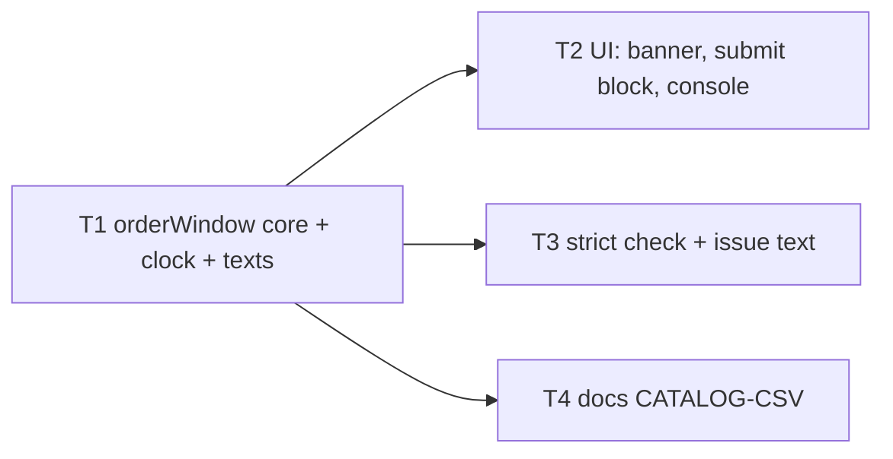
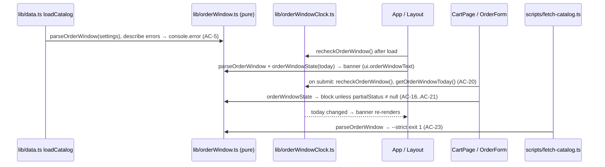

# Implementation Plan — Ordering window (order_open / order_close)
Date: 2026-10-28 · Branch: feature/songbook-upyu (current; the orchestrating session may branch first) · Status: draft · Execution mode: single-agent
Sources: `specs/SPEC-2026-10-28-ordering-window.md` (approved) · user answers to the Requirements Review (Q-mode, Q-1, Q-2, Q-3, REC-1…REC-6, all 2026-10-28) — read-only; this plan does not change them

## 1. Goal & scope
Coordinators open and close ordering from the `settings` sheet (`order_open`, `order_close`) without a deploy. The fixed banner `banner.deadline` is replaced by a banner computed from the window. Outside the window the cart keeps working, but a new order cannot be submitted. An order that was already partly sent can still be finished. The strict daily check reports invalid window dates.

In scope:
- a pure window module shared by the browser and the snapshot script;
- a clock store for re-checking at click time;
- the banner, the submit blocking and the reason hint;
- the console error;
- the strict-check failure and a neutral issue text in `pages.yml`;
- the `settings` documentation in `docs/CATALOG-CSV.md`.

Out of scope:
- `docs/SPEC.md` (the main session updates §7 and §12 item 6 itself, user answer Q-1);
- `specs/**`;
- `public/sample/settings.csv` (no new keys, user answer Q-3c);
- server-side enforcement, timers, countdowns, several windows (spec Non-goals).

## 2. Requirements
- R1 — `order_open` / `order_close` are read from `settings` and parsed with the existing `normalizeDate` (`YYYY-MM-DD`, `M/D/YY(YY)`, `DD.MM.YYYY`). Empty or absent means no bound. · Source: SPEC AC-1
- R2 — "Today" is the Europe/Berlin calendar date of the current instant, whatever the device time zone, including DST. Both bounds are inclusive. · Source: SPEC AC-2, NFR-2, E1, E2, E3
- R3 — Key combinations:
  - both empty: open (AC-3);
  - only end: open through the end date, closed after it (AC-27);
  - only start: closed before it, open from it with no end (AC-28);
  - an invalid value or start > end: closed (AC-4).
  
  · Source: SPEC AC-3, AC-4, AC-27, AC-28
- R4 — Invalid settings write a `console.error` that names the key and its raw value, once per catalog load (live or snapshot). · Source: SPEC AC-5; REC-5 accepted
- R5 — With live CSVs failing, the window comes from the snapshot `settings`. No extra request is made. · Source: SPEC AC-6, NFR-1
- R6 — Banner on every page, by state. Dates use `DD.MM.YYYY` from the parsed date and never the raw text:

  | State | Banner text |
  |---|---|
  | open, both dates | "Відсилайте замовлення від {start} і до {end}" |
  | open, end only | "Відсилайте замовлення до {end}" |
  | open, start only | "Відсилайте замовлення від {start}" |
  | before start | "Замовлення відкриються {start}" |
  | after end / invalid | "Прийом замовлень закрито" |
  | not configured | no banner |

  · Source: SPEC AC-7, AC-29, AC-30, AC-8, AC-9, AC-10, AC-11, AC-26
- R7 — No banner while the catalog is loading or has failed to load. · Source: SPEC AC-12
- R8 — The banner has `role="status"`. The text "⚠️ УВАГА! Замовлення приймаємо до 26 жовтня" and the key `banner.deadline` are gone. · Source: SPEC AC-13, AC-14
- R9 — Outside the window the cart works unchanged. · Source: SPEC AC-15
- R10 — Outside the window with no partial order:
  - the submit button has `aria-disabled="true"` + `is-off`;
  - the reason (same text as the banner) replaces `form.hint` under the button and is the button's `aria-describedby` description;
  - a click sends no POST, keeps the cart, does not navigate, and announces only the reason in the polite live region;
  - fields are not marked as tried/invalid.

  · Source: SPEC AC-16, AC-17, AC-18, AC-19, OQ-7; Q-3b accepted
- R11 — On every submit activation the window is re-evaluated against the Berlin date at that moment. The banner and the hint update to the new state. · Source: SPEC AC-20, E7, E18
- R12 — A partial order (≥1 but not all lines sent, `partialStatus`) bypasses the block. A send that started inside the window finishes even if the window closes during it. · Source: SPEC AC-21, AC-22, E13
- R13 — In the first-line failure case (E14: pending order with 0 lines sent), the "Спробувати ще" button in the alert is also shown disabled (`aria-disabled`, `is-off`) with the same reason, and activating it sends nothing. · Source: user answer Q-3a (REC-4)
- R14 — `npm run validate:catalog` (`--strict`) exits 1 on invalid window settings, with messages that name the key and the raw value. A non-strict snapshot run (part of `npm run build`) exits 0. · Source: SPEC AC-23, AC-24; REC-6 accepted
- R15 — The validation issue opened by `pages.yml` has the title `Таблиця каталогу: помилки перевірки (<date>)` and a body without "рядки пропущено". The log stays in the body. · Source: user answer Q-2
- R16 — `docs/CATALOG-CSV.md` documents `order_open` / `order_close` as listed in AC-25. · Source: SPEC AC-25; user answer Q-1
- R17 — New UI texts live only in `src/i18n/uk.json`, and `npm run lint` passes. · Source: SPEC NFR-5

## 3. Requirements review, assumptions & open questions
- REC-1 — Skills follow the Vite + React stack: `frontend-ui-architecture`, `react-best-practices`, `typescript-expert`, `react-testing-library`. `next-best-practices` is not used (there is no Next.js, `package.json`). There is no Backend scope: `scripts/fetch-catalog.ts` is a Node script, not Fastify. · Accepted
- REC-2 — One pure module `src/lib/orderWindow.ts` holds the window rules and is shared by the UI and `scripts/fetch-catalog.ts`. It has no React and no i18n, so the `tsx` script can import it. The clock store sits in a separate React-side module. · Accepted
- REC-3 — The spec's `e2e` ACs (AC-7, AC-15, AC-16, AC-17, AC-18, AC-21) are covered by RTL flows in `tests/app.test.tsx` (jsdom). Real-browser and GitHub-Actions checks are listed as gaps in §7. · Accepted
- REC-4 — Disable the alert's "Спробувати ще" in E14 outside the window (R13). · Accepted (Q-3a)
- REC-5 — `console.error` for invalid settings is written once, in `loadCatalog`, for both branches. · Accepted
- REC-6 — The script collects row errors and window errors first, then exits. · Accepted
- A1 — No new keys in `public/sample/settings.csv`, so existing app tests keep seeing "not configured", whatever the date. · Q-3c
- A2 — Window tests fake only `Date` (`vi.useFakeTimers({ toFake: ['Date'] })` + `vi.setSystemTime`), so `userEvent` and real `setTimeout` keep working. `vi.useRealTimers()` runs in `afterEach`.
- A3 — For "start after end", the console/log message names both keys and both raw values.
- A4 — Raw values go to the console and the CI log unchanged (no truncation). The spec asks only that they are never rendered in the UI (AC-26).
- Q — none open.

## 4. Affected modules
| Package | Layer / area | Files (existing or new) |
|---|---|---|
| root (single package) | pure domain helpers `src/lib` | `src/lib/orderWindow.ts` (new), `src/lib/orderWindowClock.ts` (new), `src/lib/ui.ts`, `src/lib/data.ts` |
| root | UI `src/components`, `src/App.tsx` | `src/App.tsx`, `src/components/Layout.tsx`, `src/components/CartPage.tsx`, `src/components/OrderForm.tsx` |
| root | texts | `src/i18n/uk.json` |
| root | build/CI | `scripts/fetch-catalog.ts`, `.github/workflows/pages.yml` |
| root | tests | `tests/orderWindow.test.ts` (new), `tests/fetchCatalog.test.ts` (new), `tests/harness.ts`, `tests/app.test.tsx` |
| root | docs | `docs/CATALOG-CSV.md` |

## 5. Constraints
- No Cyrillic literals in `src/components/*.tsx` outside comments. All visible texts go in `src/i18n/uk.json` — source: `README.md` "Тексти", `scripts/check-i18n.ts`, `docs/SPEC.md` §12 item 14. Cyrillic in `src/lib/*.ts` console/log messages is allowed: check-i18n scans only `src/components` (`scripts/check-i18n.ts:5`), and `src/lib/data.ts:44,48` already does this.
- No backend and no new network request. The window is evaluated from the `settings` already loaded — source: `docs/SPEC.md` §3; SPEC NFR-1.
- The snapshot keeps carrying the whole `settings` map unchanged. The form payload is unchanged — source: SPEC "Contract: settings sheet keys"; `src/lib/types.ts:53-58`, `src/lib/submit.ts`.
- External stores follow the existing `useSyncExternalStore` pattern with a test reset function — source: `src/lib/live.ts`, `src/lib/pendingOrder.ts:65-79`.
- Scripts run under `tsx` in Node and must not import modules that pull in React or the JSON i18n file — source: `scripts/fetch-catalog.ts:1-4` (imports only `src/lib/catalog`, `src/lib/config`, `src/lib/types`).
- The regular build must not fail on data errors. Only `--strict` fails — source: `scripts/fetch-catalog.ts:8,40-41`, `.github/workflows/pages.yml:64-65`.
- Do not touch: `package-lock.json`, `.env`, `public/config.json`, `public/catalog.json` (generated, `.gitignore`), `specs/**`, `docs/SPEC.md`.

## 6. Tasks

### T1 — Pure window module, clock store and texts
- Requirements: R1, R2, R3, R6 (text mapping), R11 (store), R14 (messages), R17
- Scope: Frontend
- Depends on: —
- Owned paths: `src/lib/orderWindow.ts` (new), `src/lib/orderWindowClock.ts` (new), `src/lib/ui.ts`, `src/i18n/uk.json` (add keys only; `banner.deadline` stays until T2), `tests/orderWindow.test.ts` (new)
- Mandatory skills: `engineering-paved-path:frontend-ui-architecture`, `engineering-paved-path:react-best-practices`, `engineering-paved-path:typescript-expert`, `engineering-paved-path:react-testing-library`
- Change:
  - **`src/lib/orderWindow.ts`** — pure. It imports only `normalizeDate` from `./catalog` and `type Settings` from `./types`. No React, no `./i18n`. This is the contract for T2 and T3:
    ```ts
    export const ORDER_OPEN = 'order_open';
    export const ORDER_CLOSE = 'order_close';
    export type OrderWindowError =
      | { reason: 'invalidDate'; key: typeof ORDER_OPEN | typeof ORDER_CLOSE; raw: string }
      | { reason: 'startAfterEnd'; openRaw: string; closeRaw: string };
    export type OrderWindow =
      | { kind: 'none' }
      | { kind: 'valid'; start: string | null; end: string | null } // ISO YYYY-MM-DD; at least one non-null
      | { kind: 'invalid'; errors: OrderWindowError[] };
    export type OrderWindowState =
      | { status: 'notConfigured' }
      | { status: 'open'; start: string | null; end: string | null }
      | { status: 'beforeStart'; start: string }
      | { status: 'afterEnd' }
      | { status: 'invalid' };
    export function parseOrderWindow(settings: Settings): OrderWindow;
    export function berlinDate(now: Date): string;          // YYYY-MM-DD in Europe/Berlin
    export function orderWindowState(win: OrderWindow, today: string): OrderWindowState;
    export function isOrderingOpen(state: OrderWindowState): boolean; // notConfigured | open
    export function describeOrderWindowErrors(errors: OrderWindowError[]): string[];
    ```
    - `parseOrderWindow`: `raw = (settings[key] ?? '').trim()`. Empty means `null`. Otherwise `normalizeDate(raw)`; a `null` result adds `invalidDate` with the untrimmed-of-content raw value. If both are valid and `start > end` (ISO string compare), return `invalid` with `startAfterEnd`. If both are empty, return `none`.
    - `berlinDate`: a module-level `new Intl.DateTimeFormat('en-CA', { timeZone: 'Europe/Berlin', year: 'numeric', month: '2-digit', day: '2-digit' })`, then `formatToParts`, then assemble `YYYY-MM-DD` from the parts. Do not rely on the locale's string format.
    - `orderWindowState` follows the spec's state diagram:
      - `none` → `notConfigured`;
      - `invalid` → `invalid`;
      - `start` set and `today < start` → `beforeStart`;
      - `end` set and `today > end` → `afterEnd`;
      - otherwise `open` with `start` / `end`.
    - `describeOrderWindowErrors` returns one log line per error:
      - `settings: order_open — некоректна дата «<raw>»`;
      - `settings: order_open «<openRaw>» пізніше за order_close «<closeRaw>»`.
  - **`src/lib/orderWindowClock.ts`** — a React-side store modelled on `src/lib/live.ts`:
    ```ts
    export function getOrderWindowToday(): string;   // lazy init: berlinDate(new Date())
    export function recheckOrderWindow(): void;      // today = berlinDate(new Date()); notify listeners only if it changed
    export function useOrderWindowToday(): string;   // useSyncExternalStore
    export function resetOrderWindowClock(): void;   // tests: drop the cached value
    ```
    There is no timer (OQ-8).
  - **`src/lib/ui.ts`** — add `orderWindowText(state: OrderWindowState): string | null`, mapping states to text keys:

    | State | Key / result |
    |---|---|
    | `notConfigured` | `null` |
    | `open`, both dates | `window.open` |
    | `open`, end only | `window.openUntil` |
    | `open`, start only | `window.openFrom` |
    | `beforeStart` | `window.beforeStart` |
    | `afterEnd`, `invalid` | `window.closed` |

    Dates go through the existing `formatDate` only, never the raw cell text.
  - **`src/i18n/uk.json`** — add:
    - `"window.open": "Відсилайте замовлення від {start} і до {end}"`
    - `"window.openUntil": "Відсилайте замовлення до {end}"`
    - `"window.openFrom": "Відсилайте замовлення від {start}"`
    - `"window.beforeStart": "Замовлення відкриються {start}"`
    - `"window.closed": "Прийом замовлень закрито"`
  - **`tests/orderWindow.test.ts`** — `describe('SPEC-2026-10-28-ordering-window', …)` with tests named `AC-N: …` (see Acceptance).
- Why: one source of truth for the rules, so the browser and the daily check can never disagree (AC-4 = AC-23). Keeping the module pure lets `tsx` import it without React or JSON imports.
- Risk: Medium.
  - (a) `Intl` formatting differs by runtime or locale.
  - (b) DST edges.
  - (c) The `M/D` versus `D.M` order gets mixed up.
  - (d) Invalid dates such as `2026-02-30`.
  
  Mitigation:
  - (a) `formatToParts` with a fixed `timeZone`;
  - (b) tests at the March and October 2026 transitions;
  - (c) and (d) reuse `normalizeDate`, which already rejects impossible dates (`src/lib/catalog.ts:31-35`), and test both formats.
- Acceptance (unit, `tests/orderWindow.test.ts`):
  - AC-1: `01.11.2026`/`15.11.2026`, `2026-11-01`/`2026-11-15` and `11/1/26`/`11/15/26` all parse to `2026-11-01`/`2026-11-15`. With today `2026-11-05`, `orderWindowText` gives "Відсилайте замовлення від 01.11.2026 і до 15.11.2026".
  - AC-2: `berlinDate(new Date('2026-10-31T23:00:00Z'))` is `'2026-11-01'`; `…'2026-11-15T22:59:59Z'` is `'2026-11-15'`; `…'2026-11-15T23:00:00Z'` is `'2026-11-16'`. The window 2026-11-01…2026-11-15 is open on the first two and closed on the third.
  - NFR-2: `2026-03-28T22:59:59Z` gives `2026-03-28` and `2026-03-28T23:00:00Z` gives `2026-03-29`; `2026-07-01T21:59:59Z` gives `2026-07-01` and `2026-07-01T22:00:00Z` gives `2026-07-02`.
  - AC-3 / AC-8: `{}` and empty values give `notConfigured`, `isOrderingOpen` is true and the text is `null`.
  - AC-4 / AC-11: `order_open: '2026-13-01'`, `'2026-02-30'`, `'abc'`, and `2026-11-20` > `2026-11-10` give `invalid`, closed, "Прийом замовлень закрито". A bad value in one key while the other is empty is also `invalid`.
  - AC-5: `describeOrderWindowErrors` output contains `order_close` and the raw value.
  - AC-26: `<b>1.11</b>` gives `invalid`, and the text contains neither `<b>` nor `1.11`.
  - AC-27 / AC-29: only `order_close: 2026-11-15` is open on 2026-10-28 ("Відсилайте замовлення до 15.11.2026") and on 2026-11-15, and `afterEnd` on 2026-11-16.
  - AC-28 / AC-30 / AC-9: only `order_open: 2026-11-01` is `beforeStart` on 2026-10-31 ("Замовлення відкриються 01.11.2026"), and open on 2026-11-01 and 2027-01-01 ("Відсилайте замовлення від 01.11.2026").
  - AC-10: the window on 2026-11-16 gives "Прийом замовлень закрито".
  - E2: a one-day window is open on that day only.
  - Clock: after `vi.setSystemTime` + `recheckOrderWindow()`, `getOrderWindowToday()` returns the new Berlin date.
- Done-condition: `npm run lint && npm test`

### T2 — Banner, submit blocking and console error in the UI
- Requirements: R4, R5, R6, R7, R8, R9, R10, R11, R12, R13, R17
- Scope: Frontend
- Depends on: T1
- Owned paths: `src/App.tsx`, `src/components/Layout.tsx`, `src/components/CartPage.tsx`, `src/components/OrderForm.tsx`, `src/lib/data.ts`, `src/i18n/uk.json` (remove `banner.deadline` only), `tests/harness.ts`, `tests/app.test.tsx`
- Mandatory skills: `engineering-paved-path:frontend-ui-architecture`, `engineering-paved-path:react-best-practices`, `engineering-paved-path:typescript-expert`, `engineering-paved-path:react-testing-library`
- Change:
  - **`src/lib/data.ts`** — in `loadCatalog`, after building the `LoadedCatalog` on either branch (live and snapshot), call a local `reportOrderWindow(settings)`. It runs `parseOrderWindow`, and when the result is `invalid` it writes `console.error(line)` for each `describeOrderWindowErrors` line. The `LoadedCatalog` type is unchanged.
  - **`src/App.tsx`**:
    - in `load()`, call `recheckOrderWindow()` right before `setState({ status: 'ready', … })`, so the page-load evaluation uses the load moment;
    - during render, derive `const orderWindow = status === 'ready' && catalog ? parseOrderWindow(catalog.settings) : null` (no state or effect; derive, don't store);
    - pass it to `Layout`.
  - **`src/components/Layout.tsx`**:
    - new prop `orderWindow: OrderWindow | null`;
    - `const today = useOrderWindowToday()`;
    - `const text = orderWindow ? orderWindowText(orderWindowState(orderWindow, today)) : null`;
    - replace line 29 with `{text !== null && <div className="banner" role="status">{text}</div>}`. Do not add `aria-live`: `role="status"` implies polite, and the existing hidden live region keeps its own `aria-live` (`Layout.tsx:24`).
  - **`src/components/CartPage.tsx`** — pass `orderWindow={parseOrderWindow(catalog.settings)}` to `OrderForm`.
  - **`src/components/OrderForm.tsx`** — new prop `orderWindow: OrderWindow`.
    - Render:
      - `const today = useOrderWindowToday()`;
      - `const state = orderWindowState(orderWindow, today)`;
      - `const windowBlocked = !isOrderingOpen(state) && partial === null`;
      - `const reason = windowBlocked ? orderWindowText(state) : null`.
    - `onSubmit`, after `preventDefault` and only when `!sendingRef.current`:
      1. Call `recheckOrderWindow()`.
      2. Compute `const now = orderWindowState(orderWindow, getOrderWindowToday())`.
      3. Read the partial order fresh: `partialStatus(getCart(), getPendingOrder()) === null`.
      4. If `!isOrderingOpen(now)` and there is no partial order, call `announce(orderWindowText(now) ?? '')` and `return`. Do not call `setTried`, do not POST, do not touch the cart.

      The existing validity/sending check follows unchanged. The send loop is not re-checked (AC-22).
    - Main button:
      - `off = !valid || sending || windowBlocked`;
      - `className` gets `is-off` when `off`, and `aria-disabled={off}`.
    - Hint:
      - when `!sending`, render `<span id="f-submit-hint" className="hint">{reason ?? t('form.hint')}</span>` if `reason !== null || !valid`;
      - the main button gets `aria-describedby="f-submit-hint"` while the hint is shown.
    - Alert retry button (R13): when `windowBlocked`, add ` is-off`, `aria-disabled="true"` and `aria-describedby="f-submit-hint"`. It stays `type="submit"`, so `onSubmit` blocks it.
  - **`src/i18n/uk.json`** — delete `banner.deadline`.
  - **`tests/harness.ts`**:
    - add `overrideFiles(patch: Record<string, string | null>)`: a string sets `files[path]`, and `null` deletes it, so the stub returns 404;
    - add `restoreFiles()`, which restores the original map (snapshot the original entries at module load).
  - **`tests/app.test.tsx`**:
    - add `describe('SPEC-2026-10-28-ordering-window', …)`;
    - `beforeEach`: `vi.useFakeTimers({ toFake: ['Date'] })`, `resetOrderWindowClock()`;
    - `afterEach`: `vi.useRealTimers()`, `restoreFiles()`, `vi.restoreAllMocks()`;
    - write window settings by `overrideFiles({ 'sample/settings.csv': <sample + order_open/order_close rows> })`;
    - query the banner with `within(screen.getByRole('banner'))`, because the header has the implicit role `banner`. The hint repeats the same text, so unscoped `getByText` would be ambiguous.
- Why: this is the user-visible part of the spec. Keeping the window check in `onSubmit` before validation makes the closed state a pure "no", with no field noise (Q-3b). Passing the parsed window down follows the existing prop flow (`App` → `CartPage` → `OrderForm`), and only the date is shared through a store, because it is the one value that changes at click time and must reach both `Layout` and `OrderForm`.
- Risk: High.
  - (a) Existing tests assume a single `role="status"` (`tests/app.test.tsx:133`).
  - (b) The block must not fire for partial orders, or retries outside the window break (AC-21).
  - (c) A stale render-time `partial` in `onSubmit`.
  - (d) Repeated clicks while sending (AC-42) must keep their current behaviour.
  - (e) The clock cache leaks between tests.
  
  Mitigation:
  - (a) Sample settings have no window keys, so no banner appears in old tests. New tests scope queries to `banner`, or find the live region via `aria-live="polite"`.
  - (b) and (c) Read `partialStatus(getCart(), getPendingOrder())` fresh inside `onSubmit`.
  - (d) The window check runs only when `!sendingRef.current`.
  - (e) `resetOrderWindowClock()` in `beforeEach`.
- Acceptance (RTL in `tests/app.test.tsx`; each test named `AC-N: …`):
  - AC-7, AC-14: window 2026-11-01…2026-11-15 at 2026-11-05 12:00 Berlin. The header banner reads "Відсилайте замовлення від 01.11.2026 і до 15.11.2026" on `#/`, `#/cart` (seeded cart) and `#/faq`. "Замовлення приймаємо до 26 жовтня" is absent.
  - AC-8, AC-3: the unchanged sample settings show no window text in the header. A valid cart submits and "Дякуємо! Замовлення відправлено." appears.
  - AC-12: before the catalog resolves, and with all CSV files and `catalog.json` returning 404 (error screen), the header shows no window text.
  - AC-13: the banner element has `role="status"`.
  - AC-6: `overrideFiles({ 'sample/settings.csv': null, 'catalog.json': <snapshot from buildCatalogData(sample csv) whose settings hold a window containing the faked today> })` makes the banner show that window's dates.
  - AC-5: with `order_close` = `2026-11-1x`, `vi.spyOn(console, 'error')` receives a line containing `order_close` and `2026-11-1x`.
  - AC-15, AC-16, AC-17: at 2026-11-16 (after end), "Додати до замовлення" adds a line and the header count updates. On `#/cart` with valid fields:
    - `getByRole('button', { name: 'Відправити', description: 'Прийом замовлень закрито' })` exists;
    - it has `aria-disabled="true"`;
    - `form.hint` text is absent.
  - AC-9 (UI): at 2026-10-28 with window 2026-11-01…, the banner and the hint read "Замовлення відкриються 01.11.2026".
  - AC-18, AC-19: clicking the disabled button gives:
    - `posts` length 0;
    - `plast-cart-v1` unchanged;
    - no Thanks heading;
    - the live region (`aria-live="polite"`) text is "Прийом замовлень закрито";
    - no field error such as "Вкажіть ім'я" is shown.
  - AC-20: set the time to 2026-11-15 23:59 Berlin and render the open window. Set the time to 2026-11-16 00:01 Berlin and click "Відправити". Result: no POST, and the banner and the hint read "Прийом замовлень закрито".
  - AC-21: inside the window, `failAt(2)` with three lines gives a partial order. Set the time after the end and click "Спробувати ще". Only the 2 unsent lines are posted, with the same `entry.1001`, and Thanks appears.
  - AC-22: inside the window, with three lines, the POST handler calls `vi.setSystemTime(<after end>)` on index 1. All 3 lines are posted and Thanks appears.
  - E14 / R13: inside the window, `failAt(1)`. Set the time after the end. The alert's "Спробувати ще" has `aria-disabled="true"`, and a click posts nothing and announces "Прийом замовлень закрито".
  - All existing tests in `tests/app.test.tsx` still pass unchanged.
- Done-condition: `npm run lint && npm test`

### T3 — Strict data check and neutral validation issue
- Requirements: R14, R15
- Scope: Frontend (build script; there is no backend in this project)
- Depends on: T1
- Owned paths: `scripts/fetch-catalog.ts`, `.github/workflows/pages.yml` (only the "Open issue on invalid rows" step `--title` / `--body`, lines 88-95), `tests/fetchCatalog.test.ts` (new)
- Mandatory skills: `engineering-paved-path:typescript-expert`
- Change:
  - **`scripts/fetch-catalog.ts`** — import `parseOrderWindow`, `describeOrderWindowErrors` from `../src/lib/orderWindow`.
    1. Right after `buildCatalogData`, and before the existing `rows.length === 0` throw, compute `const win = parseOrderWindow(data.settings)` and `const windowErrors = win.kind === 'invalid' ? describeOrderWindowErrors(win.errors) : []`.
    2. Print each line with `console.error` in strict mode, otherwise with `console.warn`.
    3. Change the strict exit to `if (strict && (data.errors.length > 0 || windowErrors.length > 0))`. It prints `Знайдено помилок: рядків <n>, налаштувань вікна <m>` and exits 1.
    
    Non-strict behaviour and snapshot writing are unchanged: the build still succeeds and the snapshot keeps the raw `settings`, so the site shows "closed" (AC-24).
  - **`.github/workflows/pages.yml`**:
    - title becomes `--title "Таблиця каталогу: помилки перевірки ($(date +%F))"`;
    - body becomes `printf 'Щоденна перевірка таблиці каталогу знайшла помилки: некоректні рядки каталогу або дати вікна замовлень (order_open / order_close у листі settings). Деталі в журналі нижче.\n\n```\n%s\n```\n' "$(cat validate.log)"`.
    
    Nothing else in the workflow changes. The step name can stay.
  - **`tests/fetchCatalog.test.ts`** (new), modelled on the `spawnSync` pattern in `tests/config.test.ts:13-17`:
    - create a temporary directory (`mkdtempSync(join(tmpdir(), …))`) containing `public/config.json` (from `config.example.json`) and `public/sample/{catalog,synonyms}.csv` copied from the repo;
    - write `public/sample/settings.csv` = sample + `order_close,2026-11-1x`;
    - run `spawnSync(<repo>/node_modules/.bin/tsx, [<repo>/scripts/fetch-catalog.ts, '--strict'], { cwd: tmp, encoding: 'utf8' })`, then without `--strict`;
    - remove the directory in `afterEach`.
- Why: the coordinator must learn about a mistake that silently closes ordering (US-6). Using the same module guarantees the same verdict as the site. The neutral issue text stops telling the coordinator that "the site works" when ordering is actually closed (Q-2).
- Risk: Medium.
  - (a) The script must not import React or JSON.
  - (b) The test must not write into the repo's `public/`.
  - (c) The strict exit must not hide the window lines.
  
  Mitigation:
  - (a) T1 keeps `orderWindow.ts` pure (constraint in §5).
  - (b) `cwd` is the temporary directory, because the script resolves `public/…` relative to `cwd` (`scripts/fetch-catalog.ts:11,15,36`).
  - (c) The lines are printed before any exit.
- Acceptance:
  - AC-23: strict run gives status 1, and `stderr` contains `order_close` and `2026-11-1x`.
  - AC-24: non-strict run gives status 0, writes `<tmp>/public/catalog.json`, and its `settings.order_close` is `2026-11-1x`.
  - Valid window with valid rows: strict gives status 0.
  - `pages.yml`: the title and body match R15 (`file:line`).
- Done-condition: `npm run lint && npm test`

### T4 — Document the window keys for coordinators
- Requirements: R16
- Scope: docs
- Depends on: T1 (texts and rules settled)
- Owned paths: `docs/CATALOG-CSV.md` (§2 date line and §5 only)
- Mandatory skills: — (documentation only)
- Change (in Ukrainian, matching the file):
  - **§2** — the line "Дати `YYYY-MM-DD`" becomes: dates `YYYY-MM-DD` or `ДД.ММ.РРРР`; dates with slashes are read as month/day (`M/D/YY`), which is how Google Sheets exports a date cell.
  - **§5**:
    - add `order_open` / `order_close` to the CSV example as empty, commented-by-text values;
    - add a sub-section "Вікно замовлень" containing:
      - the recommended format `ДД.ММ.РРРР` (e.g. `26.10.2026`), with `YYYY-MM-DD` also accepted, typed as plain text;
      - a warning that `10/11/2026` is read as 11 October;
      - both bounds inclusive;
      - "today" means Europe/Berlin;
      - both empty: ordering open, no banner;
      - only `order_close`: open until and including that day;
      - only `order_open`: closed before it, open from it with no end;
      - an invalid value or start > end: ordering closed, banner "Прийом замовлень закрито", and the daily check opens an issue "Таблиця каталогу: помилки перевірки";
      - the banner texts by state;
      - a partly sent order can be finished after closing;
      - advice: do not close the Google Form instead, because orders sent to a closed form are lost silently;
      - changes appear after a page reload, with the CSV publish delay; when Google is unreachable, the site uses the daily snapshot.
- Why: coordinators edit the sheet without code, so the doc is the only place they learn the rules (AC-25).
- Risk: Low — the doc could diverge from the code. · Mitigation: copy the texts from the T1 `uk.json` keys and the rules from the T1 tests.
- Acceptance: AC-25. A manual review confirms every item listed in AC-25 is present in `docs/CATALOG-CSV.md` §5. `grep -n "order_open" docs/CATALOG-CSV.md` returns lines in §5.
- Done-condition: `npm run lint` (sanity; docs do not affect it) + manual review

## 8. Diagrams

Task graph (single-agent; executed top to bottom):



Module wiring (cross-layer):



## 6b. Package gates
| Gate | Package | Commands (full existing suite) | Run by |
|---|---|---|---|
| G.root | root (single package) | `npm run lint && npm test && SITE_CONFIG="$(jq -c . config.example.json)" npm run build` | after implementer (orchestrating session) · plan-verifier |

## 7. Testing strategy
- Existing suites (root, `npm test`, Vitest + jsdom, fast, all unit or RTL):
  - `tests/app.test.tsx` covers the full order flow, partial orders and live announcements, and guards against regressions in T2;
  - `tests/pendingOrder.test.ts` covers `partialStatus`;
  - `tests/catalog.test.ts` covers `normalizeDate`;
  - `tests/config.test.ts` provides the spawn pattern.
  
  `npm run lint` covers `tsc` and check-i18n. `npm run build` covers the non-strict snapshot.
- New or changed tests:
  - `tests/orderWindow.test.ts` (T1, new);
  - `tests/app.test.tsx` + `tests/harness.ts` (T2);
  - `tests/fetchCatalog.test.ts` (T3, new).
- Spec ACs, all inside `describe('SPEC-2026-10-28-ordering-window', …)` with test names `AC-N: …`:

  | Test file | ACs |
  |---|---|
  | `tests/orderWindow.test.ts` | AC-1, AC-2, AC-3, AC-4, AC-5, AC-9, AC-10, AC-11, AC-26, AC-27, AC-28, AC-29, AC-30 (+ NFR-2) |
  | `tests/app.test.tsx` | AC-3, AC-5, AC-6, AC-7, AC-8, AC-9, AC-12, AC-13, AC-14, AC-15, AC-16, AC-17, AC-18, AC-19, AC-20, AC-21, AC-22 |
  | `tests/fetchCatalog.test.ts` | AC-23 (script part), AC-24 (snapshot part) |

  - AC-25 (manual): documentation review by the user.
- Gaps:
  - AC-7, AC-15, AC-16, AC-17, AC-18, AC-21 are `e2e` in the spec. They are verified in jsdom, not a real browser: a manual smoke check in the browser (`npm run dev` with a temporarily edited local `public/sample/settings.csv`, not committed) is left to the user.
  - AC-23's GitHub-issue creation and AC-24's deployed-site part run only in Actions, so the user verifies them after merge (e.g. `workflow_dispatch` with a bad value in the real sheet).
  - NFR-3 (publish delay) is not testable locally.

## 9. Traceability
| Requirement | Source | Tasks |
|---|---|---|
| R1 | AC-1 | T1 |
| R2 | AC-2, NFR-2 | T1 |
| R3 | AC-3, AC-4, AC-27, AC-28 | T1 |
| R4 | AC-5, REC-5 | T1 (messages), T2 (console) |
| R5 | AC-6, NFR-1 | T2 |
| R6 | AC-7, AC-8, AC-9, AC-10, AC-11, AC-26, AC-29, AC-30 | T1 (texts), T2 (banner) |
| R7 | AC-12 | T2 |
| R8 | AC-13, AC-14 | T2 |
| R9 | AC-15 | T2 |
| R10 | AC-16…AC-19, OQ-7, Q-3b | T2 |
| R11 | AC-20 | T1 (clock), T2 |
| R12 | AC-21, AC-22 | T2 |
| R13 | Q-3a / REC-4 | T2 |
| R14 | AC-23, AC-24, REC-6 | T3 |
| R15 | Q-2 | T3 |
| R16 | AC-25, Q-1 | T4 |
| R17 | NFR-5 | T1, T2 |

## 10. Red-flags check
- [x] Every requirement maps to ≥1 task and cites a source; every task maps to ≥1 requirement
- [x] Nothing in the plan authors or changes a spec: no user stories or EARS criteria, no owned path under `specs/`; `docs/SPEC.md` left to the main session
- [x] Execution mode is the one the user chose (single-agent); no waves
- [x] Depends-on forms a DAG (T1 → T2, T3, T4); order T1 → T2 → T3 → T4 is executable
- [x] Owned paths don't overlap except `src/i18n/uk.json`, which is sequenced T1 (add keys) → T2 (remove `banner.deadline`)
- [x] Exported changes and consumers:
  - `Layout` props: only consumer `src/App.tsx` (T2);
  - `OrderForm` props: only consumer `CartPage.tsx` (T2);
  - `uk.json` key removal: the only `banner.deadline` user is `Layout.tsx:29` (T2);
  - `LoadedCatalog` is unchanged.
- [x] No owned path hits lockfiles, `.env`, generated `public/config.json` / `public/catalog.json` (the T3 test writes only to a temporary directory) or symlinked instruction files
- [x] Schema and API-contract decisions settled: `OrderWindow` / `OrderWindowState` / function signatures, text keys, settings keys; no DB schema
- [x] Migrations: none
- [x] Every task has a Why and a Risk; Medium/High risks name edge cases and mitigations
- [x] Testing strategy names the existing suites and the gaps (real browser, Actions)
- [x] Every Done-condition and the Package gate use existing `package.json` scripts (`lint`, `test`, `build`); `jq` only supplies the env value (as in `docs/plans/2026-10-19-item-quantity.md`)
- [x] No slow suite: Done-condition = `npm run lint && npm test` (jsdom and one ~1 s subprocess test); §6b has a gate for the only package
- [x] No task contradicts a mandatory skill:
  - derive-don't-store for the parsed window;
  - no `useEffect` for derived state;
  - the store uses `useSyncExternalStore` like the existing ones;
  - `userEvent` only, accessible queries, no `getByTestId`;
  - no Cyrillic in components.
- [x] No blocking open question; all defaults confirmed by the user (Q-3)

## 11. Handoff to reviewers
- Accessibility:
  - two `role="status"` regions (banner + the hidden live region): on a click outside the window (AC-20 transition) the reason may be read twice;
  - check `aria-disabled` together with `type="submit"` (the button stays focusable by design, as today);
  - check the `aria-describedby` linkage of the hint.
- Security:
  - raw `order_open` / `order_close` values reach only `console.error` and the CI log/issue body inside a code fence; check that nothing renders them in the DOM (AC-26);
  - `printf` in `pages.yml` keeps `%s` substitution, so no shell expansion of log content.
- Architecture:
  - `src/lib/orderWindow.ts` must stay free of React and `./i18n`, because the `tsx` script imports it;
  - the date store is the only new global state.

## 12. Risks & rollback
- Cross-task: a coordinator typo now closes ordering (fail-closed by design). Mitigation: daily strict check + issue (T3) and docs (T4). The user should send coordinators the doc link before the first window.
- `docs/SPEC.md` §7 / §12 item 6 is updated by the main session (Q-1). Until then the v1 spec text contradicts the behaviour.
- Rollback: revert the commits. With no window keys in the sheet the feature is inert (no banner, ordering open), so clearing `order_open` / `order_close` in the sheet is the immediate, deploy-free off switch.
- Suggested note for the project notes (not written by this plan): "Ordering window lives in `settings` (`order_open`/`order_close`); fail-closed on invalid values; daily `validate:catalog --strict` alerts."
