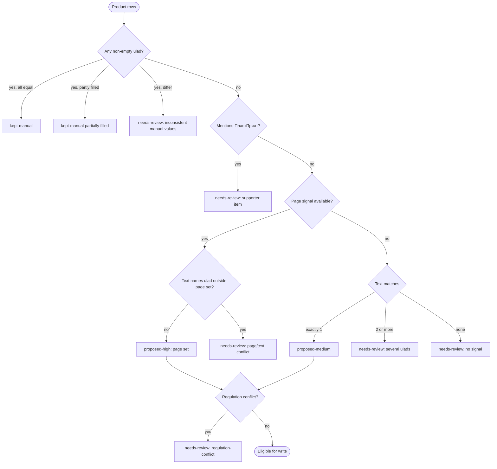
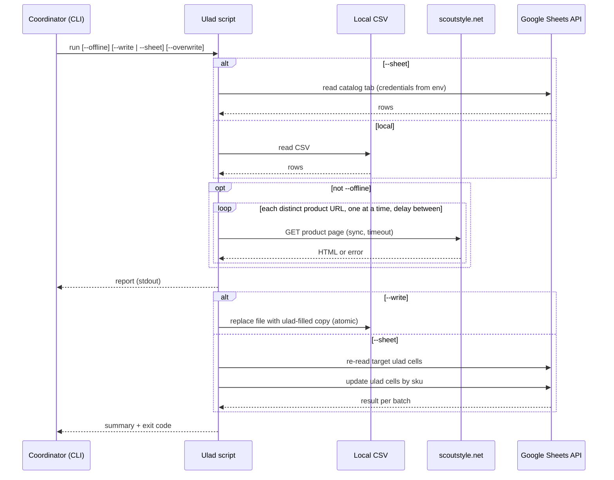

# Spec: Ulad classifier script for the catalog
Spec ID: SPEC-2026-10-18-ulad-classifier
Status: draft
Supersedes: —

## Problem and user

**Who:** the station coordinator who maintains the `catalog` Google Sheet (and the repo's `public/sample/catalog.csv`).

**Pain:** the site's ulad filter is strict. A product shows under a ulad chip only if its `ulad` column lists that ulad, or if its name/synonyms contain a ulad keyword (`src/lib/search.ts:86`, `src/lib/catalog.ts:159-171,203-204`). Otherwise it is visible only under «Усі улади» (`docs/CATALOG-CSV.md` §3, `ulad` row). In the sample catalog only 11 of 52 products have `ulad` set (`public/sample/catalog.csv`). Generic items such as shirts, trousers, knee socks, whistle cords and belts are therefore invisible when a parent filters by «УПН» (`tests/search.test.ts:31` asserts that УПН returns nothing today).

**What they do today:** open each scoutstyle.net product page by hand, read which ulads it is meant for, and type the value into the Sheet. Nothing checks that hand-typed values agree with the shop or with the Plast uniform regulations. URL slugs on scoutstyle.net are misleading: `/odnostrij/91-422-sorocka-dla-hlopcikiv.html` is trousers, and `/elementi-odnostroyu/156-plastovij-novac-kij-poas-col.html` is a belt that is *not* for УПН (research, see Inputs and provenance).

## Goals / Non-goals

### Goals

- G1: For every product with an empty `ulad`, the coordinator gets a proposal with a confidence level and the evidence behind it, from one command run.
- G2: The shop page's «Улади» attribute is the primary signal. Name/synonyms/category text is the fallback. A proposal is never silently guessed: ambiguous or conflicting products are listed as `needs-review` with a reason.
- G3: Hand-set `ulad` values are never changed unless the coordinator explicitly asks.
- G4: Accepted proposals can be applied to a local CSV in place (explicit flag) or to the Google Sheet through the Sheets API (explicit opt-in with credentials).
- G5: The Plast uniform regulations are cited, and are used only to cross-check proposals and flag conflicts (an assumption, see OQ-2).

### Non-goals

- Changing the site, the search/filter behaviour, `detectUlads` semantics, or the allowed `ulad` values (`src/lib/types.ts:68`).
- Running the script in CI or GitHub Actions, or adding any credential to `SITE_CONFIG` (which is public, `docs/SPEC.md:123`).
- Using URL slugs as a signal (they are unreliable, see Edge cases).
- Inferring ulad from sizes (for example children's sizes on trousers). Accepted limitation, see Edge cases E-9.
- Using the regulations as the primary rule, or overriding the shop attribute with them.
- Cross-run caching of fetched pages. Default, see OQ-9.
- Fixing the Пташата age label mismatch between sources (`src/i18n/uk.json:124` says 2–5, scoutstyle 3–6, the УПП США regulation 3–5, the user's reference 2–6). Noted only.
- Classifying ПластПрият items into a ulad (it is a supporters' membership category, not a ulad). Accepted limitation, see E-11.
- Writing to the `synonyms` or `settings` sheets, or to any other column than `ulad`.
- Locking or transactional protection against concurrent Sheet edits beyond the re-check in AC-38. Accepted limitation, see E-14.

## User stories

- US-1 [Must]: As a coordinator, I want the script to propose a `ulad` value per product with a confidence and the evidence, so that I can fill the column without opening every page.
- US-2 [Must]: As a coordinator, I want the script to read the scoutstyle.net product page by default, and to work offline on request, so that proposals use the shop's own ulad attribute when possible.
- US-3 [Must]: As a coordinator, I want hand-set `ulad` values kept unless I pass an explicit override, so that my corrections are never lost.
- US-4 [Must]: As a coordinator, I want to apply the proposals to a local CSV in place behind an explicit flag, so that I can update `public/sample/catalog.csv` or an exported sheet. [NEEDS CLARIFICATION: OQ-3]
- US-5 [Should]: As a coordinator, I want to apply the proposals directly to the `catalog` Google Sheet through the Sheets API when I opt in with credentials, so that I don't have to paste values by hand. [NEEDS CLARIFICATION: OQ-1]
- US-6 [Should]: As a coordinator, I want proposals cross-checked against the Plast uniform regulations, so that obvious contradictions (for example a yellow kerchief not tagged УПН) are flagged.
- US-7 [Could]: As a coordinator, I want the report grouped by decision (proposed, needs review, kept manual), so that I can work through it quickly. *(Unconfirmed UX proposal.)* [NEEDS CLARIFICATION: OQ-10]
- US-8 [Could]: As a coordinator, I want a paste-ready `ulad` column in sheet row order, so that I can fill the Sheet without API credentials. *(Unconfirmed UX proposal.)* [NEEDS CLARIFICATION: OQ-10]
- US-9 [Could]: As a coordinator, I want `docs/CATALOG-CSV.md` to mention the script and its flags next to the `ulad` column rule, so that other coordinators find it. *(Unconfirmed UX proposal.)* [NEEDS CLARIFICATION: OQ-10]

## Acceptance criteria (EARS)

Terms used below:

- **Product:** all catalog rows sharing one `product_id`.
- **Text signal:** the ulads matched by the existing keyword rule (`src/lib/catalog.ts:159-171`) over `name_uk`, `synonyms` and `category` of the product.
- **Page signal:** the ulads read from the «Улади» attribute of the product's scoutstyle.net page.
- **Decision categories** (stable report tokens): `proposed-high`, `proposed-medium`, `needs-review`, `kept-manual`.
- **Canonical value:** ULADS members in the order `Пташата, УПН, УПЮ, УСП, УПС`, joined by `, `.

### Classification (US-1)

- AC-1 (US-1): The script shall report exactly one line per product of the valid input rows. · Verify: unit — observable: a report over `public/sample/catalog.csv` has 52 product lines.
- AC-2 (US-1): WHEN a product's page signal contains at least one ulad and the text signal names no ulad outside that set, the script shall propose the page set as a canonical value with category `proposed-high`. · Verify: unit — observable: page values «Для УПН (6-11 років)», «Для УПЮ (11-18 років)», «Для УСП (18-35 років)», «Для УПС (35+ років)» give the line `proposed-high  УПН, УПЮ, УСП, УПС`.
- AC-3 (US-1): WHEN a product has no page signal and its text signal matches exactly one ulad, the script shall propose that ulad with category `proposed-medium`. · Verify: unit — observable: offline, a product named «Хустка Новаків» shows `proposed-medium  УПН`.
- AC-4 (US-1): IF a product has no page signal and its text signal matches two or more ulads, THEN the script shall report it as `needs-review` with reason "several ulads in text" and the matched ulads. · Verify: unit — observable: the line shows `needs-review`, the reason, and no proposed value.
- AC-5 (US-1): IF a product has neither a page signal nor a text match, THEN the script shall report it as `needs-review` with reason "no signal". · Verify: unit — observable: offline, «Свисток» shows `needs-review  no signal`.
- AC-6 (US-1): IF the text signal names a ulad that is not in the page set, THEN the script shall report the product as `needs-review` with reason "page/text conflict" and both sets. · Verify: unit — observable: page set `УПЮ, УСП, УПС` plus the name «… новацький …» shows `needs-review page/text conflict page=УПЮ, УСП, УПС text=УПН`.
- AC-7 (US-1): The script shall map each «Улади» attribute value to a ulad by its unit token (`Пташат`/`УПП` → `Пташата`, `УПН`, `УПЮ`, `УСП`, `УПС`), ignoring the age text in brackets. · Verify: unit — observable: «Для Пташат (3-6 років)» maps to `Пташата`.
- AC-8 (US-1): IF an «Улади» attribute value maps to no ulad, THEN the script shall ignore that value and list it as "unrecognised attribute value" on the product's line. · Verify: unit — observable: the value «Для Пластприят» appears under "unrecognised attribute value" and is absent from the proposal.
- AC-9 (US-1): The script shall show, for every proposal, its evidence: the source (`page` or `text`) and the matched attribute values or keywords. · Verify: unit — observable: the line for «Хустка Новаків» shows `evidence: text "новак"`.
- AC-10 (US-1): IF rows of one product carry different non-empty `ulad` values, THEN the script shall report the product as `needs-review` with reason "inconsistent manual values" and the distinct values. · Verify: unit — observable: two rows with `УПН` and `УПЮ` give that reason with both values.
- AC-11 (US-1): IF some rows of a product have a `ulad` value and others are empty, THEN the script shall report the product as `kept-manual` with the note "partially filled" and shall propose nothing for the empty rows. [NEEDS CLARIFICATION: OQ-4] · Verify: unit — observable: the line shows `kept-manual partially filled` and the empty rows stay empty after a write.
- AC-12 (US-1): IF an input row fails the existing catalog row validation, THEN the script shall list its row number and message and shall exclude that row from proposals and writes. · Verify: integration — observable: a row with `stock=foo` appears as `рядок N: невідоме значення stock` and its `ulad` cell is unchanged after `--write`.
- AC-13 (US-1): IF a product's name or synonyms contain «пластприят», THEN the script shall report it as `needs-review` with reason "supporter item, not a ulad", whatever the other signals say. · Verify: unit — observable: `KERCHIEF-PP` shows that reason and no proposal.
- AC-14 (US-1): WHEN the run finishes, the script shall print a summary line with the count per decision category and the number of pages fetched, failed and skipped. · Verify: integration — observable: the last report line, for example `proposed-high 30 · proposed-medium 4 · needs-review 7 · kept-manual 11 · pages 40/2/3`.

### Fetching scoutstyle.net (US-2)

- AC-15 (US-2): WHEN run without `--offline`, the script shall request each distinct `source_url` (with any `#fragment` removed) at most once per run. · Verify: integration — observable: a stub server sees one request for `/golovna/675-645-poas-plastovij-metprazka.html`, although two products (with and without a fragment) point to it.
- AC-16 (US-2): The script shall request only `https` URLs whose host is `scoutstyle.net` or a subdomain of it. · Verify: unit — observable: a row with `https://example.com/x` gets no request and shows "not fetched: foreign host".
- AC-17 (US-2): IF a `source_url` has no product path (no numeric product id in the last path segment, for example `https://scoutstyle.net/`), THEN the script shall not request it and shall report "no product page" before using the text signal. · Verify: unit — observable: `UPP-SHIRT` shows "no product page" and gets a text-based decision.
- AC-18 (US-2): IF a page request fails (network error, timeout, non-2xx status, redirect to another host, non-HTML content), THEN the script shall use the text signal for that product and show the failure reason on its line. · Verify: integration — observable: a stub returning 403 gives the line note `page unavailable: HTTP 403` and the run exits 0.
- AC-19 (US-2): WHERE `--offline` is given, the script shall make no network requests. · Verify: integration — observable: the stub server receives 0 requests and the report contains no `proposed-high` line.
- AC-20 (US-2): The script shall not use the URL slug (the text after the numeric ids) as a signal. · Verify: unit — observable: offline, a product named «Пояс» with URL `…/156-plastovij-novac-kij-poas-col.html` shows `needs-review no signal`, not `УПН`.
- AC-21 (US-2): WHILE fetching pages, the script shall send at most one request at a time and wait at least the configured delay between consecutive requests (NFR-2). · Verify: integration — observable: the timestamps of requests at the stub server are ≥ the delay apart and never overlap.
- AC-22 [Should] (US-2): The script shall send a User-Agent header that names the project and a contact URL. · Verify: integration — observable: the stub server logs the header value. [NEEDS CLARIFICATION: OQ-8]

### Manual values (US-3)

- AC-23 (US-3): WHILE `--overwrite` is not given, the script shall leave every non-empty `ulad` cell unchanged in every output mode. · Verify: integration — observable: after `--write`, the `ulad` cells that were non-empty before are byte-identical.
- AC-24 (US-3): WHEN a product has a manual value and its evidence gives a `proposed-high` value that differs, the script shall report it as `kept-manual` with the manual and the evidence values. [NEEDS CLARIFICATION: OQ-11] · Verify: unit — observable: the line `kept-manual manual=Пташата evidence=УПН, УПЮ, УСП, УПС`.
- AC-25 (US-3): WHERE `--overwrite` is given, the script shall replace manual values only with `proposed-high` values and shall list each replacement as `old → new`. · Verify: integration — observable: the report line `УПН → УПН, УПЮ` and the read-back cell value `УПН, УПЮ`; `proposed-medium` products keep their manual value.

### Writing to a local CSV (US-4)

- AC-26 (US-4): WHILE neither `--write` nor `--sheet` is given, the script shall not modify any file or sheet. · Verify: integration — observable: the input file checksum is unchanged after a run.
- AC-27 (US-4): WHERE `--write` is given, the script shall write each `proposed-high` and `proposed-medium` value into the empty `ulad` cells of all valid rows of that product in the input CSV. [NEEDS CLARIFICATION: OQ-3] · Verify: integration — observable: re-reading the file with the catalog validation gives the same rows and errors as before, except that `ulad` is filled for the proposed products.
- AC-28 (US-4): WHERE `--write` is given, the script shall keep all other cells, the header names, the column order and the row order of the input CSV. · Verify: integration — observable: a cell-by-cell comparison of the CSV parsed before and after differs only in the `ulad` column.
- AC-29 (US-4): WHERE `--write` is given and the input CSV has no `ulad` column, the script shall add a `ulad` column as the last column. [NEEDS CLARIFICATION: OQ-5] · Verify: integration — observable: the header of the written file ends with `ulad`.
- AC-30 (US-4): IF writing the local file fails, THEN the script shall leave the input file with its original content and exit with code 1. · Verify: integration — observable: with a read-only target, exit code 1 and an unchanged checksum.
- AC-31 (US-4, US-5): The script shall never write a `needs-review` product, in any output mode. · Verify: integration — observable: after `--write`, every `needs-review` product's `ulad` cells are unchanged.
- AC-32 (US-4, US-5): The script shall write only canonical values made of ULADS members. · Verify: unit — observable: every written cell matches `^(Пташата|УПН|УПЮ|УСП|УПС)(, (Пташата|УПН|УПЮ|УСП|УПС))*$`, in canonical order.
- AC-33 (US-4, US-5): IF both `--write` and `--sheet` are given, THEN the script shall exit with code 1 and a usage message before reading any input. · Verify: unit — observable: exit code 1 and the message names both flags.

### Writing to the Google Sheet (US-5)

- AC-34 (US-5): WHERE `--sheet` is given, the script shall read the catalog from the `catalog` tab of the configured spreadsheet through the Sheets API, not from the published CSV. · Verify: integration — observable: with a stubbed Sheets API, the published CSV URL receives no request.
- AC-35 (US-5): IF the spreadsheet id or the credentials are missing in the environment, THEN the script shall exit with code 1 before any request to Google, with a message naming the missing setting. · Verify: unit — observable: exit code 1 and a message such as "missing setting: spreadsheet id", with no value printed.
- AC-36 (US-5): IF the Sheets API rejects authentication or edit permission, THEN the script shall exit with code 1 without writing any cell. · Verify: integration — observable: a stub returning 403 gives exit code 1 and zero write calls.
- AC-37 (US-5): WHERE `--sheet` is given, the script shall update only the `ulad` cells of rows identified by `sku`, and no other cell. · Verify: integration — observable: the stub receives write ranges inside the `ulad` column only, each row matched by `sku` even after rows were reordered.
- AC-38 (US-5): WHERE `--sheet` is given, WHEN the script is about to write, it shall re-read the target `ulad` cells and skip each cell that is no longer empty (unless `--overwrite`), reporting it as "changed meanwhile". · Verify: integration — observable: a stub cell filled between read and write is skipped and listed.
- AC-39 (US-5): IF the `catalog` tab has no `ulad` header, THEN the script shall exit with code 1 without changing the sheet. [NEEDS CLARIFICATION: OQ-5] · Verify: integration — observable: exit code 1, zero write calls, and the message "no ulad column".
- AC-40 (US-5): IF the Sheets write fails partway, THEN the script shall list the `sku`s written and not written, and exit with code 1. · Verify: integration — observable: a stub failing the second batch gives both lists and exit code 1.
- AC-41 (US-5): The script shall not print credential values or tokens to stdout, stderr or any output file. · Verify: integration — observable: a canary credential string is absent from all captured output.

### Regulation cross-check (US-6)

- AC-42 (US-6): WHEN a product whose name or synonyms contain «хустка», «краватка» or «крайка» also contains a colour from the cross-check table (Workflows and contracts), and its proposal or manual value does not include the table's ulad, the script shall add a `regulation-conflict` note citing the rule's source. · Verify: unit — observable: a kerchief «… жовта …» proposed as `УПЮ` shows `regulation-conflict: yellow kerchief → УПН (Правильник однострою ч.1, XIII-4)`.
- AC-43 (US-6): IF a `regulation-conflict` note is raised for a `proposed-high` or `proposed-medium` product, THEN the script shall move that product to `needs-review` and keep the proposed value visible in the line. [NEEDS CLARIFICATION: OQ-2] · Verify: unit — observable: the line shows `needs-review` with the proposed value and the note, and a `--write` run leaves its cells empty.
- AC-44 (US-6): WHEN a `regulation-conflict` note concerns a manual value, the script shall report it without changing the value or its category. · Verify: unit — observable: the line shows `kept-manual` with the note, and the cell is unchanged.

### Report presentation (US-7, US-8, US-9)

- AC-45 (US-7): The script shall group product lines into sections in the order `proposed-high`, `proposed-medium`, `needs-review`, `kept-manual`, each headed by its count. [NEEDS CLARIFICATION: OQ-10] · Verify: unit — observable: four section headers in that order with counts that sum to the product count.
- AC-46 (US-8): WHERE the paste-column option is given, the script shall output one line per data row of the input, in input row order, holding the row's resulting `ulad` (existing, or newly proposed when it would be written, otherwise empty). [NEEDS CLARIFICATION: OQ-10] · Verify: integration — observable: the output has 170 lines for the sample, and line *n* equals the `ulad` of data row *n* after a simulated `--write`.
- AC-47 (US-9): `docs/CATALOG-CSV.md` shall describe, next to the `ulad` column rule, how to run the script and the meaning of `--offline`, `--write`, `--sheet` and `--overwrite`. [NEEDS CLARIFICATION: OQ-10] · Verify: manual (documentation review) — observable: §3 of the document contains that description.

### Exit codes (US-1)

- AC-48 (US-1): WHEN a run completes without input, network-wide or write errors, the script shall exit with code 0, even if `needs-review` products exist. · Verify: integration — observable: exit code 0 with at least one `needs-review` line.
- AC-49 [Could] (US-1): WHERE `--strict` is given, the script shall exit with code 1 when at least one product is `needs-review`. · Verify: integration — observable: exit code 1 on the sample.
- AC-50 (US-1): IF the input file is missing or unreadable, or contains no valid row, THEN the script shall exit with code 1 with a message naming the cause. · Verify: integration — observable: exit code 1 and "Файл не знайдено: <path>" (or "no valid rows").

## Edge cases

| # | Edge case | Source | Outcome |
|---|---|---|---|
| E-1 | URL slug names another product (`91-422-sorocka-dla-hlopcikiv` is trousers; `156-…novac-kij-poas` is a non-УПН belt; `123-starso-plastuns-ka-hustka` is the Пташата kerchief) | scoutstyle research | Slug ignored → AC-20; the page decides → AC-2 |
| E-2 | `source_url` is the site root (`UPP-SHIRT`, `UPP-CAP`, `KRAVAT`) | `public/sample/catalog.csv` | No request, text fallback → AC-17 |
| E-3 | Several products share one page; one URL has a `#/17-kolir-…` fragment | `BELT-MET-F`/`BELT-MET-M` in sample | One request per URL without the fragment → AC-15 |
| E-4 | Page unavailable (403/429/timeout, possible bot protection: the homepage reports a recent bot attack, and reCAPTCHA is in use) | scoutstyle research | Text fallback with the reason → AC-18; rate limit → AC-21, NFR-2 |
| E-5 | Generic item listed for several ulads (the boys' shirt, knee socks and whistle cord for УПН, УПЮ, УСП and УПС) | scoutstyle research; reg. part 1 (the shirt, ring, cord, socks of УСП/УПС are "same as юнак", XIII-10) | Full set, `proposed-high` → AC-2 |
| E-6 | Text names a ulad the page lacks | design analysis | `needs-review` conflict → AC-6 |
| E-7 | Rows of one product disagree, or are partly filled (the site combines the values of all rows, `src/lib/catalog.ts:203`) | code | AC-10, AC-11 |
| E-8 | Hand-set value contradicts the evidence (for example «Сорочка УПП» = Пташата, while the УПП США regulation gives Пташата a T-shirt/vest, п. 4.2–4.3) | sample + regulations | Kept and reported → AC-24; changed only via AC-25 |
| E-9 | Page attribute is incomplete (trousers in sizes 128–176 omit УПН) | scoutstyle research | Accepted limitation: the script trusts the page attribute; size-based inference is a Non-goal |
| E-10 | Attribute value that is not a ulad, or uses Latin look-alike letters | design analysis | Ignored and listed → AC-8 |
| E-11 | ПластПрият items (`KERCHIEF-PP`, `SCARF-RING-PP`) | regulations research (membership category, not a ulad) | `needs-review` → AC-13. Accepted limitation: no ulad is proposed for them (Non-goals) |
| E-12 | Invalid catalog row (bad stock, bad date, duplicate sku) | `src/lib/catalog.ts:58-112` | Listed and never written → AC-12 |
| E-13 | Text keyword collisions (word-prefix match: «старш» → УСП, «упс» → УПС) | `src/lib/catalog.ts:159-171` | Evidence shows the keyword → AC-9; several matches → AC-4 |
| E-14 | Coordinator edits the Sheet between the script's read and write | design analysis | Re-check before write → AC-38. Accepted limitation: a sub-second race inside the API write call is not detected (Non-goals: no locking) |
| E-15 | Sheets write fails partway | design analysis | Lists of written / not written → AC-40 |
| E-16 | Both write targets requested | design analysis | Usage error → AC-33 |
| E-17 | CSV without a `ulad` column | `docs/CATALOG-CSV.md` §3 (column optional) | Local: add the column → AC-29; Sheet: abort → AC-39 |
| E-18 | Local write interrupted | design analysis | Original content kept → AC-30 |
| E-19 | Malicious or huge page content | security analysis | Treated as data, size cap → NFR-4, Untrusted inputs |
| E-20 | Kerchief colour contradicts the proposal | reg. part 1 | `regulation-conflict` → AC-42, AC-43 |
| E-21 | URL with a foreign host in the CSV (a coordinator typo or a malicious edit) | security analysis | Not fetched → AC-16 |

Accepted limitations E-9, E-11 and E-14 are repeated in Non-goals.

## Workflows and contracts

### Per-product decision flow (AC-2…AC-13, AC-23…AC-25, AC-42…AC-44)

With `--overwrite`, a `kept-manual` product whose evidence gives `proposed-high` becomes eligible for write (AC-25).

### Communication (AC-15…AC-21, AC-26…AC-41)

### CLI contract (AC-19, AC-25…AC-27, AC-33…AC-35, AC-46, AC-49)

| Input | Meaning | Default | ACs |
|---|---|---|---|
| positional CSV path | Local catalog CSV to read (and, with `--write`, to update) | `public/sample/catalog.csv` [NEEDS CLARIFICATION: OQ-6] | AC-12, AC-26…AC-30, AC-50 |
| `--offline` | No network requests; text signal only | off (fetch) | AC-19 |
| `--write` | Update the local CSV in place | off | AC-26…AC-30 |
| `--sheet` | Read from and update the Google Sheet through the API | off | AC-34…AC-41 |
| `--overwrite` | Allow replacing manual values with `proposed-high` values | off | AC-23, AC-25 |
| `--strict` | Exit 1 if any `needs-review` | off | AC-49 |
| paste-column option | Print a paste-ready `ulad` column | off | AC-46 |
| environment: spreadsheet id, tab name (default `catalog`), credentials | Required only with `--sheet`; never committed, never in `SITE_CONFIG` | — | AC-35, AC-41, NFR-6 |

Exit codes: `0` completed (AC-48) · `1` usage error, unreadable or empty input, missing settings, auth failure, write failure, or `--strict` with `needs-review` (AC-30, AC-33, AC-35, AC-36, AC-39, AC-40, AC-49, AC-50).

### Report line contract (AC-1, AC-9, AC-14, AC-24, AC-25, AC-45)

One line per product: `product_id` · `name_uk` · current `ulad` · decision category · proposed value (if any) · evidence (`page: …` / `text: …`) · notes (fetch failure, unrecognised attribute value, regulation-conflict, `old → new`). Surrounding message text is Ukrainian like the existing scripts; the decision tokens are the stable English tokens above. [NEEDS CLARIFICATION: OQ-7]

### Page signal contract (AC-2, AC-7, AC-8, AC-18)

| Item | Rule |
|---|---|
| Request | `GET` the `source_url` without its fragment; https, host `scoutstyle.net` only (AC-16) |
| Success | 2xx, HTML content type, final host still `scoutstyle.net` |
| Signal | The values listed under the product's «Улади» attribute (for example «Для УПН (6-11 років)», «Для Пташат (3-6 років)»), as observed on 8 sampled pages |
| Mapping | Unit token → ULADS member (AC-7); unknown → ignored and listed (AC-8) |
| No attribute present | No page signal → text fallback (AC-3…AC-5) |
| Not a signal | Slug, breadcrumbs, site menus (for example «Діловодства УПН»), description free text |

### Regulation cross-check table (AC-42…AC-44); role: cross-check only (assumption, OQ-2)

Applies only to products whose name/synonyms contain «хустка», «краватка» or «крайка».

| Colour words in name/synonyms | Implied ulad | Rule (citation) |
|---|---|---|
| «жовт» | УПН | Новак/новачка kerchief "жовтої барви 444" (Правильник однострою ч.1, XIII-4 п.3; XIII-12 п.7) |
| «малинов» | УПЮ | Kerchief "далекого віддалення … малинової барви 816" (ч.1, XIII-7 п.3; XIII-15 п.6а). Note: УПЮ kerchiefs are otherwise the kurin colour |
| «зелен» | УСП | Старший пластун kerchief "Барва: зелена 910" (ч.1, XIII-10 п.2); старша пластунка krayka with green 910 dominant (XIII-18 п.2) |
| «бронзов», «коричнев» | УПС | Сеніор kerchief "бронзової барви 801" (ч.1, XIII-10); сеніорка krayka with bronze 801 dominant (XIII-18 п.1); "brown" is the colloquial term for this bronze (plast.org blog 17447) |
| «біл» | Пташата | Kerchief "білого кольору" (Правильник УПП США 2025, п. 4.1; diaspora document, no Plast Ukraine equivalent found) |

Kerchiefs in a kurin colour have no rule. Bronze beret, belt and socks are excluded on purpose: bronze 801 is also the УПН beret and the girls' uniform colour (ч.1, XIII-3 п.5, XIII-4 п.1).

## Non-functional requirements

- NFR-1: WHERE `--offline` is given, the script shall finish a run over `public/sample/catalog.csv` within 5 s on a developer laptop. [NEEDS CLARIFICATION: OQ-9]
- NFR-2: WHILE fetching, the script shall keep at least 1 s between the start of consecutive requests to scoutstyle.net, with at most 1 request in flight. (A suggested value: no source sets a number.) [NEEDS CLARIFICATION: OQ-8]
- NFR-3: IF a page request receives no complete response within 15 s, THEN the script shall treat it as failed (AC-18). [NEEDS CLARIFICATION: OQ-8]
- NFR-4: IF a page response body exceeds 2 MB, THEN the script shall stop reading it and treat the page as unavailable (AC-18). [NEEDS CLARIFICATION: OQ-8]
- NFR-5: WHERE `--offline` is given, two runs over the same input shall produce byte-identical reports. (Deterministic rule.)
- NFR-6: The credentials for `--sheet` shall be read only from the environment of the local run, and shall not be stored in the repository, in `SITE_CONFIG`, in any GitHub Variable used by the site build, or in any output. (Rule; see OQ-1 for the policy conflict.)
- NFR-7: Every CSV written by `--write` shall pass the existing catalog validation with no new row errors compared with the input. (Rule; AC-27.)
- NFR-8: The credential used for `--sheet` shall have edit access to the catalog spreadsheet only, not to the responses spreadsheet (which holds personal data, `docs/SPEC.md` §9). (Rule.)

## Inputs and provenance

### Sources of this spec

- **User text:** the feature request (Ukrainian, translated by the coordinator), the user-supplied uniform reference, and the answers to BQ-1…BQ-4 (quoted below).
  - BQ-1: "update the local CSV in place AND write directly to the Google Sheet via the Sheets API … keeping the in-place local write behind explicit flags … Sheets API write as opt-in with credentials supplied via env/secret (never committed) … call out the conflict with docs/SPEC.md §10 … Still never overwrite manually set ulad values unless an explicit override flag is given."
  - BQ-2: "yes, fetch scoutstyle.net by default, with --offline flag."
  - BQ-3: "full set from the page's 'Улади' attribute as high confidence; text-only only when exactly one ulad matches; else needs review."
  - BQ-4: no role chosen; the user supplied the regulation PDFs. The coordinator asked to use cross-check and citation only as an assumption.
- **Code:**
  - `src/lib/catalog.ts:16-29,58-112,159-171,186-206`, `src/lib/types.ts:18-19,35-36,68-69`, `src/lib/search.ts:86`
  - `scripts/fetch-catalog.ts`, `scripts/check-links.ts`, `.github/workflows/check-links.yml`
  - `tests/catalog.test.ts:63-71`, `tests/search.test.ts:29-31`, `src/i18n/uk.json:124-128`
- **Docs:**
  - `README.md` (config not in repo)
  - `docs/SPEC.md:16` (no backend), `:68` ("бекенд і скрипти не потрібні"), `:106`, `:116-125` (§10 config in Variables; everything in `SITE_CONFIG` is public), §9 privacy
  - `docs/CATALOG-CSV.md` §2 (column order free, extra columns ignored), §3 (`ulad` rule)
- **Sample data:** `public/sample/catalog.csv` (170 rows, 52 products, 11 with `ulad`).
- **Regulations (user-supplied local PDFs, read):**
  - `/Users/iaroslava.nautz/Downloads/Pravylnyk-odnostroyu-ch.1.pdf`: «Правильник про пластовий однострій і відзнаки, частина 1-ша: Пластовий однострій», 31.10.1975, with amendments up to the 15th КУПО assembly. Pages XIII-1…XIII-23. Also at https://plast.org.ua/wp-content/uploads/2020/07/Pravylnyk-odnostroyu-ch.1.pdf.
  - `/Users/iaroslava.nautz/Downloads/Pravylnyk_odnostroju_II_new.pdf`: part 2 (badges), 15.11.1976, amended to 29.04.2017; https://plast.org/wp-content/uploads/2014/02/Pravylnyk_odnostroju_II_new.pdf. Read via the research agent's text extraction, not page by page by this agent.
- **Regulations (web, via the research agent):**
  - Правильник УПН, 2012, Додаток 1 (https://plast.org.au/wp-content/uploads/files/Pravylnyk_UPN.pdf)
  - Правильник УПП США, 12.2025 (https://plastusa.org/resources/wp-content/uploads/sites/2/2026/05/pravilnik-uladu-plastovih-ptashat-ssha-2025-uhvaleno-12.2025-3.pdf)
  - Правильник УПС, 2024 (https://plast.global/wp-content/uploads/2024/09/pravylnyk_ups.pdf)
  - plastusa.org knowledge-base pages "Однострій УСП" and "Однострій УПС" (secondary)
  - plast.org blog 17447 (history, bronze = brown)
- **Repository / web (scoutstyle.net, via the research agent on 2026-10-18):** 8 product pages, the root page and robots.txt (PrestaShop, product pages not disallowed).
  - The «Улади» attribute is present on all sampled product pages.
  - The slug was misleading in 6 of 8 sampled URLs.
  - The terms page has no clause on automated access.
  - Not verified: HTTP status codes, raw HTML, JSON-LD, verbatim robots.txt lines.

### Inputs the feature consumes

| Input | Origin | Deterministic | Producer → consumer |
|---|---|---|---|
| Catalog rows (local CSV) | Coordinator / repo file | yes | file → script |
| Catalog rows (`--sheet`) | Google Sheets API | no (live edits) | Google Sheet → script |
| Product page HTML («Улади» attribute) | third-party (scoutstyle.net) | no | scoutstyle.net → script |
| ULADS list and keyword rule | repo code (`src/lib/types.ts:68`, `src/lib/catalog.ts:159-171`) | yes | shared lib → script |
| Regulation cross-check table | this spec (from the regulations) | yes | spec → script |
| CLI flags | coordinator | yes | shell → script |
| Spreadsheet id, tab name, credentials | coordinator's local environment / secret store | yes | env → script |
| Written `ulad` values | script | yes given its inputs | script → local CSV / Google Sheet → site (via the published CSV and the snapshot) |

## Untrusted inputs

| Input | Threat | Handling | AC |
|---|---|---|---|
| scoutstyle.net HTML | Arbitrary or malicious markup, huge bodies, text that tries to inject values | Parsed as data only. Only «Улади» attribute values that map to ULADS are used; nothing from the page is executed or written verbatim; size cap | AC-7, AC-8, AC-32, NFR-4 |
| `source_url` from the CSV/Sheet (editable by any coordinator) | Requests to arbitrary hosts (SSRF-like), non-https | Only https `scoutstyle.net` is requested; redirects off-host count as failures | AC-16, AC-18 |
| CSV/Sheet cell text (name, synonyms, category) | Spreadsheet formula injection on write-back; odd Unicode | Only canonical ULADS values are ever written; text is used only for keyword matching | AC-32, AC-8 |
| Credentials for the Sheets API | Leak through the repo, logs or the public `SITE_CONFIG` | Read from env only; never printed; scoped to the catalog spreadsheet | AC-35, AC-41, NFR-6, NFR-8 |
| Data from the Sheets API | Rows reordered or edited during the run | Rows matched by `sku`; target cells re-checked before write | AC-37, AC-38 |

## Open questions

- OQ-1: The Sheets API write introduces a credential with edit rights on the catalog spreadsheet. This conflicts with `docs/SPEC.md` §2 (`:16`, "бекенд … не входить") and `:68` ("бекенд і скрипти не потрібні"), and with the §10 model where configuration lives only in public Variables (`:116-125`). Does the user accept this as a local-only operator tool, never run in CI? — **Default taken:** accept it as a local-only, opt-in tool (US-5 is `Should`, not `Must`). The credential lives only in the coordinator's local environment (NFR-6, NFR-8), and `docs/SPEC.md` must record the decision as an accepted risk, because I may not edit that document. This is a decision for the user before approval.
- OQ-2: The regulations' role was not chosen by the user. Should a regulation conflict demote a proposal to `needs-review` (AC-43), or only add a note? — **Default taken:** cross-check and citation only, never overriding the shop attribute. A conflict demotes the product to `needs-review`, so it is never written automatically. This was the coordinator's instruction as an assumption.
- OQ-3: Should `--write` also write `proposed-medium` (text-only) values, and is US-4 really `Must`? — **Default taken:** write both high and medium, because BQ-3 accepted the single-text-match rule as a valid proposal. US-4 is `Must` because the user chose writing explicitly.
- OQ-4: For partly filled products, should the script fill the empty sibling rows with the existing manual value? — **Default taken:** no; report "partially filled" and leave them, because the site already combines the values of all rows (`src/lib/catalog.ts:203`).
- OQ-5: If the `ulad` column is missing: should a column be added locally, and should the Sheet run abort? — **Default taken:** add it locally as the last column (`docs/CATALOG-CSV.md` §2: column order does not matter); abort for the Sheet so its structure is never changed.
- OQ-6: Default input path. — **Default taken:** `public/sample/catalog.csv`, the only catalog CSV in the repo. Reading the published CSV URL from `public/config.json` (like `scripts/fetch-catalog.ts`) is not included.
- OQ-7: Report language. — **Default taken:** Ukrainian messages like the existing scripts, with stable English decision tokens.
- OQ-8: Politeness and limits for scoutstyle.net (1 s delay, 1 concurrent, 15 s timeout, 2 MB cap, a User-Agent with a contact URL). No source states these numbers; they are suggestions. — **Default taken:** the values in NFR-2…NFR-4 and AC-22, because the site recently suffered a bot attack.
- OQ-9: Performance budget, and whether fetched pages should be cached between runs. — **Default taken:** 5 s offline for the sample (NFR-1); no cross-run cache, because ~45 unique pages at 1 s each is acceptable for an occasional manual run.
- OQ-10: The three UX proposals were neither confirmed nor rejected: the grouped report (US-7/AC-45), the paste-ready column (US-8/AC-46), and the mention in `docs/CATALOG-CSV.md` (US-9/AC-47). — **Default taken:** include them as `Could`, so the planner may cut them.
- OQ-11: Should hand-set values that contradict the regulations beyond kerchief colours (for example «Сорочка УПП» = Пташата, while the УПП США regulation gives Пташата a T-shirt/vest) be flagged? — **Default taken:** no extra rule; such products are reported as `kept-manual` with the evidence (AC-24). Only kerchief/krayka colours are cross-checked, because part 1 has no Пташата section and only the kerchief colour is ulad-specific there.

## Design analysis

### Verification of the user's uniform reference against the regulations

Part 1 = `/Users/iaroslava.nautz/Downloads/Pravylnyk-odnostroyu-ch.1.pdf`; page numbers are the document's own (XIII-n).

| Claim (user reference) | Verdict | Evidence |
|---|---|---|
| Shared base: khaki/green shirt with two chest pockets | Partly. Boys: green 732 shirt with two chest pockets (XIII-4 п.2, XIII-7 п.2; УСП and УПС "same as юнак", XIII-10). Girls: sand 842 blouse (XIII-11 п.2, XIII-14 п.2); новачки also have a bronze 801 безрукавник | ч.1 |
| Headwear with badge (beret, mazepynka, scout hat) | Partly. Beret for УПН (bronze 801, XIII-4 п.1; girls with a Hutsul braid, XIII-11 п.1). УПЮ: beret in the kurin colour, or hats (XIII-7 п.1, XIII-14 п.1). УСП: green 732 scout hat or kurin beret (XIII-10 п.1). Мазепинка is not mentioned. Badge placement is in part 2 | ч.1; ч.2 via research |
| Triangular kerchief, colour by ulad/kurin | Confirmed (XIII-4 п.3, XIII-7 п.3, XIII-10 п.2). Юначки/старші пластунки/сеніорки may wear a крайка instead (XIII-15 п.6б, XIII-18) | ч.1 |
| Tri-colour woven ring | Confirmed for all four: braided green 910 / yellow 444 / red 321 (XIII-4 п.4, XIII-7 п.4, XIII-12 п.8, XIII-15 п.7; УСП/УПС inherit) | ч.1 |
| Shorts/trousers/skirt | Confirmed: boys green 732 shorts/long trousers (XIII-5 п.5, XIII-8 п.5); girls bronze 801 skirt, skort or trousers (XIII-11 п.5, XIII-14 п.3–4, XIII-15 п.5) | ч.1 |
| Knee socks and shoes | Confirmed: boys "colour similar to the uniform" (XIII-5 п.8, XIII-8 п.8); girls bronze 801 all year (XIII-12 п.10, XIII-15 п.10) | ч.1 |
| Cord and whistle; colour shows role | Partly. Cord colour follows gender, not ulad: boys green 732 (XIII-5 п.9, XIII-8 п.9), girls bronze 801 (XIII-12 п.11, XIII-16 п.11). The white cord marks educators of all youth ulads (part 2, VI.Б) | ч.1; ч.2 via research |
| УПП: T-shirt or vest instead of shirt; ulad kerchief | Not in part 1 (no Пташата section). Confirmed only by Правильник УПП США 2025: optional blue T-shirt / vest (п. 4.2–4.3), white kerchief (п. 4.1) | УПП США |
| УПН: yellow kerchief | Confirmed, 444 (XIII-4 п.3, XIII-12 п.7) | ч.1 |
| УПН: enamel «Орлятко» on beret, cloth one on left pocket | Partly contradicted: the chest badge is the same enamel badge (part 2, II.А.2.а) | ч.2 via research |
| УПН: green whistle cord | Boys only; новачки bronze 801 (XIII-12 п.11); юнаки and older boys also green (XIII-8 п.9) | ч.1 |
| УПЮ: crimson (юнаки) / viburnum (юначки) kerchief until joining a kurin | Contradicted. Both wear the kurin colour; crimson 816 is for "далекого віддалення" (remote) members of both genders (XIII-7 п.3, XIII-15 п.6а); no viburnum colour exists | ч.1 |
| УПЮ: lily with trident badge | Confirmed (part 2, II.А) | ч.2 via research |
| УПЮ: twisted cord on left shoulder | Not found in part 1 or part 2 | — |
| УСП: green kerchief or kurin kerchief | Green 910 confirmed (XIII-10 п.2). The kurin-kerchief option is not in part 1; it is in Правильник УПС 2024 п. 3.3.5.2–3.3.5.4 and the plastusa УСП page | ч.1; secondary |
| УСП: metal lily on headwear | Confirmed (part 2, II.А.1.б) | ч.2 via research |
| УСП: white educator cords | Not УСП-specific (part 2, VI.Б) | ч.2 via research |
| УПС: bronze kerchief or senior kurin kerchief | Bronze 801 confirmed (XIII-10). Kurin option per Правильник УПС 2024 п. 3.3.5.4. Сеніорки: krayka with bronze dominant (XIII-18) | ч.1; УПС 2024 |
| УПС: bronze knee socks for women in terrain | Confirmed (XIII-18 п.2) | ч.1 |
| Ulad colours | УПН 444, УПЮ 816, УСП 910, УПС 801 (XIII-3 п.6) | ч.1 |

Implication: in part 1, the shirt/blouse, ring, trousers/skirt, belt, socks and cord are shared across УПН–УПС (they differ by gender, not ulad). This supports multi-ulad proposals (E-5), and limits the cross-check table to kerchief/krayka colours.

### Findings and decisions

| Finding | Bucket | Source | Decision | Reason |
|---|---|---|---|---|
| Output mode: report vs local write vs Sheet write | gap | BQ-1 | accepted → AC-26…AC-41 | User chose both writes behind flags |
| Fetch pages by default, `--offline` | gap | BQ-2 | accepted → AC-15…AC-22 | User answer |
| Multi-ulad generic items | corner case | scoutstyle research, BQ-3 | accepted → AC-2, E-5 | Full page set = high |
| Role of the regulations | gap | BQ-4 | open → OQ-2 (assumed: cross-check only) | User did not choose |
| Slugs unreliable | corner case | scoutstyle research | accepted → AC-20, E-1 | 6/8 slugs wrong |
| Root `source_url` rows | corner case | sample CSV | accepted → AC-17, E-2 | No product page |
| Shared URLs and fragments | corner case | sample CSV | accepted → AC-15, E-3 | One request per page |
| Fetch failures / bot protection | corner case | scoutstyle research | accepted → AC-18, AC-21, E-4 | Gentle, degrade to text |
| Politeness numbers | gap | no source | open → OQ-8 | No invented limit without a question |
| Page/text conflict | corner case | design analysis | accepted → AC-6, E-6 | Never silently guess |
| Inconsistent / partial manual values | corner case | `src/lib/catalog.ts:203` | accepted → AC-10, AC-11; open → OQ-4 | Site combines rows |
| Manual value vs evidence («Сорочка УПП») | corner case | sample + УПП США regs | accepted → AC-24, E-8; open → OQ-11 | Keep manual values |
| Incomplete page attribute (trousers without УПН) | corner case | scoutstyle research | rejected → Non-goal (E-9) | Trust the page; no size inference |
| ПластПрият is not a ulad | corner case | regulation research | accepted → AC-13; limitation E-11 → Non-goal | No basis for a ulad |
| Unknown attribute values | corner case | design analysis | accepted → AC-8 | Normalise to ULADS only |
| Invalid rows | corner case | `src/lib/catalog.ts:58-112` | accepted → AC-12 | Reuse validation |
| Keyword collisions | corner case | `src/lib/catalog.ts:159-171` | accepted → AC-9, AC-4 | Show evidence |
| Missing `ulad` column | gap | `docs/CATALOG-CSV.md` §3 | accepted → AC-29, AC-39; open → OQ-5 | Optional column |
| Concurrent Sheet edits | corner case | design analysis | accepted → AC-38; limitation E-14 → Non-goal | Re-check before write |
| Partial Sheet write failure | corner case | design analysis | accepted → AC-40 | Recoverable |
| Credential handling vs `docs/SPEC.md` §2/§10 | module communication | `docs/SPEC.md:16,68,116-125` | open → OQ-1; NFR-6, NFR-8 | Policy decision for the user |
| Reuse of the shared catalog lib (ULADS, validation, keyword rule) | module communication | `scripts/fetch-catalog.ts`, `src/lib/catalog.ts` | accepted → AC-3, AC-12, AC-32, NFR-7 | Same contract as the site |
| Written values feed the site via the published CSV / snapshot | module communication | `docs/SPEC.md` §3 | accepted → AC-32, NFR-7 | Must pass parser; invariant kept |
| Regulation kerchief colours as cross-check | module communication | ч.1 XIII-3…XIII-18 | accepted → AC-42…AC-44 | Only ulad-specific item in the rules |
| Grouped report | UX | coordinator (unconfirmed) | open → OQ-10 → AC-45 | Could |
| Paste-ready column | UX | coordinator (unconfirmed) | open → OQ-10 → AC-46 | Could |
| Mention in `docs/CATALOG-CSV.md` | UX | coordinator (unconfirmed) | open → OQ-10 → AC-47 | Could |
| Flag manual values contradicting regulations beyond kerchiefs | UX | discovery proposal (c) | open → OQ-11 | Not confirmed |
| Пташата age mismatch across sources | gap | `src/i18n/uk.json:124`, research | rejected → Non-goal | Out of scope; noted |
| User reference claims (юнаки/юначки colours, twisted cord, cloth Орлятко, green УПН cord, УСП white cord) | gap | user reference vs ч.1/ч.2 | rejected → not used in the cross-check table (Non-goals: regulations not the primary rule) | Contradicted or not found |

### Contract invariants kept

- `ulad` allowed values and comma-separated format (`docs/CATALOG-CSV.md` §3; `src/lib/catalog.ts:76-80`): kept, via AC-32.
- An empty `ulad` still means "detect from name" on the site: kept, because the script only fills cells and never changes the site.
- Column order is free and extra columns are ignored (`docs/CATALOG-CSV.md` §2): kept, via AC-28 and AC-29.
- "Personal data never in the public sheets" (`docs/CATALOG-CSV.md` §1, `docs/SPEC.md` §9): kept, via NFR-8 (no access to the responses sheet).
- "No backend / config only in public Variables" (`docs/SPEC.md` §2, §10): **changed for an opt-in local tool**, pending the user's decision in OQ-1.
