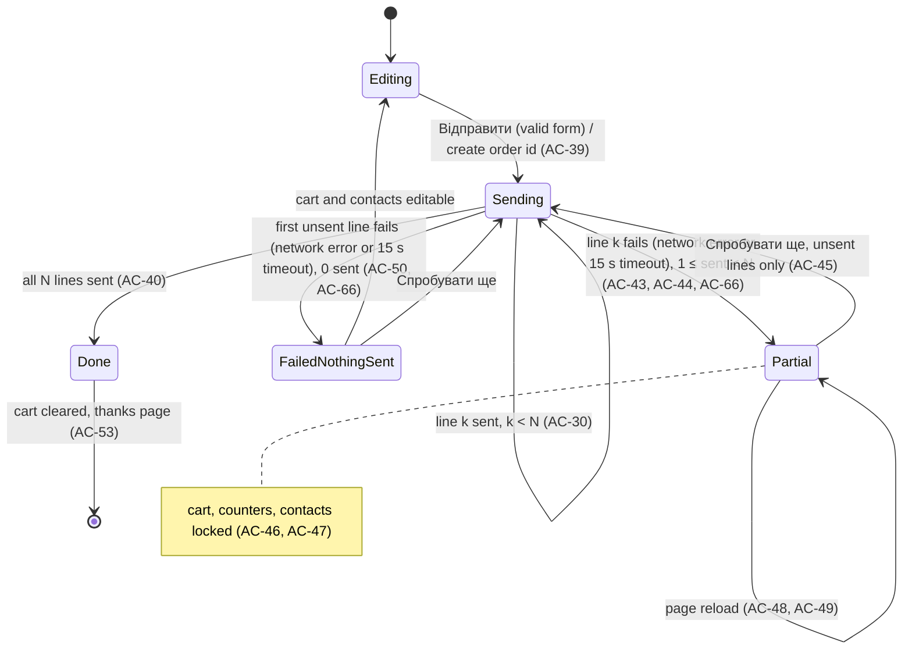

# Spec: Item quantity, approximate total and one form row per order line
Spec ID: SPEC-2026-10-19-item-quantity
Status: approved
Supersedes: —

> This spec deliberately lifts the v1 rule "cart without quantity and without sum" from `docs/SPEC.md` (§2, §7, acceptance criterion 5) and `docs/DESIGN-BRIEF.md:43,115`, and replaces the single "Замовлення" text field (`docs/SPEC.md:96`) with one Google Form submission per order line. See **Changed invariants** under Workflows and contracts.

## Problem and user

**Who:**

- **Customer** — a member (or parent) of the Düsseldorf station who orders uniform items on the site.
- **Coordinator** — reads the private responses sheet, places one combined supplier order on scoutstyle.net and tells each customer how much to transfer.

**Pain:**

- A cart line is one size with no quantity (`src/lib/types.ts:60-66`); adding the same size again does nothing (`src/lib/cart.ts:35`). A parent who needs two identical shirts for two children cannot say so except by phone.
- The summary page shows no prices and no sum: "Без кількості та суми: суму повідомить координатор." (`src/i18n/uk.json:77`, `src/components/CartPage.tsx:158`), although most catalog rows carry a price (154 of 172 rows in `public/sample/catalog.csv`).
- The whole order arrives in one free-text cell, one line per item `SKU / size — name` (`src/lib/submit.ts:16-18,56`). To build a combined supplier order the coordinator must split and count these cells by hand; a pivot table in Google Sheets cannot read them.

**What they do today:** customers call or message the coordinator about extra units; the coordinator counts items across all response cells manually and computes each customer's sum by hand.

## Goals / Non-goals

### Goals

- G1: A customer can order 1–20 units of every size, from the product card and from the summary page.
- G2: The summary page shows a per-line price × quantity and an approximate order total that excludes unpriced lines and says how many lines are unpriced.
- G3: Each order line becomes its own row in the responses sheet, with a shared order id, the contacts, SKU, name, size and quantity, so that a pivot table over the raw responses sums quantities per item without any manual splitting.
- G4: The line sum (price × quantity) of each order line reaches the coordinator in a separate numeric "Сума" field on that line's row, so the order total is the SUM of the column for one order id.
- G5: A network failure in the middle of an order never forces the customer to resend lines that were already sent, and never loses the cart.
- G6: Carts saved before this feature keep working.
- G7: Every order names the child the items are for (first and last name, required), separately from the contact person, and every line row carries that name.

### Non-goals

- Exact or binding prices; the total stays approximate and the coordinator still communicates the final amount (`src/i18n/uk.json:81`, `docs/SPEC.md:99`).
- A separate unit-price field in the form. User decision (OQ-1, resolved, revised after the first live test): the form carries only the line sum in "Сума", not the unit price and not the order total.
- A "line k of N" field in the form. [NEEDS CLARIFICATION: OQ-11]
- An order-wide quantity limit (user decision: only 20 per size).
- Typing a quantity into a text box; quantity changes only through the − / + buttons. [NEEDS CLARIFICATION: OQ-10]
- Currency conversion: prices stay in hryvnia (₴) as defined in `docs/CATALOG-CSV.md:16,32`.
- Synchronising the cart between two open browser tabs. Accepted limitation, E-9.
- Detecting duplicate rows caused by a request that Google recorded but the browser reported as failed, through a network error or the 15 s timeout. Accepted limitation, E-6.
- Detecting submissions that Google silently rejects (`no-cors` hides the response, `src/lib/submit.ts:61-75`). Accepted limitation, E-7.
- Guaranteed global uniqueness of the order id. Accepted limitation, E-16.
- Server-side storage, a backend or Apps Script (`docs/SPEC.md:14-17,156`).
- Persisting the contact form (including the child's name) across a page reload (privacy rule `docs/SPEC.md:112`). User decision (OQ-6, resolved): re-entering contacts after a reload is acceptable.
- Separate name fields per child, or splitting and checking comma-separated names. User decision (OQ-14, resolved): one pair of child fields per order. For several children, the names are typed comma-separated into the same two fields and sent verbatim, with no parsing and no limit on the number of children.

## User stories

- US-1 [Must]: As a customer, I want to add a size to my order and then change its quantity with − / + on the product card, so that I can order several identical items.
- US-2 [Must]: As a customer, I want to see and change the quantity of each line on the summary page, with price × quantity per line and an approximate total, so that I know roughly what I will pay.
- US-3 [Must]: As a coordinator, I want one responses-sheet row per order line, with order id, contacts, SKU, name, size and quantity, so that a pivot table groups all orders by item and sums quantities for one combined supplier order.
- US-4 [Must]: As a coordinator, I want the sum of each line in a separate "Сума" field on that line's row, so that I can total an order by its id and tell the customer the amount without parsing text.
- US-5 [Must]: As a customer, I want a failed submission to resume from the first unsent line, so that I neither lose my order nor send lines twice.
- US-6 [Should]: As a customer, I want the "copy order text" fallback to contain the order id, quantities, prices and total, so that a manually sent order carries the same information.
- US-7 [Should]: As a returning customer, I want a cart I saved before this change to still be there, so that I don't have to pick items again.
- US-8 [Should]: As a screen-reader user, I want the − / + buttons labelled with the item and size, and quantity changes announced, so that I can use the counter without seeing it.
- US-9 [Should]: As a customer, I want the header badge, the line counts and the thanks page to reflect units, the order id and the total, so that I can check and later reference my order.
- US-10 [Should]: As the site maintainer, I want the build to fail with a clear message when `SITE_CONFIG` lacks the new form fields, so that the site never sends per-line orders to a form that cannot store them.
- US-11 [Must]: As a parent, I want to enter the first and last name of the child the items are for, separately from my own contact name, so that the coordinator knows whom the uniform is for when distributing the combined supplier order.

## Acceptance criteria (EARS)

Terms:

- **Line** — one cart entry = one SKU (size) with a quantity.
- **Quantity bounds** — integer, minimum 1, maximum 20 per line (user decision, BQ-3).
- **Line price** — the price of the line's SKU in the currently loaded catalog (live or snapshot); "unpriced" when the SKU has no price or is no longer in the catalog.
- **Approximate total** — sum over priced lines of price × quantity, rounded to 2 decimals.
- **Partial order** — an order for which at least one line was sent and at least one line is not yet sent.
- **Send failure** — a line request that rejects with a network error, or that has not finished within 15 s of being started (NFR-7, AC-66).
- Money is displayed with the existing hryvnia formatting (`src/lib/ui.ts:25-31`), e.g. "930 ₴", "24,50 ₴".

### Product card (US-1)

- AC-1 (US-1): WHEN the customer clicks "Додати до замовлення" for a selected size that is not in the cart, the UI shall add that size to the cart with quantity 1. · Verify: e2e — observable: the card shows the counter "− 1 +" and the header badge grows by 1
- AC-2 (US-1): WHILE the selected size is in the cart, the card shall show the counter "− N +" (N = that line's quantity) and the "Прибрати" button in place of the "Додати до замовлення" button. · Verify: e2e — observable: counter with the current quantity and "Прибрати" visible, add button absent
- AC-3 (US-1, US-2): WHEN the customer clicks "+" on a counter whose quantity is below 20, the UI shall increase that line's quantity by exactly 1 per click. · Verify: unit — observable: three clicks from 1 show 4
- AC-4 (US-1, US-2): WHEN the customer clicks "−" on a counter whose quantity is 2 or more, the UI shall decrease that line's quantity by exactly 1. · Verify: unit — observable: quantity 3 becomes 2
- AC-5 (US-1, US-2): WHILE a line's quantity is 1, the UI shall show "−" as disabled and keep the quantity at 1 when it is clicked. · Verify: e2e — observable: "−" has disabled state, quantity stays 1, the line stays in the cart
- AC-6 (US-1, US-2): WHILE a line's quantity is 20, the UI shall show "+" as disabled and keep the quantity at 20 when it is clicked. · Verify: e2e — observable: "+" disabled, quantity stays 20
- AC-7 (US-1): WHEN the customer clicks "Прибрати" on the card, the UI shall remove that size from the cart whatever its quantity. · Verify: e2e — observable: "Додати до замовлення" visible again, header badge decreases by the removed quantity
- AC-8 (US-1): The UI shall keep a separate quantity for each size of the same product. · Verify: unit — observable: M ×2 and L ×1 of one product appear as two lines with quantities 2 and 1
- AC-9 (US-1): WHEN a size is selected on the card, the card shall show the price of that size, or no price line when that size has no price. · Verify: e2e — observable: selecting a size with a different price changes the shown price
- AC-10 (US-1): WHILE no size is selected on the card, the card shall show the price of the first size that has a price (current behaviour, `src/components/ProductCard.tsx:15,51-55`). · Verify: unit — observable: price text of the first priced variant
- AC-11 (US-1): WHILE a size is in the cart with quantity N ≥ 2, its size chip shall read "✓ {size} ×N"; with quantity 1 it shall read "✓ {size}". · Verify: e2e — observable: chip text "✓ M ×2"
- AC-12 (US-1): The UI shall allow quantities up to 20 for sizes with stock "немає" and "під замовлення" and keep their status marks unchanged. · Verify: unit — observable: a "під замовлення" line can reach 20 and still shows the status badge on the summary page

### Accessibility (US-8)

- AC-13 (US-8): The UI shall give the counter buttons the accessible names "Зменшити кількість: {name}, {size}" and "Збільшити кількість: {name}, {size}". · Verify: unit — observable: buttons found by these accessible names
- AC-14 (US-8): WHEN a line's quantity changes, the UI shall announce "Кількість: N" in the existing live region (`src/lib/live.ts`). · Verify: unit — observable: live region text "Кількість: 3"
- AC-15 (US-8): WHILE a size is in the cart, the size chip's accessible name shall include its quantity (for example "M, в наявності, у замовленні: 2"). · Verify: unit — observable: chip accessible name contains "у замовленні: 2"

### Summary page (US-2, US-9)

- AC-16 (US-2): The summary page shall show, on each line, the same counter as the card, following AC-3 to AC-6. · Verify: e2e — observable: changing a quantity on the summary page shows the new quantity on the product card after navigating back
- AC-17 (US-2): WHILE a line is priced, the summary page shall show "{price} × N = {line total}" on that line. · Verify: unit — observable: "930 ₴ × 2 = 1 860 ₴"
- AC-18 (US-2): WHILE a line is unpriced, the summary page shall show "Ціна невідома" on that line. · Verify: unit — observable: the text "Ціна невідома" on that line
- AC-19 (US-2): WHILE at least one line is priced, the summary page shall show "Разом орієнтовно: X ₴" with X equal to the approximate total. · Verify: unit — observable: lines 930 ₴ ×2 and 24,50 ₴ ×1 give "Разом орієнтовно: 1 884,50 ₴"
- AC-20 (US-2): WHILE at least one line is unpriced and at least one is priced, the summary page shall show "N позицій без ціни, остаточну суму повідомить координатор" below the total (N with the correct plural form). · Verify: unit — observable: "1 позиція без ціни, остаточну суму повідомить координатор"
- AC-21 (US-2): WHILE no line is priced, the summary page shall show "Ціни невідомі, суму повідомить координатор" instead of the total. [NEEDS CLARIFICATION: OQ-4] · Verify: unit — observable: that text present and no "Разом орієнтовно"
- AC-22 [Should] (US-2): WHILE the approximate total is shown, the summary page shall also show "Разом орієнтовно: X ₴" in the payment details block. · Verify: e2e — observable: the same amount appears inside "Куди та як платити"
- AC-23 (US-2): WHEN the summary page computes line prices, it shall use the prices of the currently loaded catalog, and IF a line's SKU is not in that catalog THEN it shall treat the line as unpriced. · Verify: unit — observable: a price change in the catalog changes the shown line total; a removed SKU shows "Ціна невідома"
- AC-24 (US-9): The summary page panel heading shall read "Позицій: N · штук: M", where N is the number of lines and M the sum of quantities. · Verify: unit — observable: "Позицій: 2 · штук: 3"
- AC-25 (US-9): The header cart badge shall show the sum of quantities of all lines, and its accessible name shall say the number of units. · Verify: e2e — observable: badge "3" after adding M ×2 and L ×1
- AC-26 (US-2): WHEN the customer clicks "Прибрати" on a summary line, the UI shall remove that line whatever its quantity (current behaviour, `src/components/CartPage.tsx:78-81`). · Verify: e2e — observable: line disappears, counts update

### Persistence and compatibility (US-7)

- AC-27 (US-1, US-2): WHEN the page is reloaded, the UI shall show every line with the quantity it had before the reload. · Verify: e2e — observable: quantity 3 still shown after reload
- AC-28 (US-7): WHEN a cart saved before this feature is loaded, the UI shall show each of its lines with quantity 1. · Verify: unit — observable: a stored cart without quantities shows each line with "1"
- AC-29 (US-7): IF a stored quantity is not an integer from 1 to 20, THEN the UI shall show quantity 1 for values that are missing, not a number or below 1, and 20 for values above 20. · Verify: unit — observable: stored "abc" → 1, 0 → 1, 2.5 → 1, 99 → 20

### Submission: one form row per line (US-3, US-4)

- AC-30 (US-3): WHEN the customer clicks "Відправити" with a valid contact form, the UI shall send one form submission per cart line, one at a time, in cart order. · Verify: integration — observable: a cart with 3 lines produces 3 POST requests to the form address, each started after the previous one finished
- AC-31 (US-3): Each line submission shall carry the contact fields and the consent value exactly as today's single submission does (`src/lib/submit.ts:47-58`). · Verify: unit — observable: every request body has the same first name, last name, phone, station, ulad, optional unit and consent values
- AC-32 (US-3): Each line submission shall carry the order id, the line's SKU, the product name, the size and the quantity in their configured form fields. · Verify: unit — observable: request body fields for order id, SKU, name, size, quantity are present and match the line
- AC-33 (US-3): Each line submission shall send the quantity as a plain integer with no unit or other characters. · Verify: unit — observable: quantity value is an integer string from "1" to "20", e.g. "2"
- AC-34 (US-3): Each line submission shall send the product name from the currently loaded catalog, and IF the SKU is no longer in the catalog THEN the name stored in the cart. · Verify: unit — observable: name field equals the catalog name, or the stored name for a missing SKU
- AC-35 (US-4): WHERE the "Сума" form field is configured, WHILE a line is priced, the UI shall send that line's sum (price × quantity) in that field on that line's submission. · Verify: unit — observable: each request for a priced line has its own line sum, e.g. "1860" for 930 × 2; the order total is never sent
- AC-36 (US-4): IF a line is unpriced, THEN its submission shall not carry the "Сума" field. [NEEDS CLARIFICATION: OQ-4] · Verify: unit — observable: the request body of an unpriced line has no total field
- AC-37 (US-4): The "Сума" value shall be written as digits without currency symbol and without thousands separator, with a decimal comma and at most 2 decimals. (Non-critical: the total is approximate, see OQ-3, resolved.) · Verify: unit — observable: 1884.5 → "1884,5"; 1860 → "1860"
- AC-38 (US-3): No line submission shall carry the legacy "Замовлення" text field. · Verify: unit — observable: no request body contains the configured legacy order field
- AC-39 (US-3): WHEN the customer first clicks "Відправити" for an order, the UI shall create one order id in the format `YYYYMMDD-XXXX` (device local date, 4 characters from the digits 2–9 and the capital Latin letters without I, L, O), and shall send that same id on every line and on every retry of that order. [NEEDS CLARIFICATION: OQ-2] · Verify: unit — observable: all requests of one order, including retries, carry the same id matching `^[0-9]{8}-[2-9A-HJKMNP-Z]{4}$`
- AC-40 (US-3): WHEN all line submissions of an order have finished without a send failure, the UI shall clear the cart and show the thanks page (current behaviour, `src/components/CartPage.tsx:53-58`). · Verify: e2e — observable: thanks page visible, header badge 0
- AC-41 (US-3): The rows that one order creates in the responses sheet shall let a pivot table with rows "Назва" and "Розмір" (or "SKU") and value SUM of "Кількість" give the total units per item without further editing. · Verify: manual — observable: in the Google Sheets UI the pivot of two test orders shows the summed quantity per item (third-party UI, not automatable here)
- AC-42 (US-3): WHILE an order is being sent, the submit button shall read "Відправляємо… K з N" (K = lines sent, N = lines in the order) and further clicks shall not start another send. [NEEDS CLARIFICATION: OQ-7] · Verify: e2e — observable: button text "Відправляємо… 1 з 3"; a double click produces no extra requests

### Partial failure and resume (US-5)

- AC-43 (US-5): IF a line submission ends in a send failure, THEN the UI shall not send the remaining lines of that attempt. · Verify: integration — observable: with request 2 of 3 failing, request 3 is not made
- AC-44 (US-5): IF a line submission ends in a send failure, THEN the UI shall show the alert "Відправлено K з N позицій. Номер замовлення: {id}" with the buttons "Спробувати ще" and "Скопіювати текст замовлення". · Verify: e2e — observable: alert text "Відправлено 1 з 3 позицій. Номер замовлення: 20261019-7KQX"
- AC-45 (US-5): WHEN the customer clicks "Спробувати ще", the UI shall send only the lines that were not yet sent, starting with the first unsent line. · Verify: integration — observable: after line 2 of 3 failed, the retry sends lines 2 and 3 only, with the same order id
- AC-46 (US-5): WHILE an order is partial, the summary page shall disable the quantity counters, the "Прибрати" buttons and the contact fields, including the child's name fields. · Verify: e2e — observable: these controls have disabled state
- AC-47 (US-5): WHILE an order is partial, the product cards shall disable "Додати до замовлення", the counters and "Прибрати", and show "Спершу завершіть відправлення замовлення". [NEEDS CLARIFICATION: OQ-5] · Verify: e2e — observable: note visible on cards, controls disabled
- AC-48 (US-5): WHEN the page is reloaded while an order is partial, the summary page shall show the alert from AC-44 with the same order id and the same K and N. · Verify: e2e — observable: after reload the alert shows "Відправлено 1 з 3 позицій" and the same id
- AC-49 (US-5): WHILE an order is partial after a page reload, the summary page shall show the contact fields (including the child's name) empty and editable, and "Спробувати ще" shall require a valid contact form. (User decision, OQ-6 resolved.) · Verify: e2e — observable: retry with empty fields shows the field errors and sends nothing
- AC-66 (US-5): IF a line request has not finished within 15 s of being started, THEN the UI shall stop waiting for it and treat that line as not sent: it stops the attempt at that line (AC-43), shows "Відправлено K з N позицій" (AC-44), and "Спробувати ще" resends that line and the later unsent lines only (AC-45). · Verify: integration — observable: with request 2 of 3 never answering, the alert "Відправлено 1 з 3 позицій" appears 15 s after request 2 started, request 3 is not made, and the retry starts with line 2
- AC-50 (US-5): IF the first line submission of an attempt ends in a send failure before any line of the order was sent, THEN the UI shall keep the cart and the contact fields editable and shall not clear the cart (current behaviour, `docs/SPEC.md:97`). · Verify: e2e — observable: counters and fields enabled, cart unchanged
- AC-51 (US-5): IF the stored partial-order state is unreadable or its order id does not match the AC-39 format, THEN the UI shall discard it and treat the cart as not yet sent. · Verify: unit — observable: corrupted state → no partial alert, controls enabled

### Copy text (US-6)

- AC-52 (US-6): WHEN the customer clicks "Скопіювати текст замовлення", the UI shall copy the text in the format given in **Copy text format** (order id, one line per item with quantity and price, approximate total, contacts). · Verify: unit — observable: clipboard text equals the documented example for the example cart

### Thanks page (US-9)

- AC-53 (US-9): WHEN the thanks page opens after a successful order, it shall show "Замовлення {id} · N {позиція|позиції|позицій}, M шт. · координатор зателефонує на {phone}". [NEEDS CLARIFICATION: OQ-9] · Verify: e2e — observable: thanks text contains the order id and both counts
- AC-54 (US-9): WHILE the sent order had at least one priced line, the thanks page shall show "Разом орієнтовно: X ₴". · Verify: e2e — observable: the amount shown equals the summary page total

### Configuration (US-10)

- AC-55 (US-10, US-11): IF `SITE_CONFIG` lacks any of the form fields order id, SKU, name, size, quantity, child first name or child last name, THEN the build shall fail with a message naming each missing field (existing behaviour of the config check, `scripts/write-config.ts:26-29`, `docs/SPEC.md:106`). · Verify: integration — observable: build exits non-zero and prints `form.fields.<key>: Required` for each missing key
- AC-56 (US-10): The config check shall accept a `SITE_CONFIG` that still contains the legacy order field and one that omits the "Сума" field. · Verify: unit — observable: both configs pass validation

### Child's name (US-11)

Today the form has only the contact person's first and last name, under the heading "Ваші контакти" (`src/i18n/uk.json:86-88`, `src/lib/submit.ts:5-13`). Code and docs have no notion of a child or wearer: `docs/SPEC.md:68,84` list the contact fields only, and `docs/SPEC.md:116` only says that parental consent is not required. The new fields are added next to the contact fields; the existing ones keep their meaning (the contact person).

- AC-57 (US-11): The contact form on the summary page shall show two required text fields, "Ім'я дитини" and "Прізвище дитини", separate from the existing "Ім'я" and "Прізвище" fields, once per order (user decisions OQ-13, OQ-14, resolved). · Verify: e2e — observable: both labelled fields visible, empty by default
- AC-64 (US-11): The contact form shall show, with the child's name fields, the hint "Якщо замовляєте для себе, вкажіть своє ім'я. Для кількох дітей вкажіть імена через кому." · Verify: unit — observable: hint text visible next to the child's name fields and linked to them as their description
- AC-65 (US-11): WHEN the child's name fields contain commas (several children, e.g. "Олена, Іван" / "Коваль, Коваль"), the UI shall accept them without splitting, reordering, counting or comparing the parts, and shall send each value verbatim except for trimming the outer whitespace. · Verify: unit — observable: "Олена, Іван" is sent as "Олена, Іван" on every line; "Олена, Іван" with last name "Коваль" passes validation
- AC-58 (US-11): The UI shall not prefill or copy the child's name fields from the contact person's name. · Verify: unit — observable: after typing the contact name, both child fields stay empty
- AC-59 (US-11): IF "Ім'я дитини" is empty or contains only whitespace, THEN the UI shall show "Вкажіть ім'я дитини" under the field, at the same moment as the other field errors (after the field loses focus or after "Відправити", `src/components/CartPage.tsx:26`). · Verify: unit — observable: input "   " then blur shows "Вкажіть ім'я дитини" and the field is marked invalid
- AC-60 (US-11): IF "Прізвище дитини" is empty or contains only whitespace, THEN the UI shall show "Вкажіть прізвище дитини" under the field, at the same moment as the other field errors. · Verify: unit — observable: empty field after "Відправити" shows "Вкажіть прізвище дитини"
- AC-61 (US-11): IF either child's name field is empty or whitespace only, THEN the UI shall send no line submission and shall announce "Перевірте поля форми" (current behaviour for invalid forms, `src/components/CartPage.tsx:45-48`). · Verify: integration — observable: zero POST requests, live region text "Перевірте поля форми"
- AC-62 (US-11, US-3): Each line submission shall carry the child's first name and last name, with leading and trailing whitespace removed, in their configured form fields. · Verify: unit — observable: input "  Олеся " is sent as "Олеся" on every line of the order
- AC-63 [Should] (US-11): The Datenschutzerklärung page shall list the child's first and last name among the data the order form collects (requirement on the policy content, `docs/SPEC.md:113`). · Verify: unit — observable: the privacy page text names the child's name as collected data

## Edge cases

| ID | Case | Source | Outcome |
|---|---|---|---|
| E-1 | Cart saved before the feature (no quantity) | design analysis; `src/lib/cart.ts:8-16` | Lines load with quantity 1 → AC-28 |
| E-2 | Stored quantity edited or corrupted (text, 0, fractions, 99) | design analysis | Normalised → AC-29 |
| E-3 | Rapid repeated clicks on "+" / "−" | design analysis | One step per click, bounded → AC-3, AC-4, AC-6 |
| E-4 | Double click on "Відправити" | design analysis; existing guard `src/components/CartPage.tsx:45` | No second send → AC-42 |
| E-5 | Network error in the middle of an order | user (BQ-1 revision) | Stop, report K of N, resume unsent lines → AC-43, AC-44, AC-45 |
| E-6 | Google recorded a line but the browser reported a send failure (network error, or the 15 s timeout fired after the request had already reached Google); retry duplicates that row | design analysis; `no-cors` (`src/lib/submit.ts:61-64`) | Accepted limitation: cannot be detected client-side; the coordinator removes duplicates by order id + SKU (unique within an order, AC-8, AC-39). Repeated in Non-goals |
| E-7 | Google silently rejects a line (form closed, a required question not sent, response validation failed) | `docs/SPEC.md:97`; design analysis | Accepted limitation: invisible under `no-cors`; mitigated by the Google Form change checklist (no validation, legacy question not required). Repeated in Non-goals |
| E-8 | Page reload or browser closed while partial | user (BQ-1 revision) | Partial state survives → AC-48, AC-49 |
| E-9 | Cart open in two tabs | design analysis; no cross-tab sync in `src/lib/cart.ts` | Accepted limitation (user accepted default): the last write wins. Repeated in Non-goals |
| E-10 | SKU removed from the catalog while in the cart | design analysis | Line kept, unpriced, sent with stored name → AC-23, AC-34 |
| E-11 | Price changed between adding and sending | design analysis | Current catalog price is used → AC-23 |
| E-12 | No line has a price | design analysis | Special text, no "Сума" → AC-21, AC-36 |
| E-13 | Fractional prices (`930.50`, `docs/CATALOG-CSV.md:16`) | `docs/CATALOG-CSV.md` | Rounded to 2 decimals → AC-19, AC-37 |
| E-14 | Quantity > 1 for "немає" / "під замовлення" | design analysis | Allowed, badge kept → AC-12 |
| E-15 | A request hangs without failing | design analysis; user (OQ-8 decision) | After 15 s it counts as a send failure: stop, report K of N, resume unsent lines → AC-66, NFR-7. A late-recorded row may duplicate on retry → E-6 |
| E-16 | Two orders get the same order id | design analysis | Accepted limitation: about 1 in 920 000 for two orders created on the same day (31^4 combinations); the coordinator can still tell them apart by contacts. Repeated in Non-goals |
| E-17 | Site deployed with a new `SITE_CONFIG` before the Google Form was changed | design analysis | Prevented by the rollout order in **Google Form change checklist**; missing config keys → AC-55; legacy config accepted → AC-56 |
| E-18 | Retry after reload when some lines were already sent | design analysis | Each line carries its own "Сума", so a resent line is complete and sent lines are not resent → AC-35, AC-45 |
| E-19 | Several sizes of one product | design analysis | Separate lines and quantities → AC-8 |
| E-20 | Large cart (many lines) | design analysis | No line limit; sending is sequential with visible progress → AC-30, AC-42 |
| E-21 | Child's name entered as spaces only, or with surrounding spaces | user (child-name requirement) | Treated as empty → AC-59, AC-60, AC-61; otherwise trimmed → AC-62 |
| E-22 | An adult member orders for themselves (no child) | `docs/DESIGN-BRIEF.md:9` (users aged 14 to 60+) | The fields stay required; the hint tells the person to enter their own name → AC-57, AC-64 (OQ-13 resolved) |
| E-23 | One parent orders for several children | user (OQ-14 decision) | One order; the names are typed comma-separated in the same two fields and sent verbatim on every line → AC-64, AC-65 |
| E-25 | Comma lists of different lengths or odd commas ("Олена, Іван" / "Коваль", "Олена,") | user (OQ-14 decision) | Accepted as typed, no parsing or consistency check; only blank values fail → AC-59, AC-60, AC-65 |
| E-24 | Child's name the same as the contact name | design analysis | Allowed, no comparison check → AC-58 |

## Workflows and contracts

### Submission states



### Communication with Google

```mermaid
sequenceDiagram
  participant C as Customer
  participant S as Site (browser)
  participant L as Browser storage
  participant G as Google Form formResponse
  participant R as Responses sheet
  C->>S: Відправити
  S->>L: save order id, 0 of N sent
  loop each unsent line, in cart order (AC-30)
    S->>G: POST line k (contacts, order id, SKU, name, size, quantity, Сума = line sum)
    Note over S,G: no-cors, response invisible; success = finished within 15 s without network error
    G-->>R: one row (fire-and-forget from the site's view)
    alt network error or no finish within 15 s (AC-66)
      S->>L: keep k-1 of N sent (AC-43)
      S-->>C: "Відправлено k-1 з N позицій" + retry / copy (AC-44)
    else ok
      S->>L: mark line k sent
    end
  end
  S->>L: clear cart and partial state (AC-40)
  S-->>C: thanks page with order id (AC-53)
```

### Contract: one line submission

`POST {form.action}`, `application/x-www-form-urlencoded`, `mode: no-cors` (unchanged transport, `src/lib/submit.ts:65-75`). One request per line.

| Form field (config key) | Value | Sent on | Change | AC |
|---|---|---|---|---|
| `firstName`, `lastName`, `phone`, `station`, `uladh` | trimmed contact values | every line | unchanged values, now repeated per line | AC-31 |
| `unit` | trimmed text | every line, only when not empty | unchanged | AC-31 |
| `consent` | `consentValue` | every line | unchanged | AC-31 |
| `childFirstName`, `childLastName` | trimmed child's name | every line (rows stay self-contained) | new, required | AC-62 |
| `orderId` | `YYYYMMDD-XXXX` | every line | new, required | AC-32, AC-39 |
| `sku` | line SKU | every line | new, required | AC-32 |
| `itemName` | product name (catalog, else stored) | every line | new, required | AC-32, AC-34 |
| `size` | line size | every line | new, required | AC-32 |
| `quantity` | integer 1–20 | every line | new, required | AC-32, AC-33 |
| `total` ("Сума") | line sum, e.g. `1860` | every line that is priced | new, optional in config | AC-35, AC-36, AC-37 |
| `order` ("Замовлення") | — | never | no longer sent; key accepted but unused | AC-38, AC-56 |

Error cases: only send failures are observable, i.e. a network error (fetch rejects) or no finish within 15 s → AC-43, AC-44, AC-66. A timed-out request may still have been recorded → E-6. Google-side rejections are not observable → E-7.

### Contract: `SITE_CONFIG.form.fields`

Shape relative to `src/lib/config.ts:12-21`:

| Key | Before | After |
|---|---|---|
| `firstName`, `lastName`, `phone`, `station`, `uladh`, `unit`, `consent` | required string | unchanged |
| `order` | required string | optional string, ignored |
| `orderId`, `sku`, `itemName`, `size`, `quantity`, `childFirstName`, `childLastName` | — | required non-empty strings (`entry.*` ids) |
| `total` | — | optional non-empty string (`entry.*` id) |

Missing required keys fail the build (AC-55); a legacy config with `order` and without `total` validates (AC-56). The key names above are the proposed public names for `SITE_CONFIG` maintainers.

### Contract: stored cart line

Relative to `CartItem` (`src/lib/types.ts:60-66`): each stored line gains a quantity (integer 1–20). A stored line without a quantity means 1 (AC-28); invalid values are normalised (AC-29). The browser additionally keeps the partial-order state (order id and which lines are sent) until the order is done (AC-48, AC-51); it holds no contact data and no child's name (NFR-4, OQ-6 resolved). Storage layout is left to the plan.

### Copy text format

Used by "Скопіювати текст замовлення" (AC-52). Replaces the current format (`src/lib/submit.ts:21-25`). Example for a cart with a priced shirt ×2 and an unpriced cap ×1:

```text
Замовлення: 20261019-7KQX
UPP-SHIRT-M / M — Сорочка УПП × 2 · 930 ₴ = 1 860 ₴
UPP-CAP-ONE / one size — Пілотка × 1 · ціна невідома
Разом орієнтовно: 1 860 ₴ (1 позиція без ціни)
Ім'я дитини: Олена, Іван
Прізвище дитини: Коваль, Коваль

Прізвище Ім'я, +49 151 0000000
Düsseldorf, УПН, курінь
```

Rules:

- The order id line is present once an order id exists (after the first "Відправити"). Before that the header reads "Замовлення:" without an id.
- The total line is omitted when no line is priced, and the parenthesis is omitted when every line is priced.
- The lines "Ім'я дитини: {value}" and "Прізвище дитини: {value}" follow the item block, each with the field value verbatim (trimmed, commas kept, AC-65). They are two lines rather than one combined name, because comma lists for several children can't be paired reliably. A line is omitted while its field is still empty.
- The contacts block is unchanged from today.

### Google Form change checklist (done by the coordinator before deploying)

1. In the Google Form add short-answer questions: "Номер замовлення", "Ім'я дитини", "Прізвище дитини", "SKU", "Назва", "Розмір", "Кількість", "Сума". Leave all eight **without response validation** and not required. The site enforces the required child's name itself (AC-59…AC-61). A Google-side rejection is invisible to the site (E-7).
2. Make the existing "Замовлення" question **not required**. Every new submission omits it (AC-38), and Google rejects submissions that miss a required question. Keep the question so that old responses stay in their column. [NEEDS CLARIFICATION: OQ-12]
3. Read the `entry.*` ids of the new questions (pre-filled link) and add them to `SITE_CONFIG.form.fields` as `orderId`, `childFirstName`, `childLastName`, `sku`, `itemName`, `size`, `quantity`, `total`.
4. Deploy. Steps 1–2 must be done before step 3 reaches the live site.
5. In the responses sheet, build the pivot table: rows "Назва", "Розмір"; values SUM of "Кількість"; optional filter on the timestamp. The sheet locale does not matter for "Сума": the value is approximate, and a fractional total read as text is acceptable (OQ-3, resolved).

Old rows (one per order, with "Замовлення" text) and new rows (one per line) coexist in the same sheet. The pivot covers only rows where "Кількість" is filled.

The columns "Ім'я дитини" and "Прізвище дитини" may hold comma-separated names for several children (AC-65). Grouping by item ("Назва", "Розмір", SUM of "Кількість") is unaffected, because quantities are per line, not per child. Grouping by child name gives one group per typed combination (e.g. "Олена, Іван").

### Changed invariants

| Invariant | Source | Change |
|---|---|---|
| Cart line has no quantity and no sum | `docs/SPEC.md` §2, §7, AC 5; `docs/DESIGN-BRIEF.md:43,115` | Lifted: quantity 1–20 and approximate total (AC-1…AC-25) |
| "Без кількості та суми" note on the summary page | `src/i18n/uk.json:77` | Replaced by the total and its notes (AC-19…AC-21) |
| One submission per order with an "Замовлення" text field | `docs/SPEC.md:68,96` | One submission per line; the text field is no longer sent (AC-30, AC-38) |
| Header badge counts lines | `src/components/Layout.tsx:17` | Counts units (AC-25) |
| On failure: cart kept, retry or copy | `docs/SPEC.md:97` | Kept and extended with resume of unsent lines (AC-43…AC-50) |
| Amount is told by the coordinator | `docs/SPEC.md:99`, `src/i18n/uk.json:81` | Kept: the total is labelled approximate |
| localStorage only for the cart, no personal data | `docs/SPEC.md:112` | Kept: the partial-order state holds no contact data and no child's name (NFR-4) |
| Form fields: contact first and last name, phone, station, ulad, unit, consent | `docs/SPEC.md:68,84,95`, `src/lib/submit.ts:5-13` | Extended: the child's first and last name are added as required fields (AC-57…AC-62) |
| Privacy policy lists the collected data | `docs/SPEC.md:113` | Extended: it also lists the child's name (AC-63) |
| All UI texts in `src/i18n/uk.json` | `docs/SPEC.md:24,150` | Kept (NFR-3) |

## Non-functional requirements

- NFR-1: The UI shall start at most one line submission at a time for an order. (Deterministic order makes "K of N" and resume well-defined.)
- NFR-2: The UI shall recompute line totals, the approximate total, counts and the header badge in the same update as the quantity change, without a page reload.
- NFR-3: The UI shall take every new visible text from `src/i18n/uk.json`. The existing lint that rejects Cyrillic string literals in components (`docs/SPEC.md:150`) shall pass.
- NFR-4: The UI shall store no contact data (name, phone, station, ulad, unit, child's first and last name) in browser storage.
- NFR-5: The counter controls shall be operable by keyboard alone (Tab to reach, Enter / Space to activate) and shall expose their disabled state to assistive technology.
- NFR-6: The site shall keep working without a backend: all new behaviour runs in the browser and talks only to the existing form address (`docs/SPEC.md:14-17`).
- NFR-7: The UI shall wait at most 15 s for each line request, counted from the start of that request, with one constant for all lines (user decision, OQ-8).

## Inputs and provenance

### Sources of this spec

- User text: the original request, the answers to BQ-1 (revised), BQ-2, BQ-3 and BQ-4, the accepted UX proposals and the accepted defaults, all relayed by the main session.
- Docs: `README.md`, `docs/SPEC.md`, `docs/CATALOG-CSV.md`, `docs/DESIGN-BRIEF.md`, `specs/README.md`, `specs/SPEC-2026-10-18-ulad-classifier.md` (unrelated, checked for overlap).
- Code: `src/lib/cart.ts`, `src/lib/submit.ts`, `src/lib/types.ts`, `src/lib/ui.ts`, `src/lib/lastOrder.ts`, `src/lib/config.ts`, `src/lib/live.ts`, `src/components/ProductCard.tsx`, `src/components/CartPage.tsx`, `src/components/ThanksPage.tsx`, `src/components/Layout.tsx`, `src/components/PaymentDetails.tsx`, `scripts/write-config.ts`, `config.example.json`, `src/i18n/uk.json`, `public/sample/catalog.csv`, `tests/submit.test.ts`.
- No design files (Figma or exports) were supplied.

### Inputs the feature consumes

| Input | Origin | Deterministic | Produced by → consumed by |
|---|---|---|---|
| Quantity clicks | user | yes | card / summary page → cart |
| Stored cart lines with quantity | browser storage | yes | cart → card, summary, header, submission |
| Partial-order state (order id, sent lines) | browser storage | yes | submission → summary, cards |
| Prices, names, sizes, SKUs | catalog CSV (coordinator), live or snapshot | yes | catalog loader → card, summary, submission |
| Contact fields, including the child's first and last name | user | yes | contact form → submission, copy text |
| Order id | generated in the browser | no (random part, device date) | submission → form rows, alert, copy text, thanks page |
| Form `entry.*` ids, form address | `SITE_CONFIG` (maintainer) | yes | build → submission |
| Send outcome | network (fetch resolves / rejects) | no | browser → submission state |

## Untrusted inputs

| Input | Treatment | AC |
|---|---|---|
| Stored cart (browser storage, editable by the user or by other scripts on the origin) | Parsed defensively. Lines without a string SKU are dropped (current behaviour, `src/lib/cart.ts:12`), and quantities are normalised to 1–20 | AC-28, AC-29 |
| Stored partial-order state | Discarded when unreadable or when the order id doesn't match the format | AC-51 |
| Contact free text (name, station, unit) | Validated as today (`src/lib/submit.ts:36-45`). Sent only as URL-encoded form values, and rendered through React's escaping in the copy text and the thanks page | AC-31, AC-52 |
| Child's first and last name (free text, personal data of a minor) | Required and non-blank, trimmed, sent only as URL-encoded form values, never stored in the browser | AC-59…AC-62, NFR-4 |
| Catalog values (name, size, SKU, price), coordinator-controlled but fetched at runtime | Invalid prices are rejected by the catalog check (`src/lib/catalog.ts:96-101`). Values are sent as data in URL-encoded fields and never interpreted | AC-23, AC-32, AC-34 |
| Quantity | Changed only through bounded buttons; there is no free text entry | AC-3…AC-6 |

## Open questions

- OQ-1 — **Resolved (user decision):** revised after the first live test: no unit-price field and no order total in the form. Each line carries order id, contacts, SKU, name, size, quantity and its own line sum in "Сума" (price × quantity, empty when unpriced). The order total is the SUM of "Сума" per order id; the total stays visible on the summary page and in the copy text.
- OQ-2: Order id format. — Default taken: `YYYYMMDD-XXXX` (device local date + 4 characters from an alphabet without lookalikes). It is short enough to read out on the phone, and the date helps the coordinator filter.
- OQ-3 — **Resolved (user decision):** the number format of "Сума" is non-critical, because the sum is approximate anyway. The default stands: decimal comma, no thousands separator, no currency symbol (AC-37).
- OQ-4: All lines unpriced. — Default taken: show "Ціни невідомі, суму повідомить координатор" and send no "Сума", rather than a misleading "0 ₴".
- OQ-5: Lock product cards while an order is partial. — Default taken: yes. Otherwise new items could join a half-sent order with an inconsistent total.
- OQ-6 — **Resolved (user decision):** re-entering the contacts (including the child's name) after a reload during a partial order is acceptable. Contacts are not stored in the browser (`docs/SPEC.md:112`), and the coordinator matches the rows by order id.
- OQ-7: Progress text "Відправляємо… K з N" while sending. — Default taken: yes. Sending is sequential and may take several seconds for large carts.
- OQ-8 — **Resolved (user decision):** 15 s timeout per line request. A timeout is treated like a network failure (AC-66, NFR-7).
- OQ-9: Thanks page content. — Default taken: show the order id, the line and unit counts and the approximate total, so that the customer can quote the id to the coordinator.
- OQ-10: Quantity only through − / + (no typing). — Default taken: yes. It is enough for a maximum of 20 and removes invalid input.
- OQ-11: Should the per-line rows also carry "line k of N" to let the coordinator check completeness? — Default taken: no new field. Completeness can be checked by counting the rows per order id against the copy text or the customer's call.
- OQ-12: Delete or keep the "Замовлення" question in the Google Form. — Default taken: keep it as not required, so that old responses stay readable in their column.
- OQ-13 — **Resolved (user decision):** labels "Ім'я дитини" and "Прізвище дитини". The hint "Якщо замовляєте для себе, вкажіть своє ім'я" is extended with the comma rule from OQ-14 (AC-64). The fields stay required in every case.
- OQ-14 — **Resolved (user decision):** one pair of child fields per order. For several children the user types the names comma-separated in the same two fields. The values are sent verbatim (trimmed) on every line, with no splitting and no max-children logic (AC-65).

## Design analysis

| Finding | Bucket | Source | Decision | Reason |
|---|---|---|---|---|
| Card shows the first priced variant's price, not the selected one | gap | `src/components/ProductCard.tsx:15` | accepted → AC-9, AC-10 | Line totals would otherwise disagree with the card |
| Price source at send time | gap | design analysis | accepted → AC-23 | User accepted the default: the current catalog price |
| Header badge counts lines | gap | `src/components/Layout.tsx:17` | accepted → AC-25 | User accepted the default: units |
| Thanks page shows only the line count | gap | `src/components/ThanksPage.tsx:16` | accepted → AC-53, AC-54; open → OQ-9 | Order id added for reference |
| Copy text format differs from the form text | gap | `src/lib/submit.ts:16-25` | accepted → AC-52 | One documented format |
| Prices in ₴ for a German station | gap | `docs/CATALOG-CSV.md:16` | rejected → Non-goal | Outside this feature; user accepted the default |
| Old carts without quantity | corner case | `src/lib/cart.ts:8-16` | accepted → AC-28 | Backward compatibility |
| Invalid stored quantity | corner case | design analysis | accepted → AC-29 | Untrusted storage |
| Double click on + / Відправити | corner case | design analysis | accepted → AC-3, AC-42 | Deterministic steps |
| SKU removed or price changed while in cart | corner case | design analysis | accepted → AC-23, AC-34 | Stale data |
| "немає" / "під замовлення" with quantity > 1 | corner case | design analysis | accepted → AC-12 | User accepted the default |
| Two tabs | corner case | `src/lib/cart.ts` | rejected → Non-goal (E-9) | User accepted the limitation |
| Fractional prices, rounding | corner case | `docs/CATALOG-CSV.md:16` | accepted → AC-19, AC-37 | 2-decimal rounding |
| Partial failure across per-line submissions | corner case | user (BQ-1 revision) | accepted → AC-43…AC-51 | Required by the user |
| Duplicate row after an ambiguous failure | corner case | `src/lib/submit.ts:61-64` | rejected → Non-goal (E-6) | Undetectable under no-cors |
| Silent Google rejection | corner case | `docs/SPEC.md:97` | rejected → Non-goal (E-7); mitigated by the checklist | Undetectable under no-cors |
| Hanging request | corner case | design analysis | accepted → AC-66, NFR-7 (OQ-8 resolved) | User decision: 15 s timeout |
| Where "Сума" appears across per-line rows | module communication | user (BQ-1 revision) | accepted → AC-35 | Revised: every row carries its own line sum; SUM over the column per order id is the order total |
| Order id generation | module communication | user (BQ-1 revision) | accepted → AC-39; open → OQ-2 | Shared key for grouping and dedupe |
| Config schema change and legacy `order` key | module communication | `src/lib/config.ts:12-21`, `scripts/write-config.ts:26-29` | accepted → AC-55, AC-56 | Fail early, stay compatible |
| Google Form must change before deploy | module communication | design analysis | accepted → E-17, checklist | Prevents lost lines |
| Per-line price field | module communication | original request vs BQ-1 revision | accepted in revised form → AC-35 | User decision after the first live test: the line sum, not the unit price and not the order total, goes to the form |
| Approximate total with unpriced lines | UX | BQ-4 | accepted → AC-19, AC-20, AC-21 | User decision |
| "✓ M ×2" on the size chip | UX | proposal, accepted | accepted → AC-11 | Quick feedback on the card |
| Screen-reader labels and announcements | UX | proposal, accepted | accepted → AC-13, AC-14, AC-15 | Accessibility |
| Total next to payment details | UX | proposal, accepted | accepted → AC-22 | Amount visible where payment is explained |
| Progress "K з N" while sending | UX | design analysis | accepted → AC-42; open → OQ-7 | Sequential sending takes time |
| Lock cards during a partial order | UX | design analysis | accepted → AC-47; open → OQ-5 | Keeps the half-sent order consistent |
| Child's name required, separate from the contact name | gap | user (child-name requirement); no child concept in `src/lib/submit.ts:5-13`, `docs/SPEC.md:68` | accepted → AC-57…AC-62 | User decision |
| Child's name on every line row | module communication | user (child-name requirement) | accepted → AC-62, contract table | Rows stay self-contained for the pivot |
| One child vs a child per line | gap | user (child-name requirement) | accepted → AC-64, AC-65, E-23, E-25 (OQ-14 resolved) | One field pair, comma-separated names, verbatim |
| Adult ordering for themselves | corner case | `docs/DESIGN-BRIEF.md:9` | accepted → E-22, AC-57, AC-64 (OQ-13 resolved) | Hint text, fields stay required |
| Privacy policy must mention the child's name | gap | `docs/SPEC.md:113` | accepted → AC-63 | New personal data collected |
