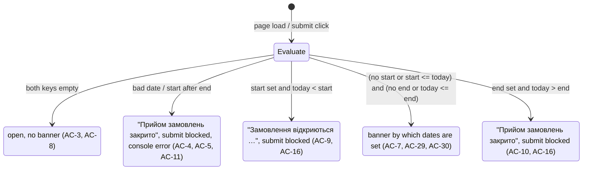
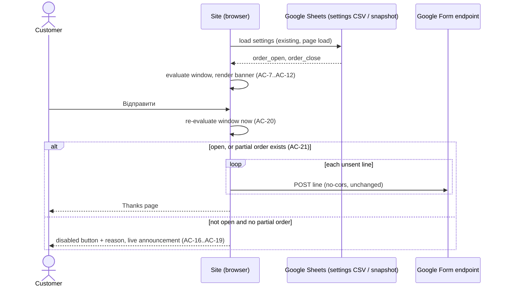
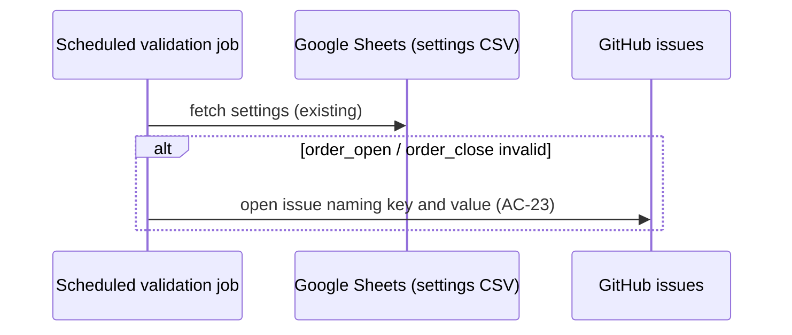

# Spec: Ordering window (open and close dates for submitting orders)
Spec ID: SPEC-2026-10-28-ordering-window
Status: approved
Supersedes: —

> This spec changes one v1 invariant: today "Відправити" always submits a valid cart (`docs/SPEC.md` §7, acceptance criterion 6). After this spec, a new order can be submitted only while the ordering window is open. It also replaces the hard-coded banner text `banner.deadline` (`src/i18n/uk.json:18`, `src/components/Layout.tsx:29`). It keeps every rule of the approved `specs/SPEC-2026-10-19-item-quantity.md`. The only addition is that a partial order may be finished outside the window (AC-21). See **Changed invariants** under Workflows and contracts.

## Problem and user

**Who:**

- **Coordinator**: collects uniform orders from the Düsseldorf station in batches and places one combined supplier order per batch (`docs/SPEC.md` §1, §11).
- **Customer**: a member or parent who builds a cart on the site and submits it (`docs/SPEC.md` §7).

**Pain:**

- The order deadline is a fixed text in the code: "⚠️ УВАГА! Замовлення приймаємо до 26 жовтня" (`src/i18n/uk.json:18`). It is shown on every page (`src/components/Layout.tsx:29`). Changing it needs a commit and a deploy, and nobody can change it from the spreadsheet.
- The deadline is only text. The site still accepts orders after the date (`src/components/OrderForm.tsx:116-152` only checks the form fields). Late orders land in the responses sheet after the supplier order has gone out.
- Today is 2026-10-28, two days after the date in the banner. The site still says "до 26 жовтня" and still accepts orders.

**What they do today:** the coordinator edits the banner text in the code and sorts out late orders by hand.

## Goals / Non-goals

### Goals

- G1: The coordinator sets the ordering window in the `settings` sheet of the catalog spreadsheet, without code changes or a deploy: a start date and an end date, or only an end date (open now, closes after that date). Every visitor sees the change after reloading the page.
- G2: While the window is open, every page shows "Відсилайте замовлення від <start> і до <end>" and orders can be submitted.
- G3: While the window is not open, customers can still browse and fill their cart, but cannot submit a new order. The banner says why: the window has not opened yet (with its start date), or it is closed.
- G4: An order whose sending already started and is partly in the responses sheet can still be finished after the window closes, under the same order number.
- G5: Invalid window dates never open ordering by accident, and the coordinator learns about them from the daily data check.

### Non-goals

- **Server-side enforcement.** The site has no backend. Orders go straight from the browser to a public Google Form endpoint (`docs/SPEC.md` §3, §14), so the window is enforced only in the site's UI. Anyone who posts to the form endpoint directly bypasses it. This is the same risk already accepted in `docs/SPEC.md` §14. (Accepted limitation, see Edge cases E10.)
- **Closing the hidden Google Form to stop orders.** The site cannot detect a closed form: with `no-cors` it never sees Google's response (`src/lib/submit.ts:95-99`). Orders sent to a closed form would look successful and be silently lost. The coordinator should control ordering only through this window. (Accepted limitation, E11.)
- **More than one window, or a schedule of future windows** (user decision, BQ-3). After the window closes, the banner does not name the next window.
- **A "N days left" countdown in the banner** (UX proposal, rejected by the user).
- **Protection against a wrong device clock.** The check uses the device's clock. (Accepted limitation, E9.)
- **Fresh window dates while Google is unreachable.** The site then uses the daily snapshot, so a window change made since the last snapshot is not visible until Google answers again. (Accepted limitation, E12.)
- **Time-of-day bounds.** The window is whole calendar days only (start of the first day to end of the last day).
- **Restricting browsing or the cart outside the window.** Adding items, changing quantities and the cart's local persistence keep working as today.

## User stories

- US-1 [Must]: As a coordinator, I want to set the start and end date of the ordering window in the `settings` sheet, so that I can open and close ordering without touching code or deploying.
- US-2 [Must]: As a customer, I want the banner to tell me the dates of the current ordering window, so that I know until when I can send my order.
- US-3 [Must]: As a customer outside the window, I want to see that ordering is not possible now (and when it opens, if known) while still being able to fill my cart, so that I can prepare my order and send it later.
- US-4 [Must]: As a coordinator, I want the site to refuse new order submissions outside the window, so that no late orders reach the responses sheet after I place the supplier order.
- US-5 [Should]: As a customer whose order was only partly sent before the window closed, I want to finish sending it under the same order number, so that the coordinator does not receive an incomplete order.
- US-6 [Should]: As a coordinator, I want the daily data check to alert me when the window dates are invalid, so that I notice that ordering is closed by mistake.

## Acceptance criteria (EARS)

### Reading the window (US-1)

- AC-1 (US-1): The UI shall take the window start date from the `settings` sheet key `order_open` and the end date from the key `order_close`. Each value is accepted as `DD.MM.YYYY` (for example `26.10.2026`, user decision), and also in the other formats already accepted for catalog `updated_at` (`YYYY-MM-DD`, `M/D/YY` or `M/D/YYYY`, see `docs/CATALOG-CSV.md` §3 and `src/lib/catalog.ts:37-47`). · Verify: unit — observable: with `order_open` = `01.11.2026` and `order_close` = `15.11.2026`, and again with `2026-11-01` / `11/15/26`, on 2026-11-05 the banner reads "Відсилайте замовлення від 01.11.2026 і до 15.11.2026".
- AC-2 (US-1): WHILE the current calendar date in the Europe/Berlin time zone is on or after the start date (when one is set) and on or before the end date (when one is set), the UI shall treat ordering as open. · Verify: unit — observable: with window 2026-11-01…2026-11-15 and the device clock set to UTC, ordering is open at 2026-10-31T23:00:00Z (00:00 on 1 Nov in Berlin) and at 2026-11-15T22:59:59Z (23:59:59 on 15 Nov in Berlin), and closed at 2026-11-15T23:00:00Z.
- AC-3 (US-1): WHILE both `order_open` and `order_close` are empty or absent, the UI shall treat ordering as open. · Verify: unit — observable: with neither key in the `settings` sheet, a valid cart is submitted and the Thanks page appears, as today.
- AC-4 (US-1): IF a non-empty value of `order_open` or `order_close` is not a valid calendar date in an accepted format, or both are set and the start date is after the end date, THEN the UI shall treat ordering as closed. · Verify: unit — observable: with `order_open` = `2026-13-01`, or with `order_open` = `2026-11-20` and `order_close` = `2026-11-10`, the submit button is disabled and the closed reason is shown.
- AC-27 (US-1): WHILE `order_open` is empty or absent and `order_close` holds a valid date, the UI shall treat ordering as open up to and including the end date (Berlin) and closed after it. · Verify: unit — observable: with only `order_close` = `2026-11-15`, ordering is open on 2026-10-28 and on 2026-11-15, and closed on 2026-11-16 (Berlin).
- AC-28 (US-1): WHILE `order_close` is empty or absent and `order_open` holds a valid date, the UI shall treat ordering as closed before the start date and open from the start date on, with no end. · Verify: unit — observable: with only `order_open` = `2026-11-01`, ordering is closed on 2026-10-31 and open on 2026-11-01 and on 2027-01-01 (Berlin).
- AC-5 (US-1): IF the window settings are invalid as described in AC-4, THEN the UI shall write an error to the browser console that names the offending key and its raw value. · Verify: unit — observable: console error output contains `order_close` and the raw cell value.
- AC-6 (US-1): WHILE the catalog is served from the saved snapshot because Google is unreachable, the UI shall evaluate the window from the `settings` stored in that snapshot. · Verify: integration — observable: with the live CSV URLs failing and a snapshot whose settings hold a window containing today, the banner shows that window's dates.

### Banner (US-2, US-3)

- AC-7 (US-2): WHILE ordering is open and both dates are set, the UI shall show, on every page, the banner text "Відсилайте замовлення від <start> і до <end>", with both dates formatted `DD.MM.YYYY` (user decision, as in `src/lib/ui.ts:27`). · Verify: e2e — observable: banner text "Відсилайте замовлення від 01.11.2026 і до 15.11.2026" visible on the catalog, cart and FAQ pages.
- AC-29 (US-2): WHILE ordering is open and only the end date is set, the UI shall show, on every page, the banner text "Відсилайте замовлення до <end>", with the date formatted `DD.MM.YYYY`. · Verify: unit — observable: with only `order_close` = `2026-11-15`, on 2026-10-28 the banner reads "Відсилайте замовлення до 15.11.2026".
- AC-30 (US-2): WHILE ordering is open and only the start date is set, the UI shall show, on every page, the banner text "Відсилайте замовлення від <start>", with the date formatted `DD.MM.YYYY`. · Verify: unit — observable: with only `order_open` = `2026-11-01`, on 2026-11-05 the banner reads "Відсилайте замовлення від 01.11.2026".
- AC-8 (US-1): WHILE both window keys are empty or absent, the UI shall show no banner. · Verify: unit — observable: no banner element in the header.
- AC-9 (US-3): WHILE the current Berlin date is before the start date of a valid window (with or without an end date), the UI shall show the banner text "Замовлення відкриються <start>", with the date formatted `DD.MM.YYYY`. · Verify: unit — observable: on 2026-10-28 with window 2026-11-01…2026-11-15, banner reads "Замовлення відкриються 01.11.2026".
- AC-10 (US-3): WHILE the current Berlin date is after the end date of a valid window (with or without a start date), the UI shall show the banner text "Прийом замовлень закрито". · Verify: unit — observable: on 2026-11-16 with window 2026-11-01…2026-11-15, banner reads "Прийом замовлень закрито".
- AC-11 (US-3): IF the window settings are invalid as described in AC-4, THEN the UI shall show the banner text "Прийом замовлень закрито". · Verify: unit — observable: with `order_open` = `abc`, banner reads "Прийом замовлень закрито".
- AC-12 (US-3): WHILE the catalog data is loading or has failed to load, the UI shall show no banner. · Verify: unit — observable: during loading and on the load-error screen, no banner element in the header.
- AC-13 (US-3): The UI shall expose the banner to assistive technology as a status region. · Verify: unit — observable: the banner has role "status" in the accessibility tree.
- AC-14 (US-2): The UI shall no longer show the fixed text "⚠️ УВАГА! Замовлення приймаємо до 26 жовтня" in any state. · Verify: unit — observable: that text is absent from the rendered page for every window state.

### Cart and submission (US-3, US-4)

- AC-15 (US-3): WHILE ordering is not open, the UI shall let the user add items to the cart, change quantities and remove lines exactly as while ordering is open. · Verify: e2e — observable: outside the window, "Додати до замовлення" adds a line, and the header cart count and the cart page reflect it after reload.
- AC-16 (US-4): WHILE ordering is not open and no partial order exists, the UI shall show the submit button in its disabled state. · Verify: e2e — observable: the "Відправити" button has `aria-disabled="true"` and the inactive style, even with all form fields valid.
- AC-17 (US-4): WHILE ordering is not open and no partial order exists, the UI shall show under the submit button the same reason text as the banner (AC-9, AC-10 or AC-11). · Verify: e2e — observable: text "Замовлення відкриються 01.11.2026" (or "Прийом замовлень закрито") visible directly under the button and linked to it as its description.
- AC-18 (US-4): WHEN the user activates the submit button WHILE ordering is not open and no partial order exists, the UI shall send no request to the order form endpoint. · Verify: e2e — observable: no network request to the form endpoint, the cart is unchanged and the Thanks page does not appear.
- AC-19 (US-4): WHEN the user activates the submit button WHILE ordering is not open and no partial order exists, the UI shall announce the reason text through the screen-reader live region. · Verify: unit — observable: the polite live region contains the reason text.
- AC-20 (US-4): WHEN the user activates the submit button, the UI shall evaluate the window against the Berlin date at that moment, not at page load. · Verify: unit — observable: with the page loaded at 23:59 Berlin on the end date and submit activated at 00:01 Berlin the next day, no request is sent and the banner and the hint switch to "Прийом замовлень закрито".
- AC-21 (US-5): WHILE a partial order exists (at least one but not all lines of the current cart already sent under one order number), the UI shall allow "Спробувати ще" and "Відправити" to send the remaining lines under the same order number, whatever the window state. · Verify: e2e — observable: outside the window, after a partial failure, "Спробувати ще" sends only the unsent lines, the responses carry the same order number, and the Thanks page appears.
- AC-22 (US-4): WHEN the window closes while a send that started inside the window is still in progress, the UI shall continue sending the remaining lines of that send. · Verify: unit — observable: with the clock crossing midnight after the end date between line 1 and line 2, both lines are posted and the Thanks page appears.

### Coordinator feedback and documentation (US-1, US-6)

- AC-23 (US-6): IF the daily strict data check finds invalid window settings as described in AC-4, THEN the check shall fail with a message that names the offending key and its raw value. · Verify: integration — observable: the scheduled validation job fails, and the GitHub issue it opens contains `order_open` or `order_close` and the bad value.
- AC-24 (US-6): IF the window settings are invalid, THEN the regular site build shall still complete. · Verify: integration — observable: the build exits with code 0 and the deployed site shows "Прийом замовлень закрито".
- AC-25 (US-1): The documentation of the `settings` sheet shall describe the keys `order_open` and `order_close`: accepted date formats with `DD.MM.YYYY` (for example `26.10.2026`) as the recommended one, that slash dates are read as month/day, that both bounds are inclusive, that "today" means Europe/Berlin, the behaviour when both keys are empty, the behaviour when only one key is set, the behaviour when the values are invalid, and the advice not to close the Google Form instead. · Verify: manual — documentation review; there is nothing to automate.

### Untrusted values (US-1)

- AC-26 (US-1): The UI shall show window dates only in the `DD.MM.YYYY` form derived from a successfully parsed date, and shall never render the raw cell text of `order_open` or `order_close`. · Verify: unit — observable: with `order_open` = `<b>1.11</b>`, the banner reads "Прийом замовлень закрито" and contains no markup or raw text from the cell.

## Edge cases

| # | Case | Source | Outcome |
|---|---|---|---|
| E1 | Today is exactly the start date or exactly the end date | design analysis | Open (inclusive bounds). AC-2 |
| E2 | Start date equals end date (one-day window) | design analysis | Open for that one Berlin day. AC-2 |
| E3 | Device is in another time zone (for example a visitor in Ukraine, UTC+2/+3, near midnight) | design analysis; no time zone handling in the code today (`src/lib/orderId.ts:12` uses device local time) | Berlin calendar date decides. AC-2 |
| E4 | Both keys empty or absent (also an older snapshot without the keys) | user answer BQ-2; `src/lib/data.ts:53` | Open, no banner. AC-3, AC-8 |
| E5 | Malformed date; impossible date (`2026-02-30`); start after end; a bad value in one key while the other is empty | user answer BQ-2 | Closed, closed banner, console error, daily-check alert. AC-4, AC-5, AC-11, AC-23 |
| E19 | Only `order_close` set (no start) | user requirement (follow-up to BQ-2) | Open now through the end date, closed after it; banner "Відсилайте замовлення до <end>". AC-27, AC-29, AC-10 |
| E21 | Coordinator types a slash date in day/month order (`10/11/2026` meaning 10 November) | user note on the `DD.MM.YYYY` format; `src/lib/catalog.ts:42-43` | Read as month/day (11.10.2026); the banner shows the parsed date so the mistake is visible; documentation advises `DD.MM.YYYY`. AC-1, AC-25 |
| E20 | Only `order_open` set (no end); not requested by the user | design analysis | Closed before the start, open from the start with no end; banner "Замовлення відкриються <start>", then "Відсилайте замовлення від <start>". AC-28, AC-9, AC-30 |
| E6 | Google Sheets exports a date cell as `M/D/YY` | `docs/CATALOG-CSV.md` §3, `src/lib/catalog.ts:37-47` | Accepted as a date. AC-1 |
| E7 | Page left open across midnight after the end date, then submitted | design analysis | Re-evaluated at click and blocked. AC-20 |
| E8 | Window closes while a multi-line send is in progress | design analysis; sending is line by line (`src/lib/submit.ts:131-145`) | The started send finishes. AC-22 |
| E9 | Device clock is wrong, or the user changes it | design analysis | Accepted limitation: the check is client-side only; also in Non-goals. |
| E10 | Someone posts directly to the public form endpoint outside the window | `docs/SPEC.md` §14 | Accepted limitation: no backend; also in Non-goals. |
| E11 | Coordinator closes the Google Form to stop orders; the site sees `no-cors` "success" and orders are lost | `src/lib/submit.ts:95-99` | Accepted limitation: documented advice not to do this. AC-25; also in Non-goals. |
| E12 | Live CSV unreachable; snapshot settings are up to one day old | `src/lib/data.ts:46-56`, `.github/workflows/pages.yml:18` | Window taken from the snapshot. AC-6. A change made in the sheet since the last snapshot is not visible until Google is reachable again: accepted limitation, follows from the existing fallback design; also in Non-goals. |
| E13 | Partial order exists when the window closes | user answer BQ-4; partial = at least one but not all lines sent (`src/lib/pendingOrder.ts:90-95`) | Can be finished under the same number. AC-21 |
| E14 | A send started inside the window failed on its first line (nothing sent), and the user retries after the window closed | design analysis; such an order is not "partial" (`src/lib/pendingOrder.ts:94`) | Treated as a new order: blocked. AC-16, AC-18 |
| E15 | Cart built outside the window, window opens later | user request | Cart persists in localStorage (`docs/SPEC.md` §7). After reload inside the window, submission works. AC-15, AC-2 |
| E16 | Catalog still loading, or failed to load | design analysis; `src/App.tsx:30-47` | No banner. The cart page is not reachable without data (`src/App.tsx:58-66`). AC-12 |
| E17 | Cell contains markup or a very long text | security review | Never rendered raw; treated as invalid. AC-26, AC-11 |
| E18 | Two tabs: one opened inside the window, submit clicked after it closes | design analysis | Re-evaluated at click. AC-20 |

## Workflows and contracts

### Window state

"today" is the calendar date in Europe/Berlin (AC-2). A partial order bypasses the blocks in BeforeStart, AfterEnd and Invalid (AC-21).

### Submission with the window

### Daily check

### Contract: `settings` sheet keys (new)

| Key | Value | Required | Meaning | AC |
|---|---|---|---|---|
| `order_open` | date: `YYYY-MM-DD`, `M/D/YY`, `M/D/YYYY` or `DD.MM.YYYY` | no | first day orders are accepted (inclusive, Berlin); empty = no lower bound | AC-1, AC-2, AC-28 |
| `order_close` | same formats | no | last day orders are accepted (inclusive, Berlin); empty = no upper bound | AC-1, AC-2, AC-27 |

Key combinations:

| `order_open` | `order_close` | Before start | Inside | After end | AC |
|---|---|---|---|---|---|
| empty | empty | — | open, no banner | — | AC-3, AC-8 |
| date | date | closed, "Замовлення відкриються {start}" | open, "Відсилайте замовлення від {start} і до {end}" | closed, "Прийом замовлень закрито" | AC-2, AC-7, AC-9, AC-10 |
| empty | date | — | open, "Відсилайте замовлення до {end}" | closed, "Прийом замовлень закрито" | AC-27, AC-29, AC-10 |
| date | empty | closed, "Замовлення відкриються {start}" | open, "Відсилайте замовлення від {start}" | — | AC-28, AC-30, AC-9 |
| any invalid value, or start after end | | closed, "Прийом замовлень закрито" | | | AC-4, AC-11 | The sheet stays public, as do all `settings` values (`docs/CATALOG-CSV.md` §5). The snapshot keeps carrying the whole `settings` map unchanged (`src/lib/types.ts:54-59`). The form submission payload is unchanged (`src/lib/submit.ts:73-93`).

### UI texts (in `src/i18n/uk.json`, replacing `banner.deadline`)

| State | Text | AC |
|---|---|---|
| Open with both dates | "Відсилайте замовлення від {start} і до {end}" | AC-7 |
| Open, end date only | "Відсилайте замовлення до {end}" | AC-29 |
| Open, start date only | "Відсилайте замовлення від {start}" | AC-30 |
| Before start | "Замовлення відкриються {start}" | AC-9 |
| After end / invalid | "Прийом замовлень закрито" | AC-10, AC-11 |

### Changed invariants

- `docs/SPEC.md` §7 and acceptance criterion 6 ("Відправити" submits a valid cart): now it does so only while ordering is open or a partial order exists (AC-16, AC-21).
- `banner.deadline` (fixed deadline text) is removed (AC-14).
- Kept: all criteria of `specs/SPEC-2026-10-19-item-quantity.md`, including partial-order retry with the same order number and the cart being kept on failure. The rule that all UI texts live in `src/i18n/uk.json` (`docs/SPEC.md` §2, §12 item 14) is also kept.

## Non-functional requirements

- NFR-1: The UI shall evaluate the window from data it already loads (the `settings` sheet or the snapshot) and shall make no additional network request for it. Verified by counting page-load requests: unchanged.
- NFR-2: The UI shall evaluate the window in Europe/Berlin, whatever the device's time zone setting, including across the daylight-saving changes.- NFR-3: WHEN the coordinator changes `order_open` or `order_close`, the site shall show the new state after a page reload within the existing publish delay of the CSV (`docs/SPEC.md` §12 item 8), without a rebuild or deploy.
- NFR-4: The reason text under the disabled submit button shall be programmatically associated with the button as its description, and the banner shall be a status region (AC-13, AC-17).
- NFR-5: The UI shall add no visible Cyrillic text literals to components: all new texts live in `src/i18n/uk.json`, and the existing i18n lint shall pass (`docs/SPEC.md` §12 item 14).

## Inputs and provenance

### Sources of this spec

- User text (Ukrainian, via the calling session): the feature request and the answers to BQ-1…BQ-4 and to the UX proposals.
- Plans and documents: `docs/SPEC.md`, `docs/CATALOG-CSV.md`, `README.md`, `specs/SPEC-2026-10-19-item-quantity.md`, `specs/README.md`.
- Code: `src/components/Layout.tsx`, `src/i18n/uk.json`, `src/App.tsx`, `src/components/CartPage.tsx`, `src/components/OrderForm.tsx`, `src/lib/submit.ts`, `src/lib/pendingOrder.ts`, `src/lib/data.ts`, `src/lib/catalog.ts`, `src/lib/types.ts`, `src/lib/ui.ts`, `src/lib/orderId.ts`, `src/lib/config.ts`, `scripts/write-config.ts`, `scripts/fetch-catalog.ts`, `public/sample/settings.csv`, `.github/workflows/pages.yml`, `package.json`.

### Inputs the feature consumes

| Input | Origin | Deterministic | Producer → consumer |
|---|---|---|---|
| `order_open`, `order_close` | coordinator, `settings` sheet (published CSV) | yes | Google Sheets → site (banner, cart page); daily validation job |
| Same keys from the snapshot | build-time snapshot | yes | daily build → site, when Google is unreachable |
| Current instant | device clock | no | browser → site window evaluation |
| Time zone rule Europe/Berlin | fixed in the spec | yes | → site window evaluation |
| Partial-order state | localStorage (existing) | yes | earlier send → cart page |

## Untrusted inputs

| Input | Why untrusted | Handling | AC |
|---|---|---|---|
| `order_open` / `order_close` cell text | edited by hand by anyone with edit access to the sheet; fetched over the network | parsed strictly as a date; anything else is invalid and closes ordering (fail-closed); only the re-formatted parsed date is displayed, never the raw text; the raw value goes only to the console and to the validation issue | AC-4, AC-5, AC-11, AC-23, AC-26 |
| Device clock | controlled by the visitor | used as-is; bypass is an accepted limitation (E9) | AC-2 |
| Partial-order state in localStorage | controlled by the visitor | validated by the existing schema (`src/lib/pendingOrder.ts:10`); faking it only lets a visitor send rows that could be posted to the public form anyway (E10) | AC-21 |

## Open questions

- OQ-1: Besides `DD.MM.YYYY` (required by the user), which date formats are accepted for `order_open` / `order_close`? — Resolved (user decision, 2026-10-28): also `YYYY-MM-DD` and `M/D/YY(YY)`, the same set as catalog `updated_at`, because Google Sheets may export a date-typed cell as `M/D/YY` in the published CSV (`docs/CATALOG-CSV.md` §3), whatever the coordinator typed.
- OQ-2: What does "today" mean? — Resolved (user decision, 2026-10-28): the calendar date in Europe/Berlin, whatever the device's time zone, because the station and coordinator are in Düsseldorf.
- OQ-3: Are both bounds inclusive? — Resolved (user decision, 2026-10-28): yes, from 00:00 on the start date to 23:59:59 on the end date (Berlin), because "від … і до …" reads naturally as inclusive.
- OQ-4: Only `order_open` set (no `order_close`): the user asked only for the end-date-only case. — Resolved (user decision, 2026-10-28): open from the start date with no end (closed before it), mirroring the end-date-only rule, because a valid date the coordinator typed on purpose should not be treated as an error.
- OQ-5: Banner text when the settings are invalid? — Resolved (user decision, 2026-10-28): "Прийом замовлень закрито" (the same as after the end date), because customers can do nothing about a configuration error.
- OQ-6: Banner while data is loading or failed to load? — Resolved (user decision, 2026-10-28): no banner, because the window is not known yet.
- OQ-7: Under the disabled button, does the window reason replace the existing hint "fill in the fields" (`form.hint`) or appear next to it? — Resolved (user decision, 2026-10-28): the window reason replaces it, because filling the fields would not help.
- OQ-8: Does the banner refresh by itself on an open page when the date changes (for example at midnight)? — Resolved (user decision, 2026-10-28): no timer. The state is evaluated at page load and again when submit is activated (AC-20), because that is enough to block late orders.
- OQ-9: Does a send that started inside the window finish if the window closes during it? — Resolved (user decision, 2026-10-28): yes (AC-22), because stopping halfway would create a partial order.
- OQ-10: Should the open-window banner keep the "⚠️ УВАГА!" prefix and the warning colour? — Resolved (user decision, 2026-10-28): the exact text from the user, without the prefix, in the existing banner style for every state.
- OQ-11: Date display format? — Resolved (user decision, 2026-10-28): dates in the banner and in the reason under the button are shown as `DD.MM.YYYY`, for example `26.10.2026` (user decision; the format the site already uses, `src/lib/ui.ts:26-30`).
- OQ-12: A send that started inside the window but failed on its very first line (nothing reached the sheet) and is retried after the window closed: allowed, or blocked as a new order? — Resolved (user decision, 2026-10-28): blocked, because no line of that order exists in the responses sheet and BQ-4 allows only finishing an already-started (partly sent) order.
- OQ-13: Banner copy while open with only an end date? — Resolved (user decision, 2026-10-28): "Відсилайте замовлення до <end>" (`DD.MM.YYYY`), the wording the user suggested, matching the two-date text.
- OQ-14: Banner copy while open with only a start date? — Resolved (user decision, 2026-10-28): "Відсилайте замовлення від <start>" (`DD.MM.YYYY`), the first half of the two-date text.
- OQ-15: Slash dates are ambiguous: a coordinator who types `10/11/2026` meaning 10 November gets 11 October, because the slash form is always read as month/day (the order Google Sheets uses in its CSV export). Keep the slash form or reject it? — Resolved (user decision, 2026-10-28): keep it, always read as `M/D`, because a date-typed cell may be exported that way whatever the coordinator typed. The documentation (AC-25) tells coordinators to type `DD.MM.YYYY` (or `YYYY-MM-DD`) as plain text. Any misreading is visible straight away: the banner shows the parsed date as `DD.MM.YYYY`.

## Design analysis

| Finding | Bucket | Source | Decision | Reason |
|---|---|---|---|---|
| Where the window is configured | module communication | `docs/CATALOG-CSV.md` §5, `src/lib/data.ts:37-43` | accepted → AC-1, contract table | user answer BQ-1: `settings` sheet |
| Behaviour with no keys or invalid keys | gap | user answer BQ-2 | accepted → AC-3, AC-4, AC-5, AC-8, AC-11 | fail-closed on error, as before when unset |
| Window defined by end date only | gap | user follow-up requirement | accepted → AC-27, AC-29, E19 | open until the end date |
| Window defined by start date only | gap | design analysis (symmetry) | accepted → OQ-4, AC-28, AC-30, E20 | not requested; default mirrors the end-only case |
| One window vs a schedule | gap | user answer BQ-3 | rejected → Non-goal | single window |
| Partial order at window close | corner case | `src/lib/pendingOrder.ts:90-95`, user answer BQ-4 | accepted → AC-21 | finish under the same number |
| Failed first line, retried after close | corner case | `src/lib/pendingOrder.ts:94` | accepted → OQ-12, E14 | follows BQ-4 strictly |
| No server-side enforcement | gap | `docs/SPEC.md` §3, §14 | rejected → Non-goal, E10 | no backend |
| Closing the Google Form loses orders silently | corner case | `src/lib/submit.ts:95-99` | accepted → AC-25, E11 | documented advice |
| Banner while loading or on error | gap | `src/App.tsx:30-47` | accepted → OQ-6, AC-12 | window unknown |
| Texts outside the window | gap | user request, BQ-3 | accepted → AC-9, AC-10 | user wording |
| Disabled submit outside the window | gap | `src/components/OrderForm.tsx:268` | accepted → AC-16, AC-18 | core requirement |
| Fixed `banner.deadline` text | gap | `src/i18n/uk.json:18` | accepted → AC-14 | replaced |
| "Today" and time zone | corner case | no time zone handling in the code | accepted → OQ-2, AC-2, NFR-2 | Berlin default |
| Inclusive bounds; one-day window | corner case | design analysis | accepted → OQ-3, E1, E2 | inclusive default |
| Page open across midnight; two tabs | corner case | design analysis | accepted → AC-20, E7, E18 | re-check at click |
| Send in progress at close | corner case | `src/lib/submit.ts:131-145` | accepted → OQ-9, AC-22 | avoid partial orders |
| Wrong device clock | corner case | design analysis | rejected → Non-goal, E9 | client-only |
| Snapshot fallback is up to one day old | corner case | `src/lib/data.ts:46-56`, `.github/workflows/pages.yml:18` | accepted → AC-6, E12 | existing fallback |
| Sheets exports dates as `M/D/YY` | corner case | `docs/CATALOG-CSV.md` §3 | accepted → OQ-1, AC-1 | reuse existing formats |
| `DD.MM.YYYY` as input and display format | gap | user note ("26.10.2026") | accepted → AC-1, AC-7, OQ-11 | user decision |
| Day/month ambiguity of slash dates | corner case | `src/lib/catalog.ts:42-43` | accepted → OQ-15, E21 | keep slash form, document `DD.MM.YYYY` |
| Raw cell text in the banner | corner case | security review | accepted → AC-26 | never render raw input |
| Daily check alerts on invalid dates | module communication | `.github/workflows/pages.yml` validate-data job, `scripts/fetch-catalog.ts` | accepted → AC-23, AC-24 | user accepted the proposal |
| Reason text under the disabled button | UX | design analysis | accepted → AC-17, AC-19, OQ-7 | user accepted the proposal |
| `role="status"` on the banner | UX | design analysis | accepted → AC-13 | user accepted the proposal |
| "Залишилось N днів" countdown | UX | design analysis | rejected → Non-goal | user declined |
| Cart stays usable outside the window | gap | user request | accepted → AC-15 | explicit requirement |
| Document the keys for coordinators | gap | `docs/CATALOG-CSV.md` §5 | accepted → AC-25 | the coordinator edits without code |
